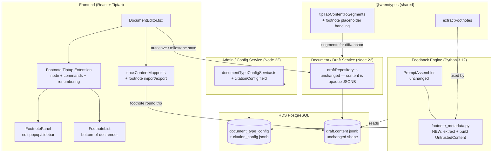
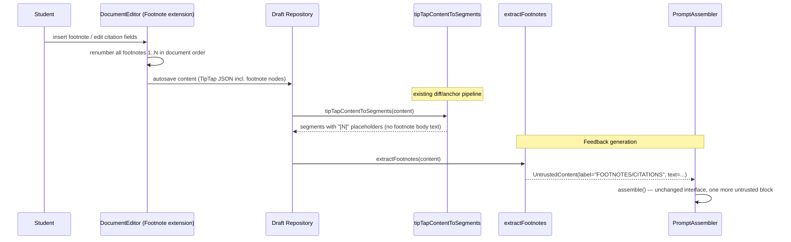
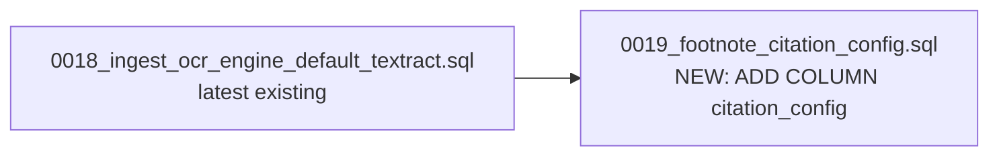

# Design Document

## Overview

This feature adds footnote and citation support to WREN's Tiptap-based document editor (`frontend/src/features/editor`). Students insert, edit, and delete footnotes inline; footnote numbering is assigned by document order, persists in the Draft's TipTap `content` JSON, and survives save/reload, `.docx` export/import, and the diff/anchor/AI-debrief pipeline untouched. Department Admins configure citation style and required fields per Document Type through the existing `documentTypeConfigService`. The Feedback Engine consumes footnotes as structured metadata rather than inline text, so citation quality can be assessed without polluting paragraph-level analysis.

This is an additive feature layered onto the existing `wren-writing-coach` system (see `.kiro/specs/wren-writing-coach/design.md`for the platform architecture). It introduces:

- A new Tiptap node (`footnote`) and its editor extension, registered alongside the existing extension set in `DocumentEditor.tsx`.
- A `citationConfig` JSONB column on `document_type_config`, surfaced through the existing `documentTypeConfigService`/`upsertDocumentTypeConfig` API — no new service, no new capability.
- Extensions to the existing `@wren/types` TipTap helpers (`tipTapContentToSegments`) and a new `extractFootnotes` function consumed by the Feedback Engine's prompt assembly.
- Extensions to the existing `.docx` import/export mapper (`docxContentMapper.ts`) for footnote round-tripping.
- One additive-only SQL migration.

No new Lambda, no new stack, no new capability, no new database table. This keeps the feature inside the existing Document/Draft Service (Node 22), Admin/Config Service (Node 22), and Feedback Engine (Python 3.12) compute boundaries described in the platform design.

### Design Goals

1. **Numbering is a persistence concern, not a render concern.** `footnoteNumber` is stored on each node and recomputed by an explicit renumbering step run after every structural edit — never derived implicitly at render time from node order (Requirement 2.1).
2. **Footnotes are metadata to the AI pipeline, not prose.** `tipTapContentToSegments` never emits footnote body text into the paragraph substrate that drives diffing, anchoring, and per-paragraph feedback; the Feedback Engine sees footnotes only through a dedicated, clearly-labeled untrusted-data block (Requirements 5, 7).
3. **Reuse, don't reinvent.** Citation configuration reuses `documentTypeConfigService`'s existing authorization (`documentType.modifyConfig`/`documentType.readConfig`), validation, and upsert pattern. Prompt assembly reuses `PromptAssembler`/`UntrustedContent` exactly as-is — no new prompt-layer concept. `.docx` round-tripping reuses the existing `docxContentMapper.ts` mapping functions and the `docx` package already in `frontend/package.json`.
4. **Migration safety is non-negotiable.** One additive-only column; nothing existing changes shape or nullability.

---

## Architecture

### Where this feature sits in the existing system



The only new persistent state is `document_type_config.citation_config`. Footnote data itself lives entirely inside `draft.content` (already a `jsonb` column, added in migration `0013_draft_tiptap_content.sql`) — no schema change is needed to store footnotes themselves, only to store the Department Admin's citation configuration.

### Extension Selection: Evaluation

Per Requirement 1, this section documents the build-vs-adopt evaluation performed before implementation.

**Candidates evaluated:**

| Candidate | Last release (relative to now) | License | Tiptap 3.x compatible | Weekly npm downloads | Persists custom numbering + citation fields in doc JSON |
|---|---|---|---|---|---|
| `tiptap-footnotes` (buttondown, npm) | Within the last 12 months (`3.0.1`, actively maintained; peer deps target `@tiptap/core@^3.0.0`) | MIT | Yes — peer deps declare `@tiptap/core ^3.0.0`, `@tiptap/pm ^3.0.0` | ~3,700/week | Partial — ships `Footnotes` (ordered-list container), `Footnote` (list item), and `FootnoteReference` nodes with auto-generated `uuid` identifiers. Node attrs do not include a citation-field schema (author/title/source/pinpoint/year) or an explicit persisted sequential `footnoteNumber` (numbering is rendered from list position via CSS counters, not stored as a positive-integer attribute) |
| **Tiptap Pages "Footnotes" concept (Tiptap Pro extension)** | N/A — this is a paid/Pro capability, not an installable community package | Commercial (Tiptap Pro license), not MIT | N/A | N/A | Not evaluated further — license alone disqualifies it under the MIT-compatibility criterion (1.2) |
| **Custom-built `footnote` node** | N/A (built for this feature) | MIT (matches project license) | Built directly against the project's Tiptap 3.x version and current extension set | N/A | Full — attrs are defined exactly to this feature's schema: `footnoteNumber` (positive int), `content` (rich-text-capable JSON), and citation fields (`author`, `title`, `source`, `pinpoint`, `year`) |

**Runtime-conflict check against the current extension set** (StarterKit, `@sereneinserenade/tiptap-comment-extension`, Table, Highlight, TextAlign, Image, TextStyle, Underline — see `DocumentEditor.tsx`): `tiptap-footnotes` registers node names `footnotes`/`footnote`/`footnoteReference`, none of which collide with the current set. No schema incompatibility was found. It is not disqualified on conflict grounds.

**Disqualifying constraint (Requirement 1.3):** `tiptap-footnotes`'s `Footnote` node schema has no attribute slot for the citation fields this feature requires (author/title/source/pinpoint/year) and represents numbering as list position rather than a persisted `footnoteNumber` positive-integer attribute that survives independent of list order (the requirement is explicit: numbering must be an "explicit `footnoteNumber` attribute," assigned by document order, and must not be "recalculated purely client-side on render" — a CSS-counter/list-position-derived number is exactly the render-time recalculation the requirement rules out). Extending `tiptap-footnotes` to add these attrs and to switch its numbering model to an explicitly-stored, document-order-assigned integer would require forking its node schema and its renumbering logic — at which point the adopted code is no longer meaningfully "the community extension," it is a custom node with borrowed scaffolding.

**Recommendation: build a custom node.** This is the correct outcome given Requirement 1.5 (recommend custom when disqualifying constraints exist) — not because `tiptap-footnotes` is poorly maintained (it is actively released, MIT-licensed, and Tiptap-3.x-compatible), but because its data model does not match the persisted-numbering-plus-citation-fields schema this feature requires, and adapting it amounts to a rewrite. Building custom also keeps the node's attrs as a first-class, project-owned schema (`footnoteNumber`, `content`, `author`, `title`, `source`, `pinpoint`, `year`) that the segment-extraction, diff, anchor, and Feedback Engine code in this design can depend on directly, rather than reverse-engineering a third-party schema.

### Feedback generation flow with footnotes (extends the existing pipeline)



---

## Components and Interfaces

### 1. Footnote Tiptap Node + Extension (Frontend)

New file: `frontend/src/features/editor/tiptapFootnote.ts` (mirrors the existing sibling modules `tiptapFontSize.ts` / `tiptapIndent.ts` — small, focused Tiptap extension modules colocated in `/features/editor`, per frontend steering §5's feature-based organization).

The `footnote` node is an **atomic inline node** (`inline: true, atom: true` — same pattern as `@tiptap/extension-image` used elsewhere in this editor) that renders a superscript reference marker in the document body. Its attrs carry the complete footnote payload directly (no separate node type for the footnote's "content region"); this keeps footnote data as a single self-contained unit inside the TipTap tree, trivial to locate, extract, renumber, and round-trip.

```typescript
// Node attrs — the full persisted schema (Requirement 1.4, 2.1, 3.4, 4.3–4.5)
interface FootnoteAttrs {
  footnoteNumber: number;      // positive integer, assigned by renumbering step
  content: JSONContent;        // rich-text body (inline marks allowed): { type: 'doc', content: [...] } subset, stored as a fragment
  author: string;               // '' when unset; each field ≤ 500 chars (Requirement 3.4)
  title: string;
  source: string;
  pinpoint: string;
  year: string;
}

export const FootnoteNode = Node.create({
  name: 'footnote',
  group: 'inline',
  inline: true,
  atom: true,
  selectable: true,
  addAttributes() {
    return {
      footnoteNumber: { default: 1 },
      content: { default: { type: 'doc', content: [{ type: 'paragraph' }] } },
      author: { default: '' },
      title: { default: '' },
      source: { default: '' },
      pinpoint: { default: '' },
      year: { default: '' },
    };
  },
  parseHTML() { return [{ tag: 'sup[data-footnote]' }]; },
  renderHTML({ node }) {
    return ['sup', { 'data-footnote': 'true', 'data-footnote-number': node.attrs.footnoteNumber }, String(node.attrs.footnoteNumber)];
  },
  addCommands() {
    return {
      insertFootnote: () => ({ state, chain }) => {
        // Reject when the selection is inside an existing footnote node's own
        // edit surface, or when there is no active selection (Requirement 3.7, 3.8).
        if (!state.selection || isInsideFootnote(state)) return false;
        return chain().insertContent({ type: 'footnote', attrs: { footnoteNumber: 0 /* placeholder; renumberFootnotes fixes this */ } }).command(renumberFootnotes).run();
      },
      deleteFootnote: (footnoteNumber: number) => ({ tr, state }) => { /* locate node by attrs.footnoteNumber, delete range, renumber */ },
      updateFootnoteFields: (footnoteNumber: number, fields: Partial<FootnoteAttrs>) => ({ tr, state }) => { /* validate 500-char cap, patch node attrs */ },
    };
  },
  onUpdate() {
    // Structural changes (insert/delete of a footnote node) trigger renumbering;
    // edits to an existing footnote's own attrs (content/citation fields) do not
    // change footnote count and are no-ops for renumbering.
  },
});
```

**Renumbering (`renumberFootnotes`)** is a single pure function — `renumberFootnotes(doc: ProseMirrorNode): { doc, changed: boolean }` — that walks the document in order, collects every `footnote` node, and rewrites each one's `footnoteNumber` attr to its 1-based position in that walk. It is invoked (a) immediately after `insertFootnote`, (b) immediately after `deleteFootnote`, and (c) on paste (Tiptap's `transformPasted` hook), and is a no-op (returns `changed: false`) when the current numbering already matches document order — so it is safe to call defensively without introducing spurious transactions. The **200-footnote cap** (Requirement 2.1) is enforced in `insertFootnote`: if the walk already finds 200 `footnote` nodes, the command returns `false` without inserting.

This renumbering function is the single property-tested core of the editing experience (see Property 1) — everything else (commands, panel, list) is a thin caller of it plus example tests.

### 2. Footnote editing UI (Frontend)

New components under `frontend/src/features/editor/components/` (matching the existing `toolbar/` subfolder pattern):

- **`FootnotePanel.tsx`** — an inline popup (Radix `Popover`, per frontend steering §9's "use shadcn/ui / Radix directly for accessible behavior") anchored to the clicked/focused footnote marker. Renders a form (React Hook Form + Zod, per steering) with fields: body content (a small nested Tiptap instance or plain rich-text area), `author`, `title`, `source`, `pinpoint`, `year`. Opens within 200ms of marker focus (Requirement 3.2) — implemented as an uncontrolled Radix `Popover` triggered synchronously from the editor's `selectionUpdate`/click handler, so there is no async work gating the open transition.
- **`FootnoteList.tsx`** — renders at the bottom of `DocumentEditor`'s scroll container (or a dedicated panel, mirroring `EditorSidebar`'s existing panel pattern), listing every footnote **sorted by `footnoteNumber` ascending** regardless of the order footnote nodes are supplied in (Property 6). Pure presentational component: `FootnoteList({ footnotes: FootnoteAttrs[] })`.
- Validation errors from Citation_Config required-field gating (Requirement 4.4) surface inline in `FootnotePanel` next to each missing field, sourced from a shared `validateFootnoteAgainstCitationConfig(footnote, citationConfig)` helper (colocated in `tiptapFootnote.ts`) so the same gating logic drives both the save-blocking behavior and the inline error display.

Design tokens only — no hardcoded colors/sizes in these components (frontend steering §9). The superscript size (60–70% of body text) is expressed via the existing `type.caption`-style token in `typography.ts`, not an inline `font-size`.

### 3. Citation_Config (Admin / Config Service — reused, not new)

`documentTypeConfigService.ts` already owns Document-Type-scoped configuration with the exact authorization boundary this feature needs (`documentType.readConfig` / `documentType.modifyConfig`, scoped to the administering Department). Citation_Config is added as **one more field** on the existing `DocumentTypeConfig` record, following the same nullable-JSONB, upsert-with-`COALESCE` pattern already used for `categoryPriority`.

`types/src/schemas.ts` addition:

```typescript
/** Department-scoped citation style + required-field configuration (Requirement 4). */
export const citationConfigSchema = z
  .object({
    citationStyle: z.string().min(1).max(50),
    requiredFields: z.array(z.string().min(1).max(50)).max(20),
    formattingTemplate: z.string().max(1000).nullable().optional(),
  })
  .strict();
export type CitationConfig = z.infer<typeof citationConfigSchema>;
```

`documentTypeConfigSchema` gains one optional field: `citationConfig: citationConfigSchema.nullable().optional()`. `updateDocumentTypeConfigInputSchema` gains the matching optional patch field. No other change to the service's public surface — `getDocumentTypeConfig` / `upsertDocumentTypeConfig` signatures are unchanged; `toDocumentTypeConfig` gains one more `COALESCE`d column in its `SELECT`/`INSERT ... ON CONFLICT` (exactly the pattern already used for `structureDescription` etc. in the existing file), and the row mapper JSON-parses `citation_config` the same way `category_priority` is parsed today.

Rejection of an out-of-bounds `CitationConfig` (Requirement 4.7) happens via Zod's own `.max()`/`.min()` validators inside `citationConfigSchema.parse(...)`, called from `upsertDocumentTypeConfig` before the DB write — consistent with the existing guardrail-before-write pattern in that file (`assertGhostwritingFree` is checked before the INSERT; `citationConfigSchema.parse` is checked the same way, and a `ZodError` propagates as a 400 to the API layer with the specific violated constraint in its issue path).

**Applying only to new footnotes (Requirement 4.6):** Citation_Config is read once, client-side, when the `FootnotePanel` opens for a *newly inserted* footnote (to drive the required-field gate at that moment). It is never re-applied to an already-persisted footnote's stored attrs — a config change has no code path that writes to any `draft.content`, so existing footnotes are structurally unaffected. This is inspectable directly from the fact that `upsertDocumentTypeConfig` touches only `document_type_config`, never `draft`.

### 4. `@wren/types` extensions

**`tipTapContentToSegments` (in `types/src/tiptapContent.ts`)** gains one new case in `walkForSegments`/`collectPlainText`: when a `footnote` node is encountered inline within a paragraph's content, `collectPlainText` emits the placeholder `[N]` (using `node.attrs.footnoteNumber`) instead of recursing into the footnote's body. If `footnoteNumber` is missing or not a positive integer, the placeholder is `[?]` (Requirement 7.5). This requires threading the placeholder logic into `collectPlainText` (currently a simple text-flattener) via a small dispatch: `collectPlainText` checks `node.type === 'footnote'` before falling through to its existing `text`/`content` handling.

```typescript
// Excerpt — extends the existing collectPlainText in tiptapContent.ts
export function collectPlainText(node: TipTapNode | undefined | null): string {
  if (!node) return '';
  if (node.type === 'footnote') {
    const n = node.attrs?.footnoteNumber;
    return typeof n === 'number' && Number.isInteger(n) && n > 0 ? `[${n}]` : '[?]';
  }
  if (typeof node.text === 'string') return node.text;
  if (!Array.isArray(node.content)) return '';
  return node.content.map(collectPlainText).join('');
}
```

Because `walkForSegments` already delegates all paragraph-level text collection to `collectPlainText`, this one change is sufficient for Requirement 7.1/7.5 — no other call site needs to change, and the Diff_Engine / Anchor_Service (Python) automatically treat `[N]`/`[?]` as literal paragraph text with no changes on their side (Requirement 7.2, 7.3, 7.4): the placeholder is just characters in the segment string they already diff/fingerprint.

**New function `extractFootnotes` (in `types/src/tiptapContent.ts`, exported from `@wren/types`):**

```typescript
export interface ExtractedFootnote {
  footnoteNumber: number;
  paragraphIndex: number;   // index of the segment containing the marker
  content: string;           // plain-text flatten of the footnote's rich body
  author: string;
  title: string;
  source: string;
  pinpoint: string;
  year: string;
}

/**
 * Structured footnote extraction for the Feedback Engine (Requirement 5.5).
 * Returns [] for null/undefined content. Skips (omits) any footnote node
 * missing footnoteNumber or content, continuing to process the rest
 * (Requirement 5.7) — mirrors the fault-tolerance pattern already used by
 * `asTipTapDoc` (narrow-and-skip rather than throw).
 */
export function extractFootnotes(content: TipTapNode | null | undefined): ExtractedFootnote[] {
  if (!content || content.type !== 'doc') return [];
  const out: ExtractedFootnote[] = [];
  let paragraphIndex = 0;
  const walk = (node: TipTapNode) => {
    if (node.type === 'paragraph' || node.type === 'heading') {
      const footnotesInParagraph = findFootnoteNodes(node);
      for (const fn of footnotesInParagraph) {
        const num = fn.attrs?.footnoteNumber;
        const body = fn.attrs?.content;
        if (typeof num !== 'number' || !Number.isInteger(num) || num <= 0 || body === undefined) continue;
        out.push({
          footnoteNumber: num,
          paragraphIndex,
          content: collectPlainText(body as TipTapNode),
          author: String(fn.attrs?.author ?? ''),
          title: String(fn.attrs?.title ?? ''),
          source: String(fn.attrs?.source ?? ''),
          pinpoint: String(fn.attrs?.pinpoint ?? ''),
          year: String(fn.attrs?.year ?? ''),
        });
      }
      paragraphIndex += 1;
      return;
    }
    for (const child of node.content ?? []) walk(child);
  };
  for (const child of content.content ?? []) walk(child);
  return out.sort((a, b) => a.footnoteNumber - b.footnoteNumber);
}
```

This lives alongside `tipTapContentToSegments` because it shares the same tree-walking primitives (`collectPlainText`) and the same "loose TipTap JSON, no `@tiptap/*` dependency" constraint that keeps `@wren/types` framework-agnostic — the Python Feedback Engine never imports this function directly (Python cannot import TS), so the *Document/Draft Service* (Node) is the one place that calls `extractFootnotes` and threads its output to the Feedback Engine as a plain JSON array (mirroring how `segments` already crosses the Node→Python boundary as JSON, not as a shared type).

### 5. Feedback Engine integration (Python)

New module `backend/engine/python/wren_engine/footnote_metadata.py`, following the exact style of `prompt_assembly.py` and `diff_engine.py` (pure, dependency-free, dataclass-based):

```python
from dataclasses import dataclass
from .prompt_assembly import UntrustedContent

@dataclass(frozen=True, slots=True)
class FootnoteMetadata:
    footnote_number: int
    content: str
    author: str = ""
    title: str = ""
    source: str = ""
    pinpoint: str = ""
    year: str = ""


def build_footnotes_untrusted_content(
    footnotes: list[FootnoteMetadata],
) -> UntrustedContent | None:
    """Builds the FOOTNOTES/CITATIONS untrusted block (Requirement 5.2, 5.3, 5.6).

    Returns None when `footnotes` is empty, so callers omit the block entirely
    and the assembled prompt is byte-for-byte identical to the no-footnotes
    case today (Requirement 5.6) — the Feedback Engine's existing call site
    only appends a block to its `untrusted: list[UntrustedContent]` when this
    returns non-None.
    """
    if not footnotes:
        return None
    lines = [
        f"[{fn.footnote_number}] {fn.content}"
        + (f" (author: {fn.author})" if fn.author else "")
        + (f" (title: {fn.title})" if fn.title else "")
        + (f" (source: {fn.source})" if fn.source else "")
        + (f" (pinpoint: {fn.pinpoint})" if fn.pinpoint else "")
        + (f" (year: {fn.year})" if fn.year else "")
        for fn in footnotes
    ]
    return UntrustedContent(label="FOOTNOTES/CITATIONS", text="\n".join(lines))
```

The Feedback Engine's existing `handler.py` (which already builds `untrusted: list[UntrustedContent]` for `SUBMITTED DOCUMENT` and each reference material, per the earlier grep of `handler.py:448-457`) gains one more line: after building the existing blocks, it calls `build_footnotes_untrusted_content(footnotes)` (where `footnotes` is the JSON array produced by `extractFootnotes` on the Node side and passed through with the Draft payload) and appends the result to `untrusted` only if it is not `None`. `PromptAssembler.assemble()` itself requires **zero changes** — it already accepts an arbitrary `list[UntrustedContent]` and renders each block identically, delimited by the same per-assembly boundary token (Requirement 5.2 is satisfied by construction, since every `UntrustedContent` block — including this new one — goes through the assembler's existing `_render_untrusted_block`).

### 6. `.docx` round-trip (Frontend)

Extends `frontend/src/features/editor/docxContentMapper.ts`, using the `docx` package's native footnote support (`IPropertiesOptions.footnotes: Record<string, { children: Paragraph[] }>` at the `Document` level, and `FootnoteReferenceRun` inline in a paragraph's children) rather than approximating footnotes as superscript text.

**Export (`tiptapContentToDocxChildren` → `Document` construction):**

```typescript
// In tiptapInlineContentToRuns: a footnote node becomes a FootnoteReferenceRun,
// and its full content+citation payload is collected into a footnotes map
// keyed by a docx-assigned sequential id (1..N, matching footnoteNumber order).
if (node.type === 'footnote') {
  const id = node.attrs?.footnoteNumber; // already 1..N, sequential, no gaps
  footnotesById.set(id, footnoteBodyToDocxParagraphs(node.attrs));
  children.push(new FootnoteReferenceRun(id));
  continue;
}
```

```typescript
// In tiptapContentToDocxBytes:
const document = new Document({
  footnotes: Object.fromEntries(footnotesById), // { [id]: { children: Paragraph[] } }
  numbering: { /* unchanged */ },
  sections: [{ children }],
});
```

`footnoteBodyToDocxParagraphs` renders one `Paragraph` per footnote whose text is the citation fields (author/title/source/pinpoint/year, each rendered only if non-empty, matching the existing "omit empty" convention already used for `alignment`/`indent` elsewhere in this file) followed by the rich-text body content mapped through the existing `tiptapInlineContentToRuns`.

**Import (`docxBytesToTiptapContent`):** `officeparser`'s AST does not currently surface footnote content as a distinct node type (it was not found in the existing `OfficeContentNode` handling read from `docxContentMapper.ts`). Footnote import therefore requires reading the `.docx`'s `word/footnotes.xml` part directly (the `docx` package's own parser does not expose a read path — `docx` is write-only — so this uses the same low-level zip access `officeparser` already performs internally, isolated behind a small `extractFootnotesXml(bytes: Uint8Array)` helper that returns `{ id: string, paragraphs: string[] }[]`). Each parsed footnote is then:

1. Matched to its reference run's position in the body text (via the `<w:footnoteReference w:id="N"/>` run already present in `word/document.xml`, which `officeparser` walks) and inserted as a `footnote` node at that position — **numbered sequentially starting at 1 in source order** (Requirement 8.3), independent of the raw `w:id` values Word assigned (which may not start at 1, since Word reserves ids 0/-1 for separators).
2. Mapped into citation fields (`author`/`title`/`source`/`pinpoint`/`year`) via a small heuristic matcher (`matchCitationFields(text: string): Partial<CitationFields>` — pattern-matches common legal-citation shapes: a leading capitalized name run as `author`, a quoted or italicized run as `title`, a trailing "at ¶N"/page-number token as `pinpoint`, a 4-digit token as `year`). **If no fields are confidently identified, the full footnote text is placed in `content` and every citation field is left `''`** (Requirement 8.5) — this is the same "confident match or don't guess" posture already used by the Python `AnchorService.remap` for text re-mapping, applied here to field identification.
3. If the footnote's XML structure itself cannot be parsed (`extractFootnotesXml` throws or returns no paragraphs for a referenced id), the importer falls back to inserting the **raw visible footnote-reference text inline** at the marker position as plain text rather than a `footnote` node, so no content is silently dropped (Requirement 8.4) — mirroring the existing `DocxClientParseError` fallback posture already used elsewhere in this file (partial-failure surfaces a degraded-but-visible result, never silent loss).

---

## Data Models

### `document_type_config.citation_config` (new column, additive)

```sql
-- 0019_footnote_citation_config.sql
ALTER TABLE document_type_config
    ADD COLUMN IF NOT EXISTS citation_config jsonb;
```

Shape (validated at the application layer by `citationConfigSchema`, not by a DB CHECK constraint — consistent with `category_priority`'s existing jsonb-with-app-level-validation pattern in this same table):

```json
{
  "citationStyle": "Bluebook",
  "requiredFields": ["author", "title", "year"],
  "formattingTemplate": "{author}, {title} ({year})"
}
```

`NULL` (the default for all existing rows, and for any Document Type that has never configured citations) means "no Citation_Config" — the vacuous-truth branch of Requirement 4.5.

### Footnote data (no new table — lives inside `draft.content` jsonb)

A `footnote` node inside the existing `draft.content` TipTap JSON:

```json
{
  "type": "footnote",
  "attrs": {
    "footnoteNumber": 3,
    "content": { "type": "doc", "content": [{ "type": "paragraph", "content": [{ "type": "text", "text": "See discussion below." }] }] },
    "author": "R. Smith",
    "title": "Contract Interpretation",
    "source": "Canadian Bar Review",
    "pinpoint": "¶ 42",
    "year": "2019"
  }
}
```

This requires no schema change to `draft` (the `content jsonb` column already accepts arbitrary TipTap JSON, per migration `0013_draft_tiptap_content.sql`) and no schema change to `draft.segments` (footnotes never appear there directly — only as `[N]`/`[?]` placeholder characters inside an existing segment's `text`).

### Schema Migration



- Single file, numbered `0019_` (sequentially after the highest existing migration, `0018_...`), registered by the existing migration runner (`runMigrations` / `run_migrations`) in `schema_migrations`, matching the pattern of every other migration in this directory (Requirement 6.4).
- `ADD COLUMN IF NOT EXISTS citation_config jsonb;` — no `DEFAULT`, no `NOT NULL`, no `CHECK`. On PostgreSQL 11+, an `ADD COLUMN` with no `DEFAULT` (or a `NULL` default) is a metadata-only change that does not rewrite existing rows or hold a long-lived `ACCESS EXCLUSIVE` lock (Requirement 6.5).
- No `UPDATE`/`DELETE`/`INSERT` statement anywhere in the file — it contains exactly one `ALTER TABLE ... ADD COLUMN` statement (Requirement 6.6).
- `IF NOT EXISTS` makes re-execution a no-op, matching every other migration in this directory (Requirement 6.4's idempotency requirement).
- Existing rows get `citation_config = NULL`; every read path (`toDocumentTypeConfig`, the new `extractFootnotes`, `tipTapContentToSegments`) already treats `NULL`/absent as "zero footnotes" / "no config" without throwing (Requirement 6.2).

No column, table, type, or constraint on `document`, `draft`, or any other existing table is touched.

---

## Correctness Properties

*A property is a characteristic or behavior that should hold true across all valid executions of a system — essentially, a formal statement about what the system should do. Properties serve as the bridge between human-readable specifications and machine-verifiable correctness guarantees.*

The properties below were derived from the acceptance-criteria prework, with redundant criteria consolidated (e.g., the insert-renumber and delete-renumber criteria collapse into one document-order-numbering invariant; the save/reload round trip and the general "for all documents" round trip collapse into one property; the two docx round-trip criteria collapse into one export→import property). Pure-logic cores — the renumbering function, segment/extraction functions, Citation_Config validation, and the footnote `UntrustedContent` builder — are the property-based targets. UI timing/visual criteria, documentation deliverables, and migration structural checks are covered by example/smoke tests in the Testing Strategy instead.

### Property 1: Footnote numbering is sequential, gapless, and document-order-derived

*For any* sequence of footnote insertions and deletions (up to 200 footnotes) applied to a TipTap document, after each operation the set of `footnoteNumber` values on remaining `footnote` nodes is exactly `{1, ..., N}` where `N` is the current footnote count, assigned in document order; deleting a footnote removes both its marker and its `content`/citation attrs entirely (no orphaned node survives); and an insertion attempted when 200 footnotes already exist is rejected without modifying the document.

**Validates: Requirements 2.1, 2.4, 2.5, 3.3**

### Property 2: Inserted footnotes satisfy the persisted node schema

*For any* valid cursor position, inserting a footnote produces a node whose attrs contain a positive-integer `footnoteNumber`, a `content` value that is a valid rich-text fragment, and the five citation fields (`author`, `title`, `source`, `pinpoint`, `year`), each defaulting to an empty string.

**Validates: Requirements 1.4**

### Property 3: Save/reload preserves footnotes exactly

*For any* valid TipTap document containing footnote nodes, saving it (via `updateCurrentDraftContent` or `insertDraft`) and then reloading it (`getCurrentDraft`) yields a document where every footnote has the same `footnoteNumber`, `content` text, citation field values, and document-order position as before the save.

**Validates: Requirements 2.2, 2.3, 8.1**

### Property 4: Absent footnote data behaves as zero footnotes throughout the pipeline

*For any* Draft whose `content` is `null`/`undefined`, or any TipTap document containing no `footnote` nodes: `extractFootnotes` returns `[]`; `tipTapContentToSegments` emits no footnote placeholders; and the Feedback Engine's assembled prompt contains no `FOOTNOTES/CITATIONS` block — behaving identically to a Draft that predates this feature.

**Validates: Requirements 2.6, 5.5, 5.6, 6.2**

### Property 5: Citation field length is bounded

*For any* string assigned to a footnote's `author`, `title`, `source`, `pinpoint`, or `year` field, the assignment succeeds iff the string is 500 characters or fewer; a string exceeding 500 characters is rejected and the field's previous value is retained.

**Validates: Requirements 3.4**

### Property 6: Footnote list is always rendered in ascending number order

*For any* array of footnotes in any order, the rendered footnote list orders them by ascending `footnoteNumber`, regardless of the input array's order or the footnotes' document-order positions.

**Validates: Requirements 3.6**

### Property 7: Citation_Config accepts and rejects at its declared boundaries

*For any* candidate `CitationConfig` payload, `upsertDocumentTypeConfig` accepts it iff `citationStyle` is 1–50 characters, `requiredFields` has 0–20 entries each 1–50 characters, and `formattingTemplate` (when present) is at most 1000 characters; a violation is rejected with an error identifying which constraint failed, and no partial write occurs.

**Validates: Requirements 4.3, 4.7**

### Property 8: Required-field gating is exactly the configured required set

*For any* Citation_Config (including the absence of one) and any footnote's citation field values, saving the footnote is blocked iff at least one field named in `requiredFields` is empty/whitespace-only, and the set of fields reported as missing equals exactly the empty subset of `requiredFields`; when no Citation_Config exists for the Document Type, saving is never blocked regardless of field values.

**Validates: Requirements 4.4, 4.5**

### Property 9: Citation_Config updates never mutate already-persisted footnotes

*For any* footnote persisted under a Document Type's Citation_Config at time T, and any subsequent update to that Document Type's Citation_Config, the footnote's stored citation field values at any time after T are unchanged from their values at T.

**Validates: Requirements 4.6**

### Property 10: Footnote extraction is complete and structurally correct

*For any* TipTap document, `extractFootnotes` returns exactly one entry per well-formed `footnote` node present in the document, each entry's `footnoteNumber` and `content` matching the source node, sorted ascending by `footnoteNumber`.

**Validates: Requirements 5.1, 5.3**

### Property 11: The FOOTNOTES/CITATIONS block is present iff footnotes exist, and stays untrusted data

*For any* list of extracted footnotes (including footnotes whose text embeds adversarial instruction-like content), `build_footnotes_untrusted_content` returns `None` iff the list is empty; when non-empty, the resulting `UntrustedContent` has label `"FOOTNOTES/CITATIONS"` and, once passed through `PromptAssembler.assemble()`, its text appears only inside the delimited untrusted-data region of the user message and never in the system message — matching the existing Property 12 guarantee (wren-writing-coach design) for every other untrusted block.

**Validates: Requirements 5.2, 5.3, 5.6**

### Property 12: Malformed footnotes are skipped, not fatal, during extraction

*For any* TipTap document containing a mix of well-formed and malformed `footnote` nodes (missing or non-numeric `footnoteNumber`, or missing `content`), `extractFootnotes` returns an entry for every well-formed node and omits every malformed node, without throwing.

**Validates: Requirements 5.7**

### Property 13: Segment placeholders correctly represent footnote markers

*For any* paragraph containing a `footnote` node, `tipTapContentToSegments` includes `[N]` (its `footnoteNumber`) in that paragraph's segment text when `footnoteNumber` is a positive integer, or `[?]` when it is missing or non-numeric — and never includes any text from the footnote's `content`.

**Validates: Requirements 5.4, 7.1, 7.5**

### Property 14: Diff sensitivity depends only on the marker placeholder, never on footnote body content

*For any* pair of consecutive Drafts, if a paragraph's only difference is a change to a footnote's `content`/citation attrs with the marker's position and `[N]`/`[?]` placeholder text unchanged, the Diff_Engine classifies that paragraph as `UNCHANGED`; if a paragraph's placeholder text itself changes (a marker is added, removed, or its number changes), the Diff_Engine classifies that paragraph as `CHANGED`, `ADDED`, or reflects the change accordingly.

**Validates: Requirements 7.2, 7.4**

### Property 15: Anchor fingerprints are stable across text containing footnote placeholders

*For any* paragraph text containing one or more `[N]`/`[?]` placeholders, `compute_fingerprint` and `AnchorService.remap` operate on that text identically to any other literal text — an anchor whose span includes a placeholder re-maps correctly when the surrounding text is unchanged, and is marked `removed` under the same rewritten-beyond-recognition/ambiguous conditions as any other span.

**Validates: Requirements 7.3**

### Property 16: `.docx` export then import round-trips footnotes

*For any* TipTap document containing well-formed footnotes, exporting it via `tiptapContentToDocxBlob`/`tiptapContentToDocxBytes` and re-importing the result via `docxBytesToTiptapContent` yields footnotes numbered sequentially starting at 1 in the original document-order, with `content` text and citation field values equal to the originals.

**Validates: Requirements 8.2, 8.3**

### Property 17: The `.docx` importer never silently discards footnote text

*For any* `.docx` byte sequence containing a footnote reference, `docxBytesToTiptapContent` either (a) produces a `footnote` node whose `content` and citation fields account for the footnote's full source text, (b) produces a `footnote` node with the full text in `content` and empty citation fields when fields cannot be confidently identified, or (c) inserts the footnote's raw visible text inline at the marker position when the footnote's XML structure cannot be parsed at all — in every case, the footnote's original text is present somewhere in the resulting document, never dropped.

**Validates: Requirements 8.4, 8.5**

---

## Error Handling

| Category | Examples | Handling |
|---|---|---|
| **Footnote insertion rejected** | Cursor inside an existing footnote; no active selection; 200-footnote cap reached | `insertFootnote` command returns `false` and performs no transaction — the document is provably unchanged (ProseMirror commands that return `false` never dispatch). No error is thrown to the caller; the toolbar/keyboard-shortcut handler simply no-ops (Requirement 3.7, 3.8, 2.1). |
| **Citation field too long** | A citation field value exceeds 500 characters | `updateFootnoteFields` rejects the patch for that field before applying any attrs change; the panel shows an inline length error and retains the previous value (Requirement 3.4). |
| **Required field missing at save** | Citation_Config requires `author`/`title`/etc. and one is empty | Save is blocked client-side (`validateFootnoteAgainstCitationConfig`); the panel lists exactly the missing field names (Requirement 4.4). |
| **Citation_Config validation failure** | `citationStyle` empty/too long, `requiredFields` > 20 entries, template > 1000 chars | `upsertDocumentTypeConfig` rejects via `citationConfigSchema.parse`, returning the specific violated field/constraint before any DB write (Requirement 4.7) — same "deny with no mutation" posture as the existing ghostwriting/authorization guards in this file. |
| **Malformed footnote node during extraction** | Missing `footnoteNumber` or `content` on a `footnote` node in stored content | `extractFootnotes` omits the node and continues; no exception propagates to the Feedback Engine caller (Requirement 5.7). |
| **Non-numeric footnote number during segmentation** | Corrupted/hand-edited JSON with a non-integer `footnoteNumber` | `tipTapContentToSegments` emits `[?]` for that marker and continues (Requirement 5.4/7.5) — segmentation never throws on malformed footnote attrs. |
| **`.docx` footnote XML unparseable** | Malformed `word/footnotes.xml`, missing referenced footnote id | Importer falls back to inserting the visible footnote-reference text inline as plain text at the marker position, reusing the existing `DocxClientParseError`-adjacent degraded-fallback posture already used for whole-file parse failures in `docxContentMapper.ts` (Requirement 8.4). |
| **`.docx` citation fields unrecognizable** | Footnote text does not match any known citation-field pattern | Full text is placed in `content`; citation fields default to `''` — never a thrown error (Requirement 8.5). |
| **Migration applied twice** | Deployment re-runs `0019_footnote_citation_config.sql` | `ADD COLUMN IF NOT EXISTS` is a no-op on the second run; the migration runner's `schema_migrations` tracking additionally prevents re-application in the normal path (Requirement 6.4). |

---

## Testing Strategy

### Dual Approach

- **Property-based tests** verify the 17 universal properties above — the renumbering function, extraction functions, segment-placeholder logic, Citation_Config validation/gating, the footnote `UntrustedContent` builder, and the `.docx` round trip.
- **Unit/example tests** cover the insert-command mechanics (3.1), the no-cursor no-op (3.8), the 200ms panel-open behavior (3.2, via a UI test with a fake timer/render-time assertion rather than a real 200ms wait), superscript styling (3.5, snapshot), `documentTypeConfigService` reuse (4.1, 4.2 — confirming the existing capability guard is invoked and the new field round-trips through the existing upsert), and the extension-selection documentation itself (Requirement 1, a written deliverable, not a test).
- **Smoke tests** cover the migration file's structural properties (additive-only DDL, no `NOT NULL`/rewriting `DEFAULT`/`CHECK`, single statement, idempotent) and its lock/duration behavior against a real migrated database — these are one-time checks, not generative properties (Requirements 6.1, 6.3, 6.4, 6.5, 6.6).

### Property-Based Testing

Tooling per the tech-stack steering, matching the sibling `wren-writing-coach` spec's existing split:

- **TypeScript** (Frontend footnote extension, `@wren/types` extraction/segmentation, `docxContentMapper.ts` round trip, Citation_Config schema): **fast-check** with Jest/ts-jest, following the existing `*.property.test.ts` convention in `backend/document/src/` and `frontend/src/features/editor/`.
- **Python** (`footnote_metadata.py`, and the Diff_Engine/Anchor_Service placeholder-stability properties): **pytest + Hypothesis**, following the existing `test_untrusted_content_property.py` / `wren_engine` convention, marker `property`.

Requirements for every property test:
- Minimum **100 iterations** per property.
- Tagged with a comment in the form **Feature: footnote-citation-support, Property {number}: {property text}**.
- Each of the 17 properties above is implemented by exactly one property-based test.
- Generators exercise: 0/1/199/200-footnote documents (cap boundary), footnotes interleaved with headings/lists/tables, citation field values at 499/500/501 characters, `requiredFields` at 0/20/21 entries, `citationStyle`/`formattingTemplate` at their length boundaries, malformed footnote attrs (missing/non-numeric `footnoteNumber`, missing `content`), adversarial instruction-like text inside footnote `content` (mirroring the existing prompt-injection generators in `test_untrusted_content_property.py`), and `.docx` byte sequences with footnotes at document start/middle/end and with unrecognizable citation text.

Mapping of properties to test homes:

| Properties | Module | Library |
|---|---|---|
| 1, 2, 6 | `tiptapFootnote.ts` (renumbering, insertion, list ordering) | fast-check (TS) |
| 3 | `draftVersioning`/`draftRepository` round trip (existing test files, extended) | fast-check (TS) |
| 4, 13 | `tiptapContent.ts` (`tipTapContentToSegments`, `extractFootnotes`) | fast-check (TS) |
| 5 | `tiptapFootnote.ts` (`updateFootnoteFields` validation) | fast-check (TS) |
| 7, 8, 9 | `schemas.ts` (`citationConfigSchema`) + `documentTypeConfigService.ts` | fast-check (TS) |
| 10, 12 | `tiptapContent.ts` (`extractFootnotes`) | fast-check (TS) |
| 11 | `footnote_metadata.py` + existing `prompt_assembly.py` | Hypothesis (Py) |
| 14 | `diff_engine.py` (existing module, new generator cases) | Hypothesis (Py) |
| 15 | `anchor_service.py` (existing module, new generator cases) | Hypothesis (Py) |
| 16, 17 | `docxContentMapper.ts` | fast-check (TS) |

### Example / Unit Tests

- `insertFootnote` inserts at the cursor and returns the expected node shape (Requirement 3.1).
- `insertFootnote` with no selection is a no-op (Requirement 3.8).
- `FootnotePanel` opens on marker focus/click within a render cycle bound suitable for asserting the 200ms budget (Requirement 3.2).
- Superscript rendering snapshot at the configured type-scale token (Requirement 3.5).
- `documentTypeConfigService.upsertDocumentTypeConfig` persists and returns `citationConfig`, reusing the existing `documentType.modifyConfig` capability check and its existing cross-Department-denial test coverage (Requirements 4.1, 4.2).
- Seed check: the extension-selection evaluation is present in this design document (Requirement 1 — a documentation deliverable, verified by review, not by an automated test).

### Integration Tests

- End-to-end: create a document, insert footnotes, autosave, reload, confirm the Feedback Engine's assembled prompt contains a single well-formed `FOOTNOTES/CITATIONS` block for that Draft.
- End-to-end `.docx` upload → editor → `.docx` export using a real Word-produced fixture file containing footnotes (extending the existing `docxContentMapper.test.ts` fixture-based tests).

### Smoke / Migration Checks

- Parse `0019_footnote_citation_config.sql` and assert it contains exactly one `ALTER TABLE ... ADD COLUMN IF NOT EXISTS` statement and no `DROP`/`RENAME`/`ALTER ... TYPE`/`NOT NULL`/rewriting `DEFAULT`/`CHECK` token (Requirements 6.1, 6.3, 6.6).
- Apply the migration twice against a test database and assert the second application is a no-op with no error (Requirement 6.4).
- Apply the migration against a database seeded with existing `document_type_config` rows and assert every existing row's non-new columns are byte-identical before/after, and `citation_config` reads as `NULL` (Requirement 6.2).

### Coverage Target

Aim for >80% coverage on public functions (tech-stack steering), consistent with the `wren-writing-coach` baseline this feature extends.
