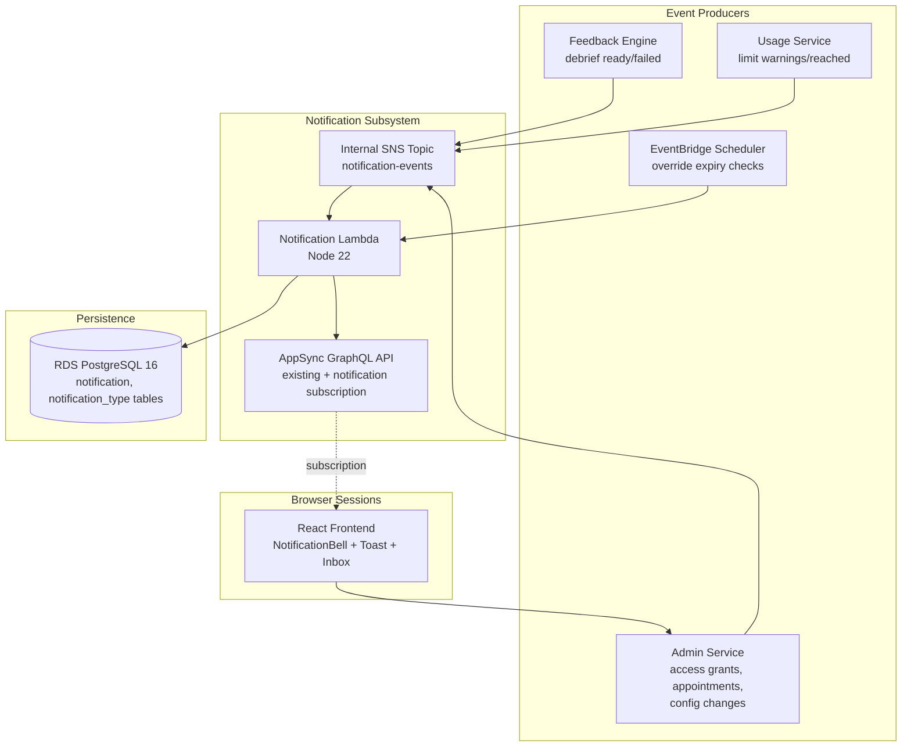
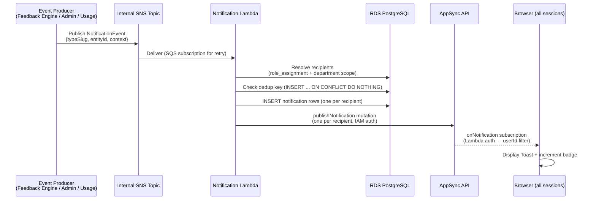
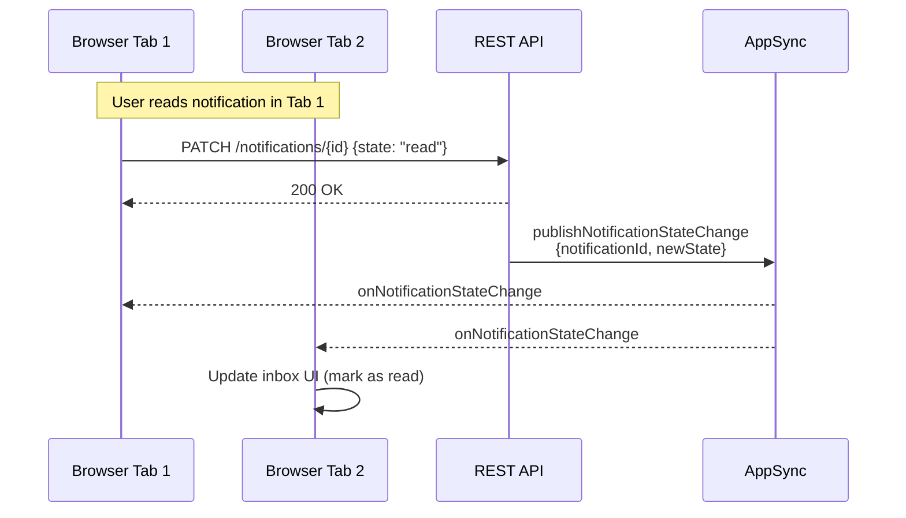
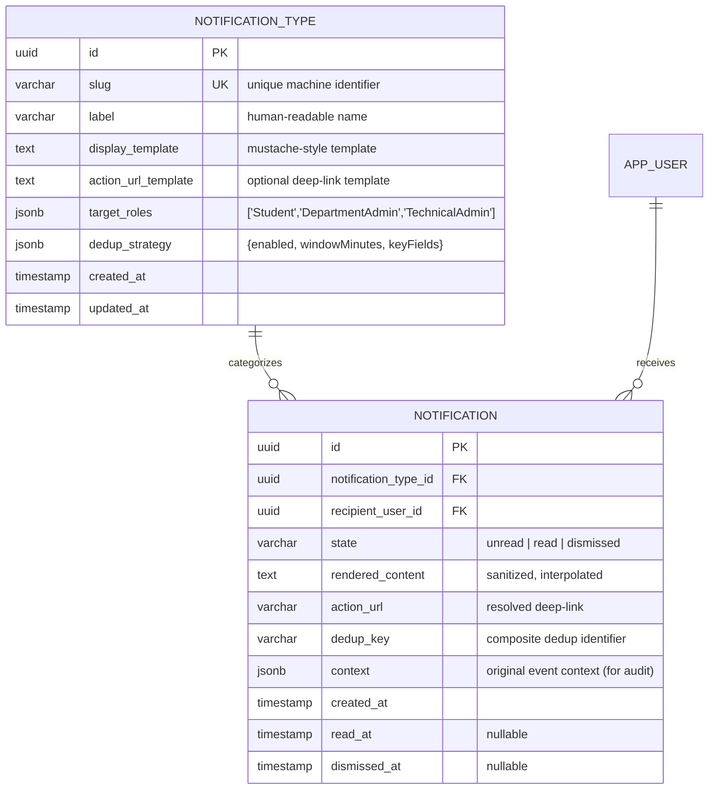
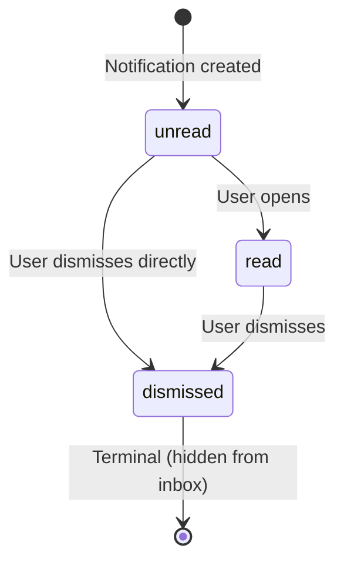

# Design Document

## Overview

This design adds a Notification_Service to WREN, providing real-time, in-app-only notifications for all three platform roles (Student, Department Admin, Technical Admin). The service integrates with the existing AppSync real-time infrastructure already proven for feedback-streaming, extends the RDS PostgreSQL data layer with notification tables, and reuses the platform's established authorization model (role/scope resolved from the app DB, never from IdP claims).

Key design decisions:

1. **AppSync subscription reuse** — The platform already uses AppSync with a Lambda authorizer for real-time delivery (debrief-ready events). Notifications use a new AppSync subscription field on the same API, broadening the authorizer to all roles (not just Students). This avoids a second WebSocket stack while preserving the proven auth model.
2. **Notification_Type as a Postgres catalog table** — extensible data, not a code-level enum. New types are INSERT rows; the application code is type-agnostic and renders from the catalog's display template.
3. **No-surveillance enforcement** — Student-facing notification templates are validated at catalog-definition time to reject numeric placeholders bound to per-Student scores/counts. This mirrors the existing guardrail pattern from the Feedback Engine.
4. **Fire-and-forget publishing via SNS internal topic** — Triggering services (Feedback Engine, Admin Service, Usage Service) publish a structured event to an internal SNS topic. A Notification Lambda subscribes, resolves recipients from the app DB, persists notifications, and publishes to AppSync. This decouples producers from notification logic and mirrors the existing SQS-based async pattern.
5. **Idempotent, deduplicated creation** — Each notification carries a deduplication key derived from (type, recipient, entity, time-window). The database enforces uniqueness via a partial unique index, making repeated triggers safe.

### Scope Boundaries

- In-app only (no email/SMS infrastructure).
- No draft-resubmission or resolution-update notifications.
- Notification_Type catalog is managed exclusively by Technical Admin.
- Multi-session state sync is handled via AppSync subscriptions (all active sessions receive the same events).

---

## Architecture

### System Context — Notification_Service Integration



### Notification Flow — Sequence



### Multi-Session State Sync



### Infrastructure Additions (CDK)

New resources added to the existing CDK stack structure:

| Resource | Stack | Purpose |
|---|---|---|
| `${StackPrefix}-notification-events` SNS topic | Compute | Internal event bus for notification triggers |
| `${StackPrefix}-notification-queue` SQS queue + DLQ | Compute | Durable delivery from SNS to Notification Lambda (retry/backoff) |
| Notification Lambda (Node 22) | Compute | Recipient resolution, dedup, persist, AppSync publish |
| EventBridge scheduled rule | Compute | Override-expiry checker (runs every 15 min) |
| AppSync schema additions (Mutation + Subscription) | Compute (existing AppSyncRealtimeConstruct) | `publishNotification`, `publishNotificationStateChange`, `onNotification`, `onNotificationStateChange` |
| AppSync authorizer update | Compute (existing) | Broadened to authorize all roles for notification subscriptions |
| RDS migrations | Database | `notification_type`, `notification`, `notification_dedup` tables |

The Notification Lambda receives messages from the SQS queue subscribed to the SNS topic — the same SQS-backed pattern used by the Feedback Engine for retry and DLQ. Max receive count is 3 before DLQ routing.

---

## Components and Interfaces

### Notification Lambda (Node 22)

The central component. Handles:
1. **Event ingestion** — Receives structured `NotificationEvent` from SQS (SNS subscription).
2. **Recipient resolution** — Queries `role_assignment` and `department` tables to determine who receives the notification, per the Notification_Type's target role scope.
3. **Template rendering** — Interpolates event context into the Notification_Type's display template. Sanitizes all dynamic values (XSS prevention via `DOMPurify` server-side equivalent / HTML entity encoding).
4. **Deduplication** — Computes a dedup key and uses `INSERT ... ON CONFLICT DO NOTHING` to enforce at-most-once semantics per (type, recipient, entity, dedup window).
5. **Persistence** — Writes notification rows to PostgreSQL with `unread` state.
6. **Real-time push** — Invokes the AppSync `publishNotification` mutation (IAM auth) for each recipient with an active subscription.

```typescript
// Notification Lambda — core interfaces

interface NotificationEvent {
  /** Slug of the Notification_Type catalog entry (e.g., "ai-debrief-ready") */
  typeSlug: string;
  /** The entity that triggered this notification (draftId, accessGrantId, etc.) */
  entityId: string;
  /** Type-specific context for template interpolation */
  context: Record<string, string>;
  /** Optional: explicit recipient userId (for single-recipient types) */
  recipientUserId?: string;
  /** Optional: departmentId for dept-scoped admin notifications */
  departmentId?: string;
  /** Optional: documentTypeId for doc-type-scoped notifications */
  documentTypeId?: string;
}

interface NotificationService {
  /** Process an incoming notification event — resolve recipients, dedup, persist, push. */
  processEvent(event: NotificationEvent): Promise<ProcessResult>;

  /** Fetch a user's inbox (paginated, filterable). */
  getInbox(userId: string, options: InboxOptions): Promise<PaginatedInbox>;

  /** Transition notification state (read, dismissed). */
  transitionState(notificationId: string, userId: string, newState: 'read' | 'dismissed'): Promise<void>;

  /** Bulk transition: mark all as read or dismiss all. */
  bulkTransition(userId: string, action: 'markAllRead' | 'dismissAll'): Promise<number>;

  /** Get unread count for badge display. */
  getUnreadCount(userId: string): Promise<number>;
}

interface InboxOptions {
  cursor?: string;           // opaque cursor for keyset pagination
  limit?: number;            // default 20, max 100
  stateFilter?: 'unread' | 'read';  // optional lifecycle filter
}

interface PaginatedInbox {
  notifications: NotificationView[];
  nextCursor?: string;
  unreadCount: number;
}

interface NotificationView {
  id: string;
  typeSlug: string;
  typeLabel: string;         // from catalog: human-readable name
  renderedContent: string;   // template with context interpolated & sanitized
  state: 'unread' | 'read';
  createdAt: string;         // ISO 8601
  actionUrl?: string;        // deep-link into the relevant view
}
```

### Notification_Type Catalog Service (Admin Lambda extension)

CRUD for the `notification_type` catalog, restricted to Technical Admin. Validates the no-leak constraint on save.

```typescript
interface NotificationTypeCatalogService {
  /** Create a new Notification_Type (Technical Admin only). */
  create(input: CreateNotificationTypeInput, actor: AuthContext): Promise<NotificationType>;

  /** Update an existing Notification_Type (Technical Admin only). */
  update(id: string, input: UpdateNotificationTypeInput, actor: AuthContext): Promise<NotificationType>;

  /** List all Notification_Types (admin read). */
  list(): Promise<NotificationType[]>;
}

interface CreateNotificationTypeInput {
  slug: string;                          // unique machine identifier
  label: string;                         // human-readable name
  targetRoles: ('Student' | 'DepartmentAdmin' | 'TechnicalAdmin')[];
  displayTemplate: string;               // e.g., "Your feedback for {{documentName}} is ready"
  actionUrlTemplate?: string;            // deep-link template
  dedupStrategy: DedupStrategy;
}

interface DedupStrategy {
  enabled: boolean;
  windowMinutes?: number;                // dedup window (default 60)
  keyFields: string[];                   // context fields that form the dedup key
}

type NotificationType = CreateNotificationTypeInput & {
  id: string;
  createdAt: string;
  updatedAt: string;
};
```

**No-leak validation logic** (runs on create/update when `targetRoles` includes `'Student'`):

```typescript
/**
 * Reject Notification_Type definitions that would leak quantitative data to Students.
 * Scans the displayTemplate for placeholders bound to numeric/count/score fields.
 */
function validateNoLeakConstraint(template: string, targetRoles: string[]): ValidationResult {
  if (!targetRoles.includes('Student')) return { valid: true };

  // Reject templates containing numeric-bound placeholders
  const numericPatterns = [
    /\{\{\s*(score|count|total|number|quantity|numItems|itemCount|feedbackCount)\s*\}\}/gi,
    /\{\{\s*\w*(Score|Count|Total|Number|Qty)\s*\}\}/g,
  ];

  const violations: string[] = [];
  for (const pattern of numericPatterns) {
    const matches = template.matchAll(pattern);
    for (const match of matches) {
      violations.push(match[0]);
    }
  }

  return violations.length > 0
    ? { valid: false, violations }
    : { valid: true };
}
```

### AppSync Schema Additions

Extensions to the existing `schema.graphql`:

```graphql
# --- Notification types ---

type NotificationPayload {
  id: ID! @aws_iam @aws_lambda
  typeSlug: String! @aws_iam @aws_lambda
  typeLabel: String! @aws_iam @aws_lambda
  renderedContent: String! @aws_iam @aws_lambda
  actionUrl: String @aws_iam @aws_lambda
  createdAt: String! @aws_iam @aws_lambda
}

type NotificationStateChange {
  notificationId: ID! @aws_iam @aws_lambda
  newState: String! @aws_iam @aws_lambda
}

type Mutation {
  # Existing
  publishDebriefReady(documentId: ID!, draftId: String!, itemCount: Int!): DebriefReady @aws_iam

  # New: Notification Lambda publishes via IAM auth
  publishNotification(
    recipientUserId: ID!,
    id: ID!,
    typeSlug: String!,
    typeLabel: String!,
    renderedContent: String!,
    actionUrl: String,
    createdAt: String!
  ): NotificationPayload @aws_iam

  # New: State-change broadcast for multi-session sync
  publishNotificationStateChange(
    recipientUserId: ID!,
    notificationId: ID!,
    newState: String!
  ): NotificationStateChange @aws_iam
}

type Subscription {
  # Existing
  onDebriefReady(documentId: ID!): DebriefReady
    @aws_subscribe(mutations: ["publishDebriefReady"])
    @aws_lambda

  # New: per-user notification stream (filtered by recipientUserId)
  onNotification(recipientUserId: ID!): NotificationPayload
    @aws_subscribe(mutations: ["publishNotification"])
    @aws_lambda

  # New: per-user state-change stream
  onNotificationStateChange(recipientUserId: ID!): NotificationStateChange
    @aws_subscribe(mutations: ["publishNotificationStateChange"])
    @aws_lambda
}
```

### AppSync Authorizer — Broadened for Notifications

The existing `appSyncAuthorizer.ts` currently restricts subscriptions to Students with document ownership checks. For notification subscriptions, the authorizer is extended:

```typescript
// Pseudocode for the broadened authorization logic:

// 1. Verify JWT and map subject → app identity (unchanged)
// 2. Determine subscription type from queryString/operationName:
//    a. onDebriefReady → existing Student + ownership check
//    b. onNotification / onNotificationStateChange → any authenticated role,
//       enforce recipientUserId === context.userId (user can only subscribe to their own)
// 3. Deny if recipientUserId argument !== authenticated userId
```

This ensures a user can only subscribe to their own notification stream — no cross-user leakage.

### REST API Endpoints (Admin Lambda)

New routes added to the existing API Gateway REST API:

| Method | Path | Auth | Description |
|---|---|---|---|
| GET | `/notifications` | Any role | Paginated inbox (cursor, limit, stateFilter) |
| GET | `/notifications/unread-count` | Any role | Badge count |
| PATCH | `/notifications/{id}` | Any role | Transition state (`read` or `dismissed`) |
| POST | `/notifications/bulk` | Any role | Bulk action (`markAllRead` / `dismissAll`) |
| GET | `/admin/notification-types` | TechnicalAdmin | List catalog |
| POST | `/admin/notification-types` | TechnicalAdmin | Create type |
| PUT | `/admin/notification-types/{id}` | TechnicalAdmin | Update type |

### Frontend Components

```
frontend/src/features/notifications/
├── components/
│   ├── NotificationBell.tsx        # Icon + unread badge in dashboard header
│   ├── NotificationInbox.tsx       # Popover/panel with paginated list
│   ├── NotificationItem.tsx        # Single notification row (unread/read styling)
│   ├── NotificationToast.tsx       # Transient toast (auto-dismiss 5s)
│   └── NotificationToastStack.tsx  # Queue/stack manager (max 3 visible)
├── hooks/
│   ├── useNotificationSubscription.ts  # AppSync subscription hook
│   ├── useNotificationInbox.ts         # React Query hook for inbox
│   └── useNotificationActions.ts       # Mutations (read, dismiss, bulk)
├── services/
│   └── notificationApi.ts              # API client methods
└── types/
    └── notification.ts                 # Shared TypeScript types
```

**Toast stack behavior**:
- Max 3 toasts visible simultaneously.
- Beyond 3, a "+N more" consolidation toast replaces the oldest.
- Each toast auto-dismisses after 5000ms (configurable).
- Toasts are ordered by creation time (FIFO).

**Reconnection handling** (`useNotificationSubscription`):
- On subscription disconnect, the hook triggers a REST refetch of the inbox on reconnect.
- Deduplication: notifications already in local state (by `id`) are not re-added.
- No duplicate toast display for notifications received via the reconnection refetch.

---

## Data Models

All notification data lives in RDS PostgreSQL 16, consistent with the existing platform data layer.

### Entity-Relationship Diagram



### Table Definitions

```sql
-- Notification_Type catalog (extensible, data-driven)
CREATE TABLE notification_type (
    id UUID PRIMARY KEY DEFAULT gen_random_uuid(),
    slug VARCHAR(100) NOT NULL UNIQUE,
    label VARCHAR(255) NOT NULL,
    display_template TEXT NOT NULL,
    action_url_template TEXT,
    target_roles JSONB NOT NULL DEFAULT '[]',
    dedup_strategy JSONB NOT NULL DEFAULT '{"enabled": false}',
    created_at TIMESTAMPTZ NOT NULL DEFAULT NOW(),
    updated_at TIMESTAMPTZ NOT NULL DEFAULT NOW()
);

-- Index for lookup by slug (most common access pattern)
CREATE INDEX idx_notification_type_slug ON notification_type(slug);

-- Notification records (one per recipient per event)
CREATE TABLE notification (
    id UUID PRIMARY KEY DEFAULT gen_random_uuid(),
    notification_type_id UUID NOT NULL REFERENCES notification_type(id),
    recipient_user_id UUID NOT NULL REFERENCES app_user(id),
    state VARCHAR(20) NOT NULL DEFAULT 'unread'
        CHECK (state IN ('unread', 'read', 'dismissed')),
    rendered_content TEXT NOT NULL,
    action_url TEXT,
    dedup_key VARCHAR(512),
    context JSONB,
    created_at TIMESTAMPTZ NOT NULL DEFAULT NOW(),
    read_at TIMESTAMPTZ,
    dismissed_at TIMESTAMPTZ
);

-- Primary inbox query: user's non-dismissed notifications, newest first
CREATE INDEX idx_notification_inbox
    ON notification(recipient_user_id, created_at DESC)
    WHERE state != 'dismissed';

-- Unread count (badge)
CREATE INDEX idx_notification_unread
    ON notification(recipient_user_id)
    WHERE state = 'unread';

-- Deduplication: at most one notification per dedup_key
CREATE UNIQUE INDEX idx_notification_dedup
    ON notification(dedup_key)
    WHERE dedup_key IS NOT NULL AND state != 'dismissed';
```

### Lifecycle State Machine



Valid transitions: `unread → read`, `unread → dismissed`, `read → dismissed`. No transition out of `dismissed`. Transitions are idempotent — repeating a transition already applied is a no-op (returns success, no error).

### Deduplication Key Construction

```typescript
function buildDedupKey(
  typeSlug: string,
  recipientUserId: string,
  entityId: string,
  dedupStrategy: DedupStrategy,
): string | null {
  if (!dedupStrategy.enabled) return null;

  // Key = type + recipient + entity + time-window bucket
  const windowMs = (dedupStrategy.windowMinutes ?? 60) * 60_000;
  const windowBucket = Math.floor(Date.now() / windowMs);

  return `${typeSlug}:${recipientUserId}:${entityId}:${windowBucket}`;
}
```

### Notification_Type Seed Data (Initial Catalog)

| Slug | Label | Target Roles | Display Template |
|---|---|---|---|
| `ai-debrief-ready` | AI Debrief ready | Student | `Your feedback for "{{documentName}}" is ready to review.` |
| `ai-debrief-failed` | AI Debrief failed | Student | `Feedback generation for "{{documentName}}" encountered an issue. You can retry.` |
| `access-grant-approved` | Access grant approved | Student | `Your access request for {{documentTypeName}} has been approved.` |
| `access-grant-denied` | Access grant denied | Student | `Your access request for {{documentTypeName}} was not approved.` |
| `usage-limit-warning` | Usage limit warning | Student | `You're approaching the usage limit for {{scopeName}}.` |
| `usage-limit-reached` | Usage limit reached | Student | `You've reached the usage limit for {{scopeName}}.` |
| `temporary-override-granted` | Temporary override granted | Student | `You've been granted additional usage for {{documentTypeName}}.` |
| `access-request-pending` | Access request pending | DepartmentAdmin | `{{studentName}} has requested access to {{documentTypeName}}.` |
| `usage-limit-reached-doctype` | Usage limit reached (Doc Type) | DepartmentAdmin | `{{documentTypeName}} has reached its usage limit.` |
| `guardrail-violation-flagged` | Guardrail violation flagged | DepartmentAdmin | `A guardrail violation was flagged for {{documentTypeName}}.` |
| `new-department-appointment` | New Department appointment | DepartmentAdmin | `You've been appointed to administer {{departmentName}}.` |
| `reference-material-failed` | Reference material processing failed | DepartmentAdmin | `Reference material "{{materialTitle}}" for {{documentTypeName}} failed to process.` |
| `override-expiring` | Override expiring | DepartmentAdmin | `An override you granted for {{studentName}} in {{documentTypeName}} expires soon.` |
| `override-expired` | Override expired | DepartmentAdmin | `An override you granted for {{studentName}} in {{documentTypeName}} has expired.` |
| `usage-limit-reached-platform` | Usage limit reached (platform) | TechnicalAdmin | `The platform-wide usage limit has been reached.` |
| `feedback-job-failures` | Feedback job failures | TechnicalAdmin | `DLQ depth has exceeded the configured threshold ({{count}} messages).` |
| `guardrail-violation-spike` | Guardrail violation spike | TechnicalAdmin | `Guardrail rejection rate has exceeded the anomaly threshold.` |
| `role-assignment-confirmation` | Role assignment confirmation | TechnicalAdmin | `You assigned {{targetRole}} to {{targetUserName}}.` |
| `model-config-change-confirmation` | Model/config change confirmation | TechnicalAdmin | `You updated {{configField}}.` |

All Student-targeted templates contain zero numeric placeholders — only qualitative status language.

### Configurable Thresholds (SSM Parameters)

| Parameter | Default | Description |
|---|---|---|
| `/${StackPrefix}/notifications/toast-duration-ms` | `5000` | Auto-dismiss duration for toasts |
| `/${StackPrefix}/notifications/toast-max-visible` | `3` | Max simultaneous visible toasts |
| `/${StackPrefix}/notifications/delivery-target-ms` | `2000` | Target latency from trigger to toast |
| `/${StackPrefix}/notifications/default-dedup-window-min` | `60` | Default dedup window in minutes |
| `/${StackPrefix}/notifications/usage-warning-threshold-pct` | `80` | Percentage of limit that triggers warning |
| `/${StackPrefix}/notifications/dlq-threshold` | `5` | DLQ message count triggering tech-admin alert |
| `/${StackPrefix}/notifications/override-expiry-warning-hours` | `24` | Hours before expiry to warn dept admin |

---

## Correctness Properties

*A property is a characteristic or behavior that should hold true across all valid executions of a system — essentially, a formal statement about what the system should do. Properties serve as the bridge between human-readable specifications and machine-verifiable correctness guarantees.*

The properties below target the pure-logic cores of the Notification_Service: lifecycle state machine, recipient resolution, deduplication, no-leak validation, content sanitization, and inbox querying. UI rendering, AppSync infrastructure, and trigger-event wiring are covered by example/integration tests in the Testing Strategy.

### Property 1: In-app-only delivery invariant

*For any* Notification record created by the Notification_Service, the record contains no external delivery address (email address, phone number, or any non-in-app channel identifier), and the only delivery paths invoked are the Notification_Inbox persistence and the AppSync real-time push.

**Validates: Requirements 1.1, 1.2, 1.3, 1.4**

### Property 2: Inbox ordering

*For any* user's Notification_Inbox query result, the returned notifications are ordered strictly by `created_at` descending (most recent first), and this ordering is preserved regardless of lifecycle state or notification type.

**Validates: Requirements 2.3, 20.2**

### Property 3: Unread count accuracy

*For any* user with a set of notifications in varying lifecycle states, the reported unread count equals exactly the number of that user's notifications whose current state is `unread`.

**Validates: Requirements 2.5**

### Property 4: Persistent creation with unread state

*For any* valid notification event processed by the Notification_Service, a notification record is persisted to the database with lifecycle state `unread` and a non-null `created_at` timestamp, regardless of whether the real-time push to AppSync succeeds or the user has an active session.

**Validates: Requirements 3.6, 4.1**

### Property 5: Lifecycle state machine validity

*For any* notification and any state-transition request, the transition succeeds iff the (current_state, requested_state) pair is in the set {(`unread`, `read`), (`unread`, `dismissed`), (`read`, `dismissed`)}; all other transitions are rejected. Additionally: (a) applying a valid transition is idempotent — repeating it returns success without error, (b) `created_at` is never modified by any transition, and (c) `dismissed` is a terminal state from which no further transition is permitted.

**Validates: Requirements 12.2, 12.3, 12.4, 14.3, 4.4, 4.5**

### Property 6: Recipient resolution correctness

*For any* notification event with a target Notification_Type, the set of recipients equals exactly the set of users whose current role assignment in the application database matches the type's `target_roles` and whose scope (for DepartmentAdmin) includes the relevant department. No recipient is resolved from IdP claims, token attributes, or client state. For multi-recipient types, exactly one independent notification record is created per recipient.

**Validates: Requirements 5.3, 6.1, 6.3, 6.4, 6.5, 12.5**

### Property 7: Type catalog referential integrity

*For any* notification creation attempt, creation succeeds only if the referenced `typeSlug` exists in the `notification_type` catalog table; if it does not exist, creation is rejected and no notification record is persisted.

**Validates: Requirements 5.4, 5.5**

### Property 8: No-leak validation for Student-targeted types

*For any* Notification_Type definition (on create or update) whose `target_roles` includes `Student`, the Notification_Service rejects the definition if its `display_template` contains a placeholder bound to a numeric score, count, or per-Student quantitative field, and identifies the offending placeholder(s) in the rejection response.

**Validates: Requirements 7.1, 7.4**

### Property 9: Audit independence

*For any* notification lifecycle-state transition (including dismissal), no row in the `activity_event` table is created, modified, or deleted as a result of that transition.

**Validates: Requirements 8.1, 8.3**

### Property 10: Deduplication enforcement

*For any* Notification_Type with deduplication enabled (window W, key fields K), two notification events arriving within window W with identical values for fields K and the same recipient produce at most one notification record. An event arriving after window W produces a new, independent notification record.

**Validates: Requirements 16.1, 16.2, 15.3**

### Property 11: Pagination and filtering correctness

*For any* inbox query with a specified `limit`, the response contains at most `limit` notification items; if more exist, a valid `nextCursor` is provided. When a `stateFilter` is applied, every notification in the response has the specified lifecycle state.

**Validates: Requirements 13.1, 13.4**

### Property 12: Bulk operation completeness

*For any* user with N non-dismissed notifications, a `dismissAll` action transitions all N to `dismissed` in one operation. For any user with M `unread` notifications, a `markAllRead` action transitions all M to `read`. Both operations respect the lifecycle-state-machine rules (Property 5).

**Validates: Requirements 13.2, 13.3**

### Property 13: Catalog authorization

*For any* actor attempting to create or modify a Notification_Type catalog entry, the operation is permitted iff the actor's resolved role is `TechnicalAdmin`; all other roles are denied.

**Validates: Requirements 17.1**

### Property 14: Stored content resilience

*For any* notification, the `rendered_content` field is populated at creation time from the template + context and is never re-resolved against external entities at display time. Deletion of a referenced entity after notification creation does not affect the notification's displayability or cause a rendering error.

**Validates: Requirements 18.1, 18.3**

### Property 15: Content sanitization

*For any* context map containing HTML tags, script elements, or other injection payloads, the `rendered_content` stored in the notification record contains only escaped/sanitized content — no executable markup survives interpolation.

**Validates: Requirements 19.1, 19.2**

---

## Error Handling

### Categories and Handling

| Category | Examples | Handling |
|---|---|---|
| **Invalid notification event** | Unknown `typeSlug`, missing required context fields | Reject the event; route to DLQ after 3 retries. Log with event payload for investigation. Do not create a notification record. |
| **Recipient resolution failure** | No matching role_assignment for target role+scope | Log a warning (no recipients resolved); do not create notifications. Not an error if the result set is legitimately empty (e.g., department has no admins). |
| **Dedup collision** | Duplicate event within dedup window | Silently skip (INSERT ... ON CONFLICT DO NOTHING). Return success — this is expected behavior, not an error. |
| **No-leak validation failure** | Student-targeted template with numeric placeholder | Reject catalog creation/update with a 422 response identifying the offending placeholder(s). |
| **Authorization failure** | Non-TechnicalAdmin attempts catalog mutation; user queries another user's inbox | Return 403. No data mutation. Inbox queries are inherently scoped to the authenticated user. |
| **Invalid state transition** | Attempt to transition `dismissed` → `read` | Return 409 Conflict with a message identifying the invalid transition. No state change. |
| **AppSync publish failure** | Transient AppSync error after notification persisted | Log the error; the notification is already persisted and will appear in the inbox on next fetch. Do not retry indefinitely — the subscription is best-effort; persistence is the guarantee. |
| **Template interpolation failure** | Context missing a required placeholder value | Render with the placeholder name visible (e.g., `{{documentName}}`). Log a warning. Still persist — better to show a slightly degraded notification than to lose it. |
| **Database connection failure** | RDS Proxy transient error | SQS visibility timeout allows automatic retry (up to maxReceiveCount). After exhaustion, route to DLQ. |

### Retry Strategy

The Notification Lambda receives events from an SQS queue (subscribed to the SNS topic). Retry behavior:

- **Visibility timeout**: 30 seconds (allows for DB + AppSync calls).
- **Max receive count**: 3 (same pattern as the Feedback Engine queue).
- **DLQ retention**: 14 days.
- **Backoff**: Inherent in SQS redelivery timing — exponential via visibility timeout doubling on re-receive.

Failed AppSync publishes are not retried separately — the notification is persisted and will be picked up on the user's next inbox fetch or subscription reconnection.

---

## Testing Strategy

### Dual Approach

- **Property-based tests** verify the 15 correctness properties above across generated inputs — the pure-logic core (lifecycle state machine, recipient resolution, deduplication, no-leak validation, sanitization, pagination, bulk operations).
- **Unit/example tests** cover specific scenarios, UI rendering (toast stack, inbox component), and edge cases.
- **Integration tests** cover trigger-to-notification flow, AppSync subscription delivery, multi-session sync, and reconnection reconciliation.
- **Snapshot tests** cover CDK stack additions (new Lambda, SNS topic, SQS queue, AppSync schema changes).

### Property-Based Testing

PBT **is** appropriate here because the Notification_Service has substantial pure-function logic with universal properties:
- Lifecycle state machine (finite states, defined transitions)
- Recipient resolution (set operations over role/scope data)
- Deduplication (time-windowed uniqueness)
- No-leak template validation (pattern matching over arbitrary strings)
- Content sanitization (injection-resistance over arbitrary input)
- Pagination/filtering (set operations with ordering invariants)

**Tooling**: **fast-check** with Jest/ts-jest (the Notification Lambda is Node 22 TypeScript, consistent with the existing admin/auth services).

**Configuration**:
- Each property test runs a **minimum of 100 iterations**.
- Each property test is tagged: **Feature: in-app-notifications, Property {number}: {property text}**.
- Each correctness property (1–15) is implemented by a **single** property-based test.

**Generator strategy**:
- Notifications: arbitrary UUIDs, random timestamps, random states from valid set.
- Notification_Types: random slugs, random subsets of roles, templates with varying placeholder patterns (including adversarial numeric ones for no-leak testing).
- Context maps: random string values including HTML/script injection payloads, empty strings, Unicode, very long strings.
- Users: random user IDs with random role assignments and department scopes.
- Dedup scenarios: pairs of events with identical/different dedup keys at timestamps within/outside dedup windows.

**Property-to-test mapping**:

| Property | Test area | What varies |
|---|---|---|
| 1 | Notification record structure | Any notification event → verify no external address fields |
| 2 | Inbox query | Random notification sets with varying timestamps |
| 3 | Unread count | Random mixes of unread/read/dismissed notifications |
| 4 | Creation persistence | Varying event types, with/without active sessions |
| 5 | State machine | All (state, transition) combinations including repeats |
| 6 | Recipient resolution | Varying role assignments, dept scopes, type target roles |
| 7 | Type referential integrity | Random slugs, some existing, some not |
| 8 | No-leak validation | Random templates with/without numeric placeholders + Student targeting |
| 9 | Audit independence | Any state transition → verify activity_event untouched |
| 10 | Deduplication | Pairs of events at varying time offsets relative to dedup window |
| 11 | Pagination + filtering | Varying inbox sizes, limits, state filters |
| 12 | Bulk operations | Random sets of notifications in mixed states |
| 13 | Catalog authorization | Random roles attempting catalog mutations |
| 14 | Content resilience | Notifications with stored content, entity deletion simulation |
| 15 | Sanitization | Random context maps including XSS vectors |

### Example / Unit Tests

- **Frontend render tests**: NotificationBell (all three role dashboards), NotificationInbox (empty/populated), NotificationToast (auto-dismiss timer), NotificationToastStack (cap behavior, "+N more").
- **Visual distinction**: unread vs. read styling in NotificationItem component.
- **Accessibility**: toast announces via aria-live, inbox keyboard-navigable, dismiss via Escape.
- **Reconnection**: simulate subscription disconnect → refetch → no duplicates in local state.
- **Specific triggers** (example-based): AI Debrief ready creates notification, access-grant-approved creates notification for requesting student.
- **Edge cases**: user with 0 notifications (empty state), user dismisses last notification, bulk dismiss on already-empty inbox.

### Integration Tests

- **End-to-end trigger flow**: Feedback Engine publishes to SNS → Notification Lambda processes → DB has notification → AppSync mutation fires → subscription client receives.
- **Multi-session sync**: state change in one tab propagates to another via AppSync subscription.
- **Reconnection reconciliation**: disconnect, create notifications during gap, reconnect, verify inbox is complete.
- **Audit co-occurrence**: guardrail violation produces both a notification and an activity_event from the same trigger.
- **Catalog CRUD**: create a new Notification_Type, then create a notification of that type — verify end-to-end.

### Smoke / Configuration Checks

- **CDK assertions**: SNS topic, SQS queue + DLQ, Notification Lambda, AppSync schema extensions all synthesize correctly.
- **SSM parameters**: all configurable thresholds have defaults and are resolvable.
- **Seed data**: all 19 seed notification types pass no-leak validation.
- **IAM least-privilege**: Notification Lambda role has only the permissions it needs (RDS Proxy, AppSync mutation, SNS/SQS, SSM read).

### Coverage Target

>80% coverage on the Notification Lambda's public functions, with property tests providing breadth across the input space for all 15 properties, and example tests pinning specific trigger scenarios and UI behaviors.
