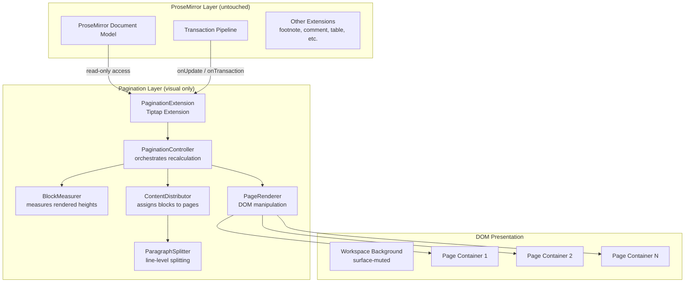
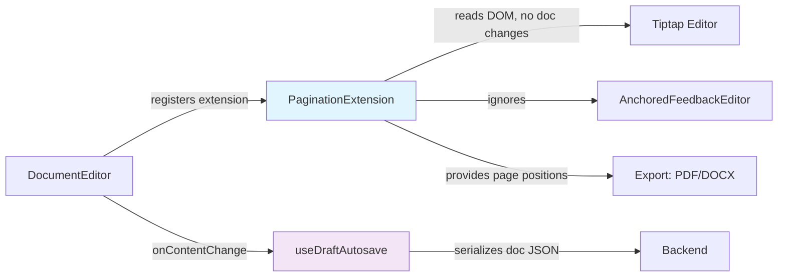

# Design Document: LEON Pagination System

## Overview

This design describes a purely visual pagination layer for WREN's LEON document editor that renders Tiptap/ProseMirror content across discrete US Letter page containers. The system operates entirely in the DOM presentation layer — it does not modify the ProseMirror document model, schema, or transaction pipeline. The single Tiptap document remains the source of truth for content, autosave, and export.

The pagination system is architected as a Tiptap Extension (`PaginationExtension`) that hooks into the editor's update lifecycle. On each content change, it measures rendered block heights and distributes content across visual page containers using CSS transforms (absolute positioning within a scrollable page stack). Headers, footers, and page numbers are rendered as cloned read-only DOM regions repeated on each page.

The design supports three delivery phases:
1. **Phase 1 — Visual Pages**: Static page containers with overflow (no distribution)
2. **Phase 2 — Block Distribution**: Block-level content distribution across pages
3. **Phase 3 — Advanced Pagination**: Paragraph splitting, explicit page breaks, header/footer repetition, heading keep-with-next, and image/table/list splitting

Each phase is independently deployable and provides value without requiring subsequent phases.

## Architecture



### Key Architecture Decisions

1. **Tiptap Extension, not a React wrapper**: The pagination logic lives as a Tiptap `Extension` that subscribes to `onTransaction` events. This keeps it in the editor lifecycle without requiring React re-renders for every keystroke. The React component simply mounts the extension.

2. **DOM manipulation over virtual DOM**: Page containers and content positioning are managed via direct DOM manipulation (moving/cloning DOM nodes, CSS transforms) rather than React state. This avoids the cost of full React reconciliation on every keystroke and meets the 16ms animation frame budget.

3. **Incremental recalculation**: The `ContentDistributor` tracks which page a given edit occurs on and only reprocesses from that page forward. Pages before the edit point are untouched.

4. **No document model changes**: All pagination state (page assignments, split positions, line break points) is ephemeral — stored in the `PaginationController`'s in-memory data structures and reflected only in the DOM. Nothing is persisted or serialized.

5. **Single PageBreak node exception**: The `pageBreak` node is a user-intent node (like a paragraph or heading) that serializes to the document JSON. It is the only schema addition and represents explicit user action, not layout metadata.

## Components and Interfaces

### PaginationExtension (Tiptap Extension)

```typescript
// frontend/src/features/editor/pagination/PaginationExtension.ts
import { Extension } from '@tiptap/core';
import { Plugin, PluginKey } from '@tiptap/pm/state';

export interface PaginationOptions {
  enabled: boolean;
  pageWidth: number;   // 816 CSS px (8.5in @ 96 DPI)
  pageHeight: number;  // 1056 CSS px (11in @ 96 DPI)
  marginTop: number;   // 96 CSS px (1in)
  marginBottom: number;
  marginLeft: number;
  marginRight: number;
  pageGap: number;     // 32 CSS px between pages
  orphanLines: number; // minimum 2
  widowLines: number;  // minimum 2
}

export const PaginationExtension = Extension.create<PaginationOptions>({
  name: 'pagination',
  // Subscribes to transactions, manages PaginationController lifecycle
});
```

### PaginationController

Orchestrates the entire pagination pipeline. Holds mutable state about page assignments.

```typescript
interface PaginationController {
  /** Full recalculation from scratch (used on initial mount / resize). */
  recalculateAll(): void;

  /** Incremental recalculation starting from the page containing the edit. */
  recalculateFrom(editPageIndex: number): void;

  /** Current page count. */
  readonly pageCount: number;

  /** Page assignments: maps block index → page index. */
  readonly blockPageMap: Map<number, number>;

  /** Returns the page index containing the given document position. */
  pageForPosition(pos: number): number;

  /** Dispose listeners and DOM mutations. */
  destroy(): void;
}
```

### BlockMeasurer

Measures rendered block element heights using the existing DOM (no off-screen rendering).

```typescript
interface BlockMeasurement {
  blockIndex: number;
  node: HTMLElement;
  height: number;          // measured via getBoundingClientRect
  isPageBreak: boolean;
  blockType: 'paragraph' | 'heading' | 'list' | 'table' | 'image' | 'blockquote' | 'pageBreak' | 'other';
  headingLevel?: number;   // 1–6 for headings
}

interface BlockMeasurer {
  measureAll(): BlockMeasurement[];
  measureRange(startIndex: number, endIndex: number): BlockMeasurement[];
  invalidateFrom(blockIndex: number): void;
}
```

### ContentDistributor

Assigns blocks to pages based on measurements and pagination rules.

```typescript
interface PageAssignment {
  pageIndex: number;
  blocks: BlockAssignment[];
  usedHeight: number;
  availableHeight: number;
}

interface BlockAssignment {
  blockIndex: number;
  startOnPage: number;
  /** For split blocks (paragraphs, tables, lists): split metadata */
  split?: SplitInfo;
}

interface SplitInfo {
  type: 'paragraph' | 'table' | 'list';
  /** For paragraphs: line index where the split occurs */
  splitAtLine?: number;
  /** For tables: row index where the split occurs */
  splitAtRow?: number;
  /** For lists: item index where the split occurs */
  splitAtItem?: number;
  continuationPageIndex: number;
}

interface ContentDistributor {
  distribute(
    measurements: BlockMeasurement[],
    options: DistributionOptions,
  ): PageAssignment[];
}

interface DistributionOptions {
  usablePageHeight: number;      // 864 px default (page height - margins)
  headerHeight: number;          // measured from header editor content
  footerHeight: number;          // measured from footer editor content
  orphanLines: number;
  widowLines: number;
  enableParagraphSplitting: boolean;  // Phase 3
  enableKeepWithNext: boolean;        // Phase 3
}
```

### ParagraphSplitter

Handles line-level measurement and splitting for paragraphs that span page boundaries.

```typescript
interface LineMeasurement {
  lineIndex: number;
  top: number;       // relative to paragraph top
  height: number;
  bottom: number;
}

interface ParagraphSplitter {
  /** Measures individual lines within a paragraph element. */
  measureLines(paragraphElement: HTMLElement): LineMeasurement[];

  /** Finds the optimal split point given remaining page height. */
  findSplitPoint(
    lines: LineMeasurement[],
    remainingHeight: number,
    orphanMin: number,
    widowMin: number,
  ): SplitResult;
}

interface SplitResult {
  /** Line index after which to split (lines 0..splitAfterLine on current page). */
  splitAfterLine: number;
  /** Whether constraints could be satisfied. */
  constraintsSatisfied: boolean;
  /** If not satisfiable: 'move-whole' | 'waive-orphan' */
  fallback?: 'move-whole' | 'waive-orphan';
}
```

### PageRenderer

Manages the DOM structure for page containers and content positioning.

```typescript
interface PageRenderer {
  /** Creates/removes page container DOM elements to match pageCount. */
  syncPageContainers(pageCount: number): void;

  /** Positions block elements within their assigned page containers. */
  positionBlocks(assignments: PageAssignment[]): void;

  /** Renders cloned header/footer content on all pages. */
  renderHeaderFooter(
    headerContent: HTMLElement | null,
    footerContent: HTMLElement | null,
    pageCount: number,
  ): void;

  /** Resolves page number nodes to their correct ordinal. */
  resolvePageNumbers(pageCount: number): void;

  /** Applies paragraph split clipping (CSS clip-path / overflow hidden). */
  applySplitClipping(splits: SplitInfo[]): void;
}
```

### PageBreakNode (ProseMirror Node Extension)

```typescript
// frontend/src/features/editor/pagination/PageBreakNode.ts
import { Node } from '@tiptap/core';

export const PageBreakNode = Node.create({
  name: 'pageBreak',
  group: 'block',
  atom: true,
  selectable: true,
  draggable: false,

  parseHTML() {
    return [{ tag: 'hr[data-page-break]' }];
  },

  renderHTML() {
    return ['hr', {
      'data-page-break': 'true',
      class: 'pagination-page-break',
    }];
  },

  addKeyboardShortcuts() {
    return {
      'Mod-Enter': () => this.editor.commands.insertPageBreak(),
    };
  },

  addCommands() {
    return {
      insertPageBreak: () => ({ commands, state }) => {
        const { $from } = state.selection;
        // Split current block at cursor, insert pageBreak between halves
        if ($from.parent.type.name !== 'doc') {
          commands.splitBlock();
        }
        return commands.insertContent({ type: 'pageBreak' });
      },
    };
  },
});
```

### Integration with Existing Components



The `PaginationExtension` is registered in the `DocumentEditor` component's `useEditor` extensions array, gated by a configuration prop (`paginationEnabled`). When disabled, the editor renders in continuous-scroll mode as it does today.

## Data Models

### Ephemeral Pagination State (in-memory only)

```typescript
interface PaginationState {
  /** Whether pagination is active. */
  enabled: boolean;
  /** Current page assignments (recomputed on every content change). */
  pages: PageAssignment[];
  /** Total page count. */
  pageCount: number;
  /** Cached block measurements (invalidated on edit). */
  blockCache: Map<number, BlockMeasurement>;
  /** Measured header height (px). */
  headerHeight: number;
  /** Measured footer height (px). */
  footerHeight: number;
  /** Computed usable height per page (pageHeight - margins - header - footer). */
  usableHeight: number;
}
```

This state is never serialized. It exists only in the `PaginationController` instance during the editor session.

### PageBreak Node Schema (persisted)

```typescript
// Tiptap JSON serialization
interface PageBreakJSON {
  type: 'pageBreak';
  // No attrs, no content, no marks
}
```

This is the only addition to the persisted document schema. It serializes identically whether pagination is active or not.

### Page Configuration (static constants)

```typescript
const PAGE_CONFIG = {
  WIDTH_PX: 816,       // 8.5 inches × 96 DPI
  HEIGHT_PX: 1056,     // 11 inches × 96 DPI
  MARGIN_PX: 96,       // 1 inch × 96 DPI (all sides)
  USABLE_WIDTH_PX: 624,  // 816 - 96 - 96
  USABLE_HEIGHT_PX: 864, // 1056 - 96 - 96
  PAGE_GAP_PX: 32,
} as const;
```


## Correctness Properties

*A property is a characteristic or behavior that should hold true across all valid executions of a system — essentially, a formal statement about what the system should do. Properties serve as the bridge between human-readable specifications and machine-verifiable correctness guarantees.*

### Property 1: Document Model Isolation

*For any* Tiptap document and any sequence of pagination operations (recalculation, split, resize), the serialized JSON output of the document SHALL be identical to the serialization without the pagination layer active, differing only by the presence of user-inserted `pageBreak` nodes. No pagination-specific attributes, marks, node types (other than `pageBreak`), or metadata SHALL appear in the serialized output.

**Validates: Requirements 2.6, 12.1, 12.2, 14.1, 14.2, 14.3, 14.4, 14.6, 11.1, 11.2, 15.4**

### Property 2: No Page Overflow

*For any* set of block measurements and any pagination configuration, the `ContentDistributor` SHALL assign blocks to pages such that the total height of content assigned to any single page never exceeds the computed usable page height (page height − margins − header height − footer height), except when a single block is taller than the usable height (in which case it occupies its page alone).

**Validates: Requirements 2.1, 2.2, 2.3**

### Property 3: Page Count Correctness

*For any* document whose total rendered content height is H and usable page height is U, the pagination layer SHALL render exactly 1 page when H ≤ U, and more than 1 page when H > U. Furthermore, no content SHALL be clipped or lost — every block in the document source SHALL be assigned to exactly one page (or split across pages with all parts accounted for).

**Validates: Requirements 1.7, 1.8**

### Property 4: Source Order Preservation

*For any* document containing N blocks, the pagination layer SHALL assign blocks to pages such that for any two blocks A and B where A precedes B in document source order, block A's page index is less than or equal to block B's page index, and within the same page, A appears above B.

**Validates: Requirements 15.3**

### Property 5: Paragraph Split Constraints

*For any* paragraph with L lines and any remaining page height R where the paragraph is taller than R, the `ParagraphSplitter` SHALL find a split point such that: (a) the split occurs only between lines (never mid-line), (b) at least 2 lines remain on the current page (orphan control), and (c) at least 2 lines continue on the next page (widow control). If L ≤ 3 and both constraints cannot be satisfied simultaneously, the entire paragraph SHALL be moved to the next page. If the paragraph exceeds one full usable page height and orphan cannot be satisfied, orphan SHALL be waived while widow is maintained.

**Validates: Requirements 3.1, 3.2, 3.3, 3.4, 3.5, 3.6**

### Property 6: Page Break Forces New Page

*For any* document containing one or more `pageBreak` nodes, the `ContentDistributor` SHALL end the current page at each `pageBreak` node and begin a new page for subsequent content, regardless of remaining space on the current page.

**Validates: Requirements 4.2**

### Property 7: PageBreak Serialization Round-Trip

*For any* Tiptap document containing `pageBreak` nodes, serializing to JSON and deserializing back SHALL produce a document with the same number of `pageBreak` nodes at equivalent positions, each with type `"pageBreak"` and no content or attributes.

**Validates: Requirements 4.5**

### Property 8: Usable Height Accounts for Header and Footer

*For any* header height H_h and footer height H_f (where H_h + H_f ≤ 352 CSS pixels), the computed usable body height for content distribution SHALL equal `pageHeight - marginTop - marginBottom - H_h - H_f`. If H_h + H_f > 352 CSS pixels, the header and footer SHALL be capped so that body content area does not shrink below two-thirds of page height.

**Validates: Requirements 5.5, 5.6**

### Property 9: Page Number Correctness

*For any* N-page document where the header or footer contains a `PageNumberNode`, each page i (1 ≤ i ≤ N) SHALL resolve its `PageNumberNode` to display the value i. After any repagination that changes page count, all page numbers SHALL be re-resolved to reflect updated ordinal positions.

**Validates: Requirements 6.1, 6.2, 6.3, 6.4**

### Property 10: Heading Keep-With-Next

*For any* heading block (h1–h6) followed by a sibling block, if fewer than 2 lines of the sibling block would fit in the remaining page height after the heading, the heading SHALL be moved to the next page. If the heading is the last block in the document (no sibling), it SHALL remain on its current page.

**Validates: Requirements 7.1, 7.2, 7.3, 7.4**

### Property 11: Non-Splittable Block Movement

*For any* image or table block whose total height exceeds the remaining page height but is less than or equal to one full usable page height, the entire block SHALL be moved to the next page as a unit (no splitting).

**Validates: Requirements 8.1, 8.3**

### Property 12: Table Row-Boundary Splitting

*For any* table block taller than one full usable page height, the table SHALL be split only at row boundaries (no row is divided across pages). If the table has a `TableHeader` row, that row SHALL be repeated at the top of each continuation page. If it has no header, no row is repeated. If a single row exceeds one full usable page height, it SHALL be placed at the top of a new page with overflow clipped.

**Validates: Requirements 8.4, 8.5, 8.6**

### Property 13: List Splitting Constraints

*For any* list block exceeding remaining page height, the list SHALL be split only between list items (not mid-item text, unless the item alone exceeds usable height). At least 1 item SHALL remain on the current page and at least 1 item SHALL be carried to the next page. For ordered lists, numbering SHALL continue sequentially on the next page. For nested lists, these constraints SHALL apply recursively at each nesting level.

**Validates: Requirements 9.1, 9.2, 9.3, 9.4, 9.5**

### Property 14: Page Break DOCX Round-Trip

*For any* Tiptap document containing K `pageBreak` nodes, exporting to DOCX SHALL produce exactly K `w:br` elements with `w:type="page"` at equivalent document positions. Importing a DOCX containing M manual page breaks SHALL produce exactly M `pageBreak` nodes at corresponding positions. Exporting and then re-importing SHALL preserve the same number of page breaks at equivalent positions.

**Validates: Requirements 12.4, 12.5, 12.7**

### Property 15: Incremental Recalculation Equivalence

*For any* document and any edit position, incremental recalculation (starting from the page containing the edit) SHALL produce identical page assignments as a full recalculation from scratch.

**Validates: Requirements 13.2**

## Error Handling

### Measurement Failures

- If `getBoundingClientRect()` returns zero-height for a rendered block (e.g., display:none, unmounted), the `BlockMeasurer` treats it as height 0 and skips it during distribution. On next recalculation after the element is visible, it will be measured correctly.
- If the DOM is in an inconsistent state during measurement (elements removed mid-calculation), the `PaginationController` aborts the current recalculation and schedules a fresh one on the next animation frame.

### Oversized Content

- A single block taller than the usable page height is assigned to its own page and allowed to overflow visually (clipped at page boundary) per Requirement 2.3.
- An image taller than usable height is scaled proportionally (Requirement 8.2). If scaling fails (invalid dimensions), the image is placed on its own page and clipped.
- A table row taller than usable height is placed on its own page with overflow clipped (Requirement 8.6).

### Performance Budget Exceeded

- If recalculation exceeds 100ms (≤50 pages) or 200ms (>50 pages), the `PaginationController` yields to the main thread using `requestAnimationFrame` and resumes on the next frame. Content above/at the cursor is never displaced during this process (Requirement 13.5, 13.6).
- The time-slicing granularity is one page per frame: the controller processes one page's worth of blocks, checks elapsed time, and yields if needed.

### Extension Conflicts

- The `PaginationExtension` does NOT register a ProseMirror plugin that filters or modifies transactions. It only observes transactions via `onTransaction`. This ensures it cannot conflict with other extensions.
- If another extension modifies the DOM in a way that invalidates pagination state (e.g., adding/removing block nodes), the next `onTransaction` callback triggers a full recalculation.

### Feature Flag Toggle

- When pagination is toggled off, the `PaginationController.destroy()` method removes all page container DOM elements, restores the original continuous-scroll layout, and clears ephemeral state. No document content is modified.
- When toggled on, a full recalculation runs from scratch.

## Testing Strategy

### Property-Based Testing (fast-check)

The project already uses `fast-check` (v4.8.0) in the frontend dev dependencies. Property-based tests will use this library.

**Configuration:**
- Minimum 100 iterations per property test
- Each property test references its design document property via tag comment
- Tag format: `// Feature: leon-pagination-system, Property {N}: {title}`

**Key test files:**
- `frontend/src/features/editor/pagination/contentDistributor.property.test.ts` — Properties 2, 3, 4, 6, 15
- `frontend/src/features/editor/pagination/paragraphSplitter.property.test.ts` — Property 5
- `frontend/src/features/editor/pagination/tableSplitter.property.test.ts` — Property 12
- `frontend/src/features/editor/pagination/listSplitter.property.test.ts` — Property 13
- `frontend/src/features/editor/pagination/pageNumbers.property.test.ts` — Property 9
- `frontend/src/features/editor/pagination/headingKeepWithNext.property.test.ts` — Property 10
- `frontend/src/features/editor/pagination/documentIsolation.property.test.ts` — Property 1
- `frontend/src/features/editor/pagination/pageBreakDocx.property.test.ts` — Properties 7, 14
- `frontend/src/features/editor/pagination/headerFooterHeight.property.test.ts` — Property 8
- `frontend/src/features/editor/pagination/blockMovement.property.test.ts` — Property 11

**Generators:**
- `blockMeasurementArb`: Generates arrays of `BlockMeasurement` objects with random heights (1–2000px), block types, and heading levels
- `paragraphLinesArb`: Generates arrays of `LineMeasurement` with random line heights (12–48px) and line counts (1–200)
- `tableRowsArb`: Generates table row arrays with random heights, optional header row
- `listItemsArb`: Generates list item arrays with random heights, nesting levels (0–4), ordered/unordered
- `pageConfigArb`: Generates page configurations with varying header/footer heights
- `tiptapDocArb`: Generates valid Tiptap JSON documents with random block compositions

### Unit Tests (vitest)

Example-based tests for:
- Page container dimensions and styling (Requirements 1.1–1.6)
- PageBreak node rendering and keyboard shortcuts (Requirements 4.1, 4.3, 4.4, 4.7)
- Header/footer repetition and read-only state (Requirements 5.1–5.3, 5.7)
- Paragraph split visual rendering for comment marks spanning splits (Requirement 11.5)
- Phase 1 overflow behavior (Requirement 15.2)

### Integration Tests

- Editor transaction triggers recalculation (Requirement 2.4)
- Resize debounce timing (Requirement 2.5)
- Performance benchmarks: ≤100ms for ≤50 pages, ≤200ms for >50 pages (Requirements 13.3, 13.4)
- Cursor navigation across page boundaries (Requirement 10.1)
- Selection rendering across pages (Requirement 10.2)
- Undo/redo with page breaks (Requirement 4.6)
- Header/footer update propagation timing (Requirement 5.4)
- Comment card scroll-to-highlight (Requirement 11.4)
- DOCX import with section breaks (Requirement 12.6)

### Test Infrastructure

- All property tests run with `vitest run` (not watch mode)
- DOM measurement tests use `jsdom` with mocked `getBoundingClientRect()` returning deterministic heights based on the generated block measurements
- Time-sensitive tests (debounce, animation frame) use `vi.useFakeTimers()`
- DOCX round-trip tests use the existing `docx` library (v9.7.1) and `jszip` for verification
