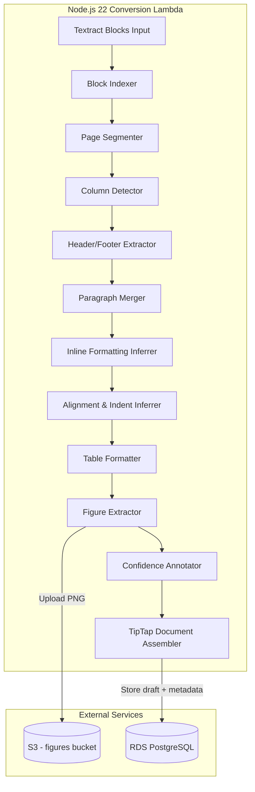

# Design Document: Scanned PDF Reconstruction

## Overview

This design enriches the Textract-backed ingestion path (`textractLayoutToTipTap.ts`) so that scanned PDFs produce TipTap JSON with the same level of rich formatting currently achieved by the spatial/digital PDF converter (`pdfToTipTap.ts`). Today, the Textract layout converter produces plain text nodes — no bold, italic, font size, alignment, indent, figures, or column awareness. The spatial converter already implements these heuristics using font metadata from digital PDFs, but that metadata is unavailable for scanned documents.

The core insight is that Textract's WORD-level bounding box geometry (height, width, aspect ratio, position) provides sufficient signal to **infer** inline formatting, text alignment, indentation, and multi-column structure — the same properties the spatial converter derives from font names and sizes. This design adapts those proven heuristics to operate on Textract geometry instead of font metadata.

### Design Decisions

1. **Extend in-place** — Rather than creating a new converter, we extend `textractLayoutToTipTap.ts` with new internal modules. This keeps a single entry point for the Textract path and avoids divergent code paths.
2. **Geometry-based inference** — Bold/italic detection uses bounding box height ratios and aspect ratios rather than font name parsing (unavailable in scanned PDFs). Thresholds are tunable constants.
3. **Figure extraction via PDF rendering** — Figures are extracted by rendering the source PDF page region to PNG using a lightweight PDF renderer (pdf-lib + sharp), not by requesting Textract image exports.
4. **Header/footer deduplication** — Repeating headers/footers are stored once as metadata on the draft record rather than duplicated across pages in the main content.
5. **Column detection before paragraph merging** — Multi-column detection runs first to establish reading order, then paragraph merging operates within each column independently.

## Architecture



### Processing Pipeline Order

The conversion pipeline processes Textract blocks in this sequence:

1. **Block Indexing** — Build `Map<Id, Block>` and extract WORD blocks per LINE.
2. **Page Segmentation** — Group blocks by page; compute per-page metrics (median line height, median word width, baseline left, content bounds).
3. **Header/Footer Extraction** — Identify and remove LAYOUT_HEADER/FOOTER/PAGE_NUMBER blocks; deduplicate repeated text across pages.
4. **Column Detection** — Detect multi-column regions per page band using horizontal gap analysis.
5. **Reading Order Resolution** — Flatten columns into linear reading order (left-to-right, top-to-bottom within each column).
6. **Paragraph Merging** — Merge consecutive LINE blocks into paragraphs using vertical gap ratios, respecting column boundaries.
7. **Inline Formatting Inference** — Apply bold/italic/fontSize marks based on word geometry within each LINE.
8. **Alignment & Indentation** — Compute textAlign and indent attributes from LINE position relative to page content bounds.
9. **Table Cell Formatting** — Enhance table cells with header detection, cell alignment, and colspan/rowspan.
10. **Figure Extraction** — Extract LAYOUT_FIGURE regions as PNG, upload to S3, produce image nodes.
11. **Confidence Annotation** — Compute per-line and per-page confidence; apply lowConfidence marks and warning paragraphs.
12. **Document Assembly** — Combine all nodes into a valid TipTap document; compute overall confidence for draft metadata.

## Components and Interfaces

### 1. `PageMetrics` — Per-page computed statistics

```typescript
interface PageMetrics {
  pageNumber: number;
  medianLineHeight: number;
  medianWordWidth: number;
  medianWordHeight: number;
  baselineLeft: number;       // 10th percentile of LINE Left values
  contentBounds: { left: number; right: number; width: number };
  indentStep: number;         // Computed from medianLineHeight + pageWidth
  lineCount: number;
}
```

### 2. `InlineFormattingInferrer` — Geometry-based mark detection

```typescript
interface FormattedRun {
  text: string;
  marks: Array<{ type: 'bold' | 'italic' | 'textStyle'; attrs?: Record<string, unknown> }>;
}

function inferInlineFormatting(
  lineBlock: Block,
  wordBlocks: Block[],
  pageMetrics: PageMetrics,
): FormattedRun[];
```

**Boldness heuristic**: For lines with ≥3 words, group adjacent words into runs where heights differ ≤10%. A run is bold if its average height exceeds 1.15× the median word height of the LINE.

**Italic heuristic**: Words with width-to-height aspect ratio below 0.55× the median aspect ratio of sibling words on the same LINE get italic marks.

**Font size heuristic**: Lines whose bounding box height exceeds 1.3× the median line height for the parent layout element get a `fontSize` textStyle mark computed as `(lineHeight / medianHeight) × 16`.

**Guard clause**: If <50% of words have valid geometry, or the line has <3 words, skip formatting inference and produce plain text.

### 3. `AlignmentInferrer` — Text alignment and indentation

```typescript
interface AlignmentResult {
  textAlign?: 'center' | 'right';
  indent?: number;  // 0–8
}

function inferAlignment(
  lineBlock: Block,
  pageMetrics: PageMetrics,
): AlignmentResult;
```

**Center detection**: Left and right margins differ by <4% of page width, and line doesn't span full width.

**Right detection**: Right edge within 4% of page right margin, left margin >20% of page width.

**Priority**: Center preferred when both conditions match.

**Indent**: `floor((lineLeft - baselineLeft) / indentStep)`, clamped to [0, 8]. Only applied when >0.6× indentStep offset.

### 4. `ColumnDetector` — Multi-column layout detection

```typescript
interface ColumnRegion {
  left: number;
  right: number;
  lines: Block[];  // LINE blocks belonging to this column
}

interface PageBand {
  top: number;
  bottom: number;
  columns: ColumnRegion[];  // 1 = single-column band
}

function detectColumns(
  lineBlocks: Block[],
  pageMetrics: PageMetrics,
): PageBand[];
```

**Algorithm**:
1. Segment page into vertical bands by identifying horizontal gaps between LINE groups exceeding 2.4× median line height.
2. Within each band, project all LINE left/right edges onto the X axis.
3. Identify gaps in the X projection exceeding 1.8× median word width.
4. If 2–6 distinct horizontal regions are found, classify as columns.
5. Ambiguous gaps (1.2×–1.8× median word width) or >6 regions → fall back to single-column.

### 5. `HeaderFooterExtractor` — Repeating content removal

```typescript
interface HeaderFooterResult {
  headerMetadata: Record<number, string>;  // pageNumber → text
  footerMetadata: Record<number, string>;
  deduplicatedHeader: string | null;       // Single instance if repeats ≥3 pages
  deduplicatedFooter: string | null;
  nonRepeatingHeaders: Block[];            // Include in main content as h2
  bodyBlocks: Block[];                     // Remaining blocks for main content
}

function extractHeadersFooters(
  blocks: Block[],
  pageCount: number,
): HeaderFooterResult;
```

**Deduplication**: After collapsing whitespace and trimming, headers/footers appearing on ≥3 pages are stored once. Non-repeating headers (<3 pages) become heading-level-2 nodes in the body.

### 6. `FigureExtractor` — Image extraction and S3 upload

```typescript
interface FigureResult {
  node: TipTapNode;          // image node or placeholder paragraph
  s3Key?: string;            // Only when extraction succeeded
}

function extractFigures(
  figureBlocks: Block[],
  pdfBuffer: Buffer,
  documentId: string,
  s3Client: S3Client,
  bucketName: string,
): Promise<FigureResult[]>;
```

**Constraints**:
- Max 20 figures per document; beyond that → placeholder nodes.
- Total extraction time capped at 30 seconds.
- Minimum figure size: 2% of page dimensions (both width and height).
- Extraction failure → `"[Figure could not be rendered]"` placeholder.

### 7. `ConfidenceAnnotator` — Quality indicators

```typescript
interface ConfidenceResult {
  lineConfidence: number;        // Per-line arithmetic mean, 2 decimal places
  applyLowConfidenceMark: boolean;  // true when < 80%
}

interface PageConfidenceResult {
  averageConfidence: number;     // 2 decimal places
  prependWarning: boolean;       // true when < 70%
}

function computeLineConfidence(wordBlocks: Block[]): ConfidenceResult;
function computePageConfidence(lineConfidences: number[]): PageConfidenceResult;
function computeDocumentConfidence(allLineConfidences: number[]): number;
```

### 8. `ParagraphMerger` — Enhanced OCR line merging

```typescript
function mergeOcrLines(
  lines: TextractLine[],
  pageMetrics: PageMetrics,
): MergedParagraph[];

interface MergedParagraph {
  lines: TextractLine[];
  text: string;
}
```

**Merge rules** (applied after column detection establishes reading order):
- Vertical gap ≤ 1.85× median line height + same horizontal alignment (left edges within 4%) → merge.
- Trailing hyphen + next line starts with word char → join without space, remove hyphen.
- Gap > 2.4× median line height → always separate.
- Sentence-terminal punctuation + gap > 1.85× → new paragraph.
- Page boundaries → always separate.
- Missing geometry → each line is its own paragraph.

### 9. Updated `textractLayoutBlocksToTipTap` — Extended entry point

The existing function signature remains unchanged. Internally it now:
1. Calls `extractHeadersFooters` to separate metadata from body content.
2. Calls `detectColumns` per page on the body content.
3. Processes blocks in column-aware reading order.
4. Applies `inferInlineFormatting` to each LINE's WORD children.
5. Applies `inferAlignment` to each LINE/paragraph node.
6. Produces enriched table nodes via the updated table formatter.
7. Inserts figure nodes (or placeholders) at their reading-order position.
8. Applies confidence marks and page warnings.
9. Returns the assembled TipTap document.

A new companion function handles metadata storage:

```typescript
interface TextractConversionResult {
  document: TipTapDoc;
  header: TipTapDoc | null;
  footer: TipTapDoc | null;
  documentConfidence: number;
}

async function convertTextractToTipTap(
  blocks: readonly Block[],
  pdfBuffer: Buffer,
  documentId: string,
  s3Client: S3Client,
  bucketName: string,
): Promise<TextractConversionResult>;
```

## Data Models

### Draft Record Extensions

The existing `draft` table already has `header` and `footer` JSONB columns. This feature uses them to store extracted header/footer metadata. A new column is added for confidence:

```sql
ALTER TABLE draft ADD COLUMN IF NOT EXISTS ocr_confidence numeric(5,2);
```

The `ocr_confidence` column stores the arithmetic mean of all line confidences (0.00–100.00).

### TipTap Schema Extensions

New mark type added to the schema:

```typescript
// lowConfidence mark — applied to text nodes from lines with <80% avg confidence
{ type: 'lowConfidence' }
```

This mark is purely presentational (CSS class in the editor) and carries no attributes.

### S3 Key Structure for Figures

```
figures/{documentId}/figure-{pageNumber}-{figureIndex}.png
```

- `pageNumber`: 1-based page number
- `figureIndex`: Zero-padded sequential integer per page (e.g., `00`, `01`)

### Header/Footer Metadata Format

Stored as TipTap documents in the existing `header`/`footer` JSONB columns:

```json
{
  "type": "doc",
  "content": [
    { "type": "paragraph", "content": [{ "type": "text", "text": "Company Name — Confidential" }] }
  ]
}
```

Combined metadata text is capped at 10,000 characters.


## Correctness Properties

*A property is a characteristic or behavior that should hold true across all valid executions of a system — essentially, a formal statement about what the system should do. Properties serve as the bridge between human-readable specifications and machine-verifiable correctness guarantees.*

### Property 1: Bold formatting inference

*For any* LINE block containing 3 or more WORD blocks with valid geometry (≥50% having Height and Top), words grouped into runs by vertical proximity (±5% height, ≤10% height difference) SHALL receive bold marks if and only if the run's average bounding box height exceeds 1.15× the median word height of all WORD blocks on that LINE.

**Validates: Requirements 1.1, 1.2**

### Property 2: Heading level mapping

*For any* LAYOUT_TITLE block, the converter SHALL produce a heading node at level 1; *for any* LAYOUT_SECTION_HEADER block, it SHALL produce a heading node at level 2 — with the full text content of the block preserved in the heading node.

**Validates: Requirements 1.3**

### Property 3: Font size mark application

*For any* set of LINE blocks within a layout element, lines whose bounding box height exceeds 1.3× the median line height of that element SHALL have a fontSize textStyle mark with value equal to `(lineHeight / medianHeight) × 16`, and lines at or below 1.3× SHALL have no fontSize mark.

**Validates: Requirements 1.4**

### Property 4: Italic formatting inference

*For any* LINE block with 3+ WORD blocks with valid geometry, words whose width-to-height aspect ratio is below 0.55× the median aspect ratio of sibling words on the same LINE SHALL receive italic marks, and words at or above the threshold SHALL not receive italic marks.

**Validates: Requirements 1.5**

### Property 5: Text alignment inference

*For any* LINE block positioned relative to a page content area: if left and right margins differ by less than 4% of page width, `textAlign: 'center'` SHALL be applied; if the right edge is within 4% of page right margin and left margin exceeds 20% of page width, `textAlign: 'right'` SHALL be applied; if both conditions hold, center SHALL take priority; if neither holds, no textAlign attribute SHALL be present.

**Validates: Requirements 2.1, 2.2, 2.3, 2.7**

### Property 6: Indentation computation

*For any* page with LINE blocks, the baseline left position SHALL equal the 10th percentile of all LINE Left values (or minimum when fewer than 3 lines exist), the indent step SHALL equal `(medianLineHeight × 2.2 + pageWidth × 0.035) / 2` clamped to [12, 56], and the indent attribute SHALL equal `floor((lineLeft - baselineLeft) / indentStep)` clamped to [0, 8], applied only when the offset exceeds 0.6× indentStep.

**Validates: Requirements 2.4, 2.5, 2.6**

### Property 7: Figure extraction decisions

*For any* set of LAYOUT_FIGURE blocks in a document, figures with both BoundingBox Width > 0.02 and Height > 0.02 SHALL trigger extraction (up to a maximum of 20 per document), and all other LAYOUT_FIGURE blocks (undersized or beyond the 20-figure limit) SHALL produce placeholder paragraph nodes with text "[Figure could not be rendered]".

**Validates: Requirements 3.1, 3.4, 3.6**

### Property 8: Figure S3 key format

*For any* extracted figure, the S3 key SHALL match the pattern `figures/{documentId}/figure-{pageNumber}-{figureIndex}.png` where pageNumber is the 1-based page number and figureIndex is a zero-padded sequential integer per page.

**Validates: Requirements 3.2**

### Property 9: Table structure preservation

*For any* Textract TABLE block with CELL children, the produced TipTap table node SHALL have the same number of rows and columns as the source TABLE (accounting for rowspan/colspan coverage), and every CELL — including empty cells — SHALL have a corresponding node in the output containing at least an empty paragraph.

**Validates: Requirements 4.1, 4.5**

### Property 10: Table header and span handling

*For any* CELL block tagged with COLUMN_HEADER entity type or located in the first row of a TABLE, the corresponding output node SHALL be of type `tableHeader` with bold formatting on all text content. *For any* CELL with RowSpan > 1 or ColumnSpan > 1, the output node SHALL carry matching `rowspan`/`colspan` attributes, and grid positions covered by those spans SHALL be omitted from the output.

**Validates: Requirements 4.2, 4.4**

### Property 11: Table cell alignment

*For any* CELL block where 75% or more of WORD blocks have their right bounding box edge within 8% of the cell's right boundary, the cell paragraph SHALL have `textAlign: 'right'`; otherwise no explicit textAlign SHALL be present.

**Validates: Requirements 4.3, 4.6**

### Property 12: Multi-column detection and reading order

*For any* page where LINE blocks cluster into 2–6 distinct horizontal regions separated by gaps exceeding 1.8× the median word width, the converter SHALL identify columns and emit content in left-to-right column order (ascending BoundingBox.Left), with lines processed top-to-bottom within each column. Full-width and multi-column regions on the same page SHALL be segmented into independent vertical bands.

**Validates: Requirements 5.1, 5.2, 5.4**

### Property 13: Header/footer extraction and exclusion

*For any* Textract block array containing LAYOUT_HEADER, LAYOUT_FOOTER, or LAYOUT_PAGE_NUMBER blocks, those blocks' text content SHALL be absent from the main TipTap document content nodes and SHALL instead appear in the extracted header/footer metadata collection keyed by page number.

**Validates: Requirements 6.1, 6.3**

### Property 14: Header/footer deduplication

*For any* header or footer text appearing on 3 or more pages (after whitespace normalization and trimming), only one instance SHALL be stored in the metadata field. *For any* LAYOUT_HEADER text appearing on fewer than 3 pages, it SHALL be included in the main TipTap document as a heading node at level 2.

**Validates: Requirements 6.4, 6.5**

### Property 15: Header/footer metadata size cap

*For any* extracted header and footer metadata, the combined text content SHALL not exceed 10,000 characters.

**Validates: Requirements 6.2**

### Property 16: Line confidence marking

*For any* LINE block containing WORD blocks with Confidence values, the line confidence SHALL equal the arithmetic mean of all WORD Confidence values rounded to two decimal places. If this mean is below 80%, a `lowConfidence` mark SHALL be applied to the corresponding text node; otherwise no `lowConfidence` mark SHALL be present.

**Validates: Requirements 7.1, 7.3**

### Property 17: Page confidence warning

*For any* page where the average of all line confidences falls below 70%, the converter SHALL prepend an informational paragraph indicating potential OCR errors to the beginning of that page's content.

**Validates: Requirements 7.2**

### Property 18: Paragraph merging

*For any* sequence of consecutive LINE blocks on the same page with valid geometry: lines SHALL be merged into a single paragraph when the vertical gap is ≤ 1.85× median line height AND left edges differ by < 4% of page width; lines SHALL be separate paragraphs when the gap exceeds 2.4× median line height OR when a page boundary separates them; lines ending with sentence-terminal punctuation with gaps between 1.85× and 2.4× SHALL start a new paragraph.

**Validates: Requirements 8.1, 8.3, 8.4, 8.6**

### Property 19: Hyphen de-hyphenation joining

*For any* LINE block whose text ends with a hyphen character immediately followed by a word character as the first character of the next LINE block's text (and lines are in the same paragraph by gap rules), the converter SHALL join the two by removing the trailing hyphen and concatenating directly without an intervening space.

**Validates: Requirements 8.2**

### Property 20: Schema conformance

*For any* Textract block array input, the produced TipTap document SHALL use only the allowed node types (doc, paragraph, heading, bulletList, orderedList, listItem, table, tableRow, tableCell, tableHeader, image, horizontalRule) and mark types (bold, italic, underline, strike, textStyle, lowConfidence).

**Validates: Requirements 9.1**

### Property 21: Non-empty output

*For any* valid Textract block array containing at least one text-bearing block (LINE or WORD with non-empty Text), the produced TipTap document SHALL have at least one content node (never an empty content array).

**Validates: Requirements 9.2**

### Property 22: Text content preservation

*For any* Textract block array, the concatenation of all text content in the produced TipTap document (plus any text stored in header/footer metadata for content repeating on 3+ pages) SHALL equal the original Textract-extracted text (excluding LAYOUT_FIGURE regions and LAYOUT_PAGE_NUMBER blocks), with no unintended duplication or loss.

**Validates: Requirements 9.3**

### Property 23: JSON serialization round-trip

*For any* TipTap document produced by the converter, serializing to JSON via `JSON.stringify` and parsing back via `JSON.parse` SHALL produce a result deeply equal to the original output — no non-serializable values (undefined, functions, circular references) shall be present.

**Validates: Requirements 9.4**

## Error Handling

### Figure Extraction Failures

| Error | Handling |
|-------|----------|
| PDF page rendering failure | Insert placeholder `"[Figure could not be rendered]"` at figure position |
| S3 upload failure | Insert placeholder; log error with document ID and figure index |
| Figure extraction timeout (30s budget exceeded) | Stop extracting remaining figures; all unprocessed figures get placeholders |
| Figure too small (Width ≤ 0.02 or Height ≤ 0.02) | Insert placeholder |
| More than 20 figures | First 20 extracted; remainder get placeholders |

### Geometry Failures

| Error | Handling |
|-------|----------|
| LINE blocks lack BoundingBox (Top/Height absent) | Skip formatting inference; produce plain text nodes; treat each LINE as own paragraph |
| <50% of WORD blocks have valid geometry | Skip bold/italic/fontSize inference for that LINE |
| LINE has <3 WORD blocks | Skip boldness heuristic for that LINE |
| Zero WORD blocks in a LINE | Exclude from confidence calculations; no lowConfidence mark |
| Missing Confidence values on WORD blocks | Treat as 100% confidence; no quality indicator |

### Data Integrity

| Error | Handling |
|-------|----------|
| Empty or no-text Textract block array | Produce doc with single empty paragraph |
| Header/footer metadata exceeds 10,000 chars | Truncate to 10,000 characters at a whitespace boundary |
| Column detection produces >6 regions | Fall back to top-to-bottom reading order |
| Ambiguous column gap (1.2×–1.8× median word width) | Fall back to top-to-bottom reading order |

### Lambda Constraints

- **Memory**: 2 GB — figure extraction uses streaming (pdf-lib page rendering + sharp resize) to limit peak memory per figure.
- **Timeout**: 3 minutes total — figure extraction budget capped at 30 seconds; remaining time available for text conversion.
- **Graceful degradation**: If any enrichment step fails (formatting, alignment, columns), the converter falls back to plain text for that section rather than failing the entire conversion.

## Testing Strategy

### Property-Based Testing

Property-based tests use **fast-check** (already in the project's testing toolchain per `package.json`). Each property test:
- Runs a minimum of **100 iterations** with randomly generated inputs.
- Is tagged with a comment referencing the design property it validates.
- Tag format: `Feature: scanned-pdf-reconstruction, Property {number}: {title}`

Property tests focus on the pure transformation functions:
- `inferInlineFormatting` (Properties 1, 3, 4)
- `inferAlignment` (Properties 5, 6)
- `detectColumns` (Property 12)
- `extractHeadersFooters` (Properties 13, 14, 15)
- `computeLineConfidence` / `computePageConfidence` (Properties 16, 17)
- `mergeOcrLines` (Properties 18, 19)
- `tableFromBlock` enhanced (Properties 9, 10, 11)
- `textractLayoutBlocksToTipTap` end-to-end (Properties 20, 21, 22, 23)
- `extractFigures` decision logic with mocked S3/PDF (Properties 7, 8)

### Unit Tests (Example-Based)

Unit tests cover:
- Specific formatting scenarios with known Textract block structures
- Edge cases: empty documents, single-word lines, pages without geometry
- Figure placeholder insertion for various failure modes
- Header/footer deduplication with exact expected outputs
- Integration between column detection → paragraph merging → formatting

### Integration Tests

- End-to-end conversion of sample scanned PDF Textract outputs (golden files)
- S3 upload verification with mocked S3 client
- Draft record metadata storage verification
- Lambda timeout enforcement test with synthetic large documents

### Test Organization

```
backend/document/src/
├── textractLayoutToTipTap.ts              (extended main module)
├── textractLayoutToTipTap.test.ts         (unit tests)
├── textractLayoutToTipTap.property.test.ts (property-based tests)
├── textractFormatting.ts                  (inline formatting inferrer)
├── textractFormatting.test.ts
├── textractFormatting.property.test.ts
├── textractAlignment.ts                   (alignment + indent)
├── textractAlignment.property.test.ts
├── textractColumns.ts                     (column detection)
├── textractColumns.property.test.ts
├── textractConfidence.ts                  (confidence computation)
├── textractConfidence.property.test.ts
├── textractFigures.ts                     (figure extraction)
├── textractFigures.test.ts
├── textractHeaderFooter.ts                (header/footer extraction)
├── textractHeaderFooter.property.test.ts
└── textractLines.ts                       (enhanced paragraph merging)
```
