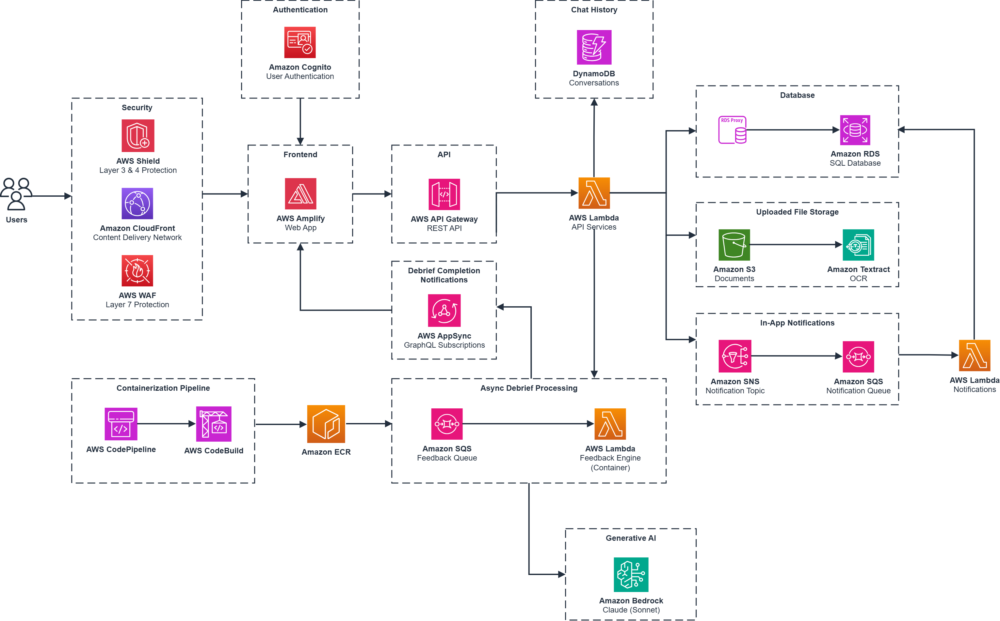

# WREN: Socratic Writing Coach

WREN is an AI-powered writing feedback platform built on AWS. Writers submit drafts through a rich-text editor, and the system generates Socratic feedback: probing questions anchored to specific passages, never corrections or rewrites. Admins configure writing types and review aggregated analytics, while writers track their progress across iterative draft revisions. The AI debrief evaluates writing against configurable rubric definitions and surfaces both strengths and areas for improvement. Writers also have access to a chatbot feature to ask clarifying questions about how to act on specific feedback from the AI debrief.

## Documentation

| Document | Description |
|----------|-------------|
| [Debrief Architecture Deep Dive](docs/DEBRIEF_ARCHITECTURE_DEEP_DIVE.md) | Feedback pipeline, diff engine, anchor service, resolution tracking, and data model |
| [Architecture Diagram](docs/WREN_ARCHITECTURE_DIAGRAM.drawio.png) | System architecture diagram |
| [Feedback Pipeline Diagram](docs/WREN_FEEDBACK_PIPELINE_DIAGRAM.png) | End-to-end feedback generation flow |

## High-Level Architecture



For a detailed breakdown of each component, data flows, and the full database schema, see the Architecture Deep Dive (TODO: insert link here).

## Directories

```
.
├── backend/                # Backend microservices (Node.js 22 + Python 3.12)
│   ├── admin/              # Organization & Writing Type management service
│   ├── auth/               # Cognito JWT verification + DB identity mapping
│   ├── database/           # Migrations, schema, and shared DB access layer
│   ├── document/           # Draft ingestion, extraction, and segmentation
│   ├── engine/python/      # AI Feedback Engine (Docker Lambda)
│   ├── feedback/           # Feedback orchestration and quote resolution
│   └── notification/       # In-app notification processing and delivery
├── cdk/                    # AWS CDK infrastructure + Lambda handlers
│   ├── bin/                # CDK app entry point
│   ├── lambda/             # Lambda function bundles (esbuild targets)
│   ├── lambda-handlers/    # Lambda handler entry points (TypeScript)
│   ├── layers/             # Lambda layers (shared dependencies)
│   └── lib/stacks/         # CDK stack definitions
├── frontend/               # React SPA (Vite + Tailwind + TipTap)
│   └── src/
│       ├── features/       # Feature modules (editor, debrief, ask-wren, progress)
│       ├── pages/          # Route-level page components (by role)
│       ├── components/     # Shared UI components
│       ├── services/       # API service layer
│       └── hooks/          # Custom React hooks
├── types/                  # Shared TypeScript types (@wren/types)
├── docs/                   # Architecture and specification documents
├── scripts/                # Utility scripts
└── testing/                # Integration and E2E test infrastructure
```

| Directory | Description |
|-----------|-------------|
| `/backend/admin` | Organization groupings and configurable Writing Type catalog (CRUD, access-state control) |
| `/backend/auth` | Cognito JWT verification plus app-database identity mapping for API Gateway authorizer |
| `/backend/database` | PostgreSQL migrations, schema definitions, and shared Node.js data-access layer |
| `/backend/document` | Draft ingestion (.docx/.pdf upload + pasted text), extraction, and paragraph segmentation |
| `/backend/engine/python` | AI Feedback Engine — prompt assembly, Bedrock invocation, feedback parsing, diff engine, carry-forward, and resolution judge |
| `/backend/feedback` | Feedback orchestration service — quote resolution, sentence expansion, section applicability |
| `/backend/notification` | In-app notification processing — recipient resolution, deduplication, template rendering, AppSync publishing |
| `/cdk` | AWS CDK v2 infrastructure code (TypeScript) — all stack definitions and Lambda handlers |
| `/frontend` | React 19 frontend — TipTap rich-text editor, AI Debrief sidebar, Ask LEON chat, progress tracking |
| `/types` | Shared TypeScript package (`@wren/types`) — schemas, TipTap helpers, segment utilities |
| `/docs` | Architecture documents and feature specifications |

## Technology Stack

### Frontend

- React 19 with TypeScript
- Vite 7 for build tooling
- Tailwind CSS 4 for styling
- TipTap 3 (ProseMirror) for rich-text editing
- Radix UI for accessible UI primitives
- AWS Amplify v6 for Cognito authentication
- TanStack React Query for server state
- React Hook Form + Zod for form validation
- Vitest for unit testing

### Backend

- AWS Lambda (Node.js 22 and Python 3.12) for serverless compute
- Amazon Bedrock with Claude Sonnet 4 (Anthropic) for LLM inference
- PostgreSQL 16 (Amazon RDS) for relational data storage
- Amazon SQS for async job processing
- Amazon S3 for document and file storage
- Amazon API Gateway (REST, OpenAPI-driven) for API management
- AWS AppSync (GraphQL) for real-time subscriptions (debrief-ready events)
- Amazon Cognito for authentication and authorization
- Zod for runtime schema validation across all services

### AI / Feedback Pipeline

- Layered prompt assembly with configurable rubric dimensions
- Diff engine for tracking changes across draft revisions
- Anchor service for precise text-span location of feedback
- Carry-forward system for persistent feedback across revisions
- LLM Judge for resolution tracking (addressed/not-addressed)
- Sentence boundary detection for quote expansion
- Footnote-aware text segmentation

### Infrastructure

- AWS CDK v2 (TypeScript) for infrastructure as code
- AWS CodePipeline and CodeBuild for CI/CD
- Amazon VPC for network isolation
- Amazon RDS with RDS Proxy for managed PostgreSQL
- AWS WAF for API and AppSync protection
- Amazon CloudFront for content delivery
- AWS Amplify Hosting for frontend deployment
- Amazon CloudWatch for observability

## Credits

This application was architected and developed by [Jovan Kalirai](https://www.linkedin.com/in/jovank99/) and [Rajrupa Sanyal](https://www.linkedin.com/in/rajrupasanyal/) with project assistance by [Raza Sidhu](https://www.linkedin.com/in/raza-sidhu-b65253301/). Thanks to the UBC Cloud Innovation Centre Technical and Project Management teams for their guidance and support.

## License

This project is licensed under the [MIT License](LICENSE).

Licenses of libraries and tools used by the system are listed below:

[PostgreSQL License](https://www.postgresql.org/about/licence/) : For PostgreSQL, a liberal open source license similar to BSD or MIT.

[Anthropic Acceptable Use Policy](https://www.anthropic.com/legal/aup) : For Claude Sonnet 4.6, accessed via Amazon Bedrock for feedback generation and resolution judging.

[TipTap License](https://tiptap.dev/docs/license) : For the TipTap rich-text editor framework (MIT-licensed core).
