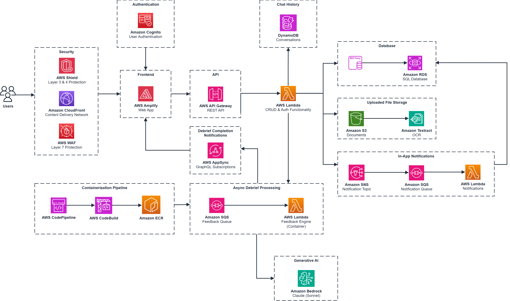

# WREN

An AI writing coach that gives **Socratic feedback** (questions, never rewrites) on student drafts. Writers upload or compose documents, request a debrief, and revise across drafts. Department admins configure document types, evaluation criteria, and prompts.

The product display name is **LEON** (UI and email). AWS resources and this repository use the project prefix **WREN**. 

| Index | Description |
| :---------------------------------------------------- | :------------------------------------------------------ |
| [High-Level Architecture](#high-level-architecture) | High-level overview illustrating component interactions |
| [Deployment](#deployment-guide) | How to deploy the project |
| [User Guide](#user-guide) | The working solution |
| [Directories](#directories) | General project directory structure |
| [Additional Documentation](#additional-documentation) | Comprehensive guides and references |
| [Credits](#credits) | Meet the team behind the solution |
| [License](#license) | License details |

## High-Level Architecture

The following architecture diagram illustrates the AWS components used to deliver the solution.



## Deployment Guide

See the [Deployment Guide](docs/deployment-guide.md) for the environment-variable reference, resumable action-required steps, default-on CI/CD pipeline, and teardown guarantees.

## User Guide

See the [User Guide](docs/user-guide.md) for how students and department admins use the web app.

## Directories

```
├── cdk/                          # AWS CDK v2 (TypeScript) — all infrastructure
│   ├── bin/wren.ts               # CDK app entry
│   ├── lib/
│   │   ├── config.ts             # Display name, prefix, region, Bedrock model
│   │   ├── openapi.yaml          # REST API spec for API Gateway
│   │   ├── stacks/               # Config, Vpc, Storage, Cognito, Database, …
│   │   └── constructs/           # VPC, RDS, S3, migrations, AppSync, …
│   ├── lambda/                   # Lambda handlers bundled into Compute
│   └── lambda-handlers/          # Node entrypoints for Compute bundling
│
├── frontend/                     # React 19 + Vite 7 web app (Amplify)
│   └── src/
│       ├── app/                  # Providers, router shell
│       ├── components/ui/        # shadcn/ui primitives
│       ├── config/               # Build-time env (VITE_*)
│       ├── features/             # auth, dashboard, editor, debrief, admin, …
│       ├── pages/                # Route-level screens
│       └── services/             # Cognito-aware API client
│
├── backend/
│   ├── auth/                     # Cognito authorizer + identity mapping
│   ├── admin/                    # Writing types, prompts, users, analytics
│   ├── document/                 # Drafts, S3, Textract, job enqueue
│   ├── feedback/                 # Orchestrator (enqueue / status)
│   ├── notification/             # In-app notifications
│   ├── database/
│   │   ├── migrations/           # Ordered SQL (pgvector + app schema)
│   │   ├── node/                 # Node postgres access layer
│   │   └── python/               # Python psycopg access layer
│   └── engine/python/            # Diff, anchors, progress, Feedback Engine
│
├── types/                        # Shared Zod/TS domain contract (@wren/types)
├── docs/                         # Deployment, user guide, architecture
├── scripts/                      # Repo checks (e.g. display-name guard)
└── testing/                      # Integration and E2E test infrastructure
```

## Technology Stack

### Frontend

- **React 19** with TypeScript (strict)
- **Vite 7** for build tooling
- **Tailwind CSS 4** with centralized design tokens
- **shadcn/ui** (Radix UI) for UI components
- **TipTap** for the document editor
- **TanStack Query** for server state
- **React Hook Form + Zod** at the API boundary
- **React Router** for client-side routing
- **AWS Amplify** for hosting; **Amazon Cognito** for sign-in

### Backend

- **AWS Lambda** (Node.js 22 and Python 3.12) for serverless compute
- **Amazon Bedrock** for LLM inference (default Claude Sonnet 4.6 inference profile)
- **Amazon Textract** for scanned / digital PDF extraction
- **Amazon SQS** for async feedback jobs (plus a DLQ)
- **Amazon RDS PostgreSQL 16** with **pgvector**, reached through **RDS Proxy** (TLS)
- **Amazon S3** for document and reference-material bytes
- **Amazon DynamoDB** for Ask WREN conversation state
- **API Gateway** (REST) from the OpenAPI spec
- **AWS AppSync** for realtime debrief notifications
- **Amazon Cognito** for authentication and the `SystemAdmin` bootstrap group

### Infrastructure

- **AWS CDK** (TypeScript) for infrastructure as code
- **Amazon VPC** (public / private / isolated), NAT Gateway, VPC endpoints
- **Amazon CloudFront + AWS WAF** in front of the API (CloudFront is a global CDN; WAF is associated with the distribution)
- **Amazon CloudWatch** log retention and alarms
- Data-plane Region is **CDK context** (`region`); the architecture is portable. Example commands in the deployment guide use a default Region.

## Additional Documentation

### Architecture and Design

- **[Architecture Deep Dive](docs/architecture-deep-dive.md)**: Platform request paths, AWS components, and PostgreSQL schema
- **[Debrief pipeline](docs/DEBRIEF_ARCHITECTURE_DEEP_DIVE.md)**: Diff engine, anchors, resolution tracking, and Feedback Engine internals
- **[Security Overview](docs/security-overview.md)**: Auth, network, encryption, GenAI guardrails, and monitoring
- **[AWS Managed Keys](docs/aws-managed-keys.md)**: Where CDK still uses AWS-managed encryption, and how to switch to a CMK
- **[Bedrock Guardrails](docs/bedrock-guardrails.md)**: Prompt-attack Guardrail on admin config vs application no-ghostwriting checks
- **[CDK package README](cdk/README.md)**: Stacks, context keys, and synth/deploy commands

### Deployment and Configuration

- **[Deployment Guide](docs/deployment-guide.md)**: End-to-end AWS deploy (Bedrock, ECR, stack order, Amplify, first admin)

### Development and Maintenance

- **[Project Modification Guide](docs/modification-guide.md)**: Theming, auth, API extensions, LLM config, migrations, ingest, and deploy
- **[Dependency Management](docs/dependency-management.md)**: npm workspaces, uv/pip pins, Feedback Engine container image
- **[Database Migrations](backend/database/migrations/README.md)**: Forward-only SQL migrations and schema invariants
- **[Shared types](types/README.md)**: Domain DTOs and the no-ghostwriting contract
- **[Frontend](frontend/README.md)**: React web app scripts, tokens, and feature layout
- **[Feedback engine](backend/engine/python/README.md)**: Diff, anchors, prompt assembly, Bedrock invocation

### API and Usage

- **[User Guide](docs/user-guide.md)**: Students, Department Admins, and System Admins
- **[REST API Documentation](docs/api-guide.md)**: Endpoints, auth, request/response examples
- **[OpenAPI spec](cdk/lib/openapi.yaml)**: REST API definition used by API Gateway
- **[Historical specs](docs/specs/README.md)**: Original requirements, design, and task lists (not the live product guide)

## Credits

This application was architected and developed by the UBC Cloud Innovation Centre (CIC) team. Thanks to the UBC CIC Technical and Project Management teams for their guidance and support.

## License

This project is distributed under the **[MIT License](LICENSE)**.

Licenses and terms of third-party libraries and services used by this system:

**[PostgreSQL License](https://www.postgresql.org/about/licence/)**  
For PostgreSQL — a liberal open source license, similar to BSD or MIT.

**[Anthropic Usage Policy](https://www.anthropic.com/legal/aup)**  
For Claude models accessed via Amazon Bedrock for feedback generation.

**[MIT License](https://opensource.org/licenses/MIT)**  
For open-source libraries and components used in this project.
