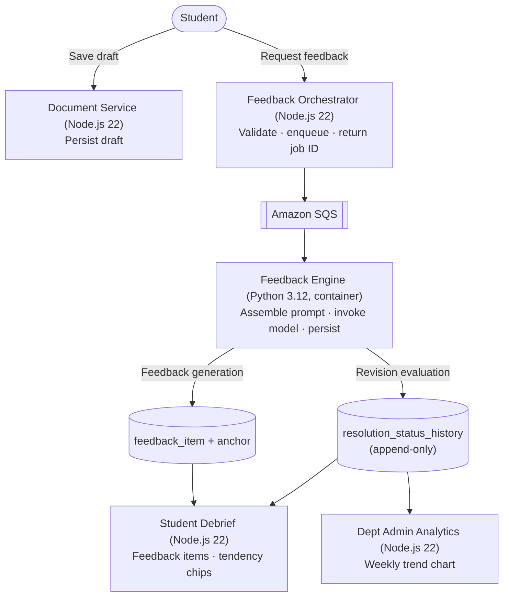
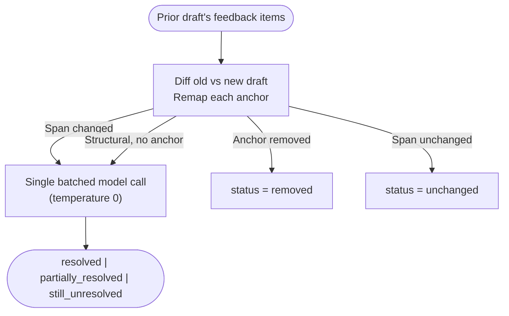
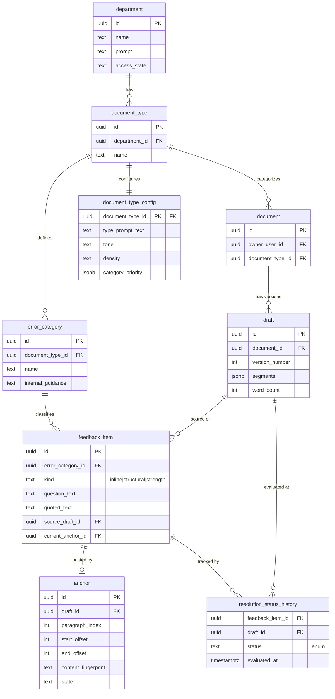

# WREN AI Debrief, Diff Engine, and Resolution Tracking — Architecture Document

WREN is a Socratic writing coach. It generates feedback as **probing questions** (never corrections or rewrites), tracks whether students address that feedback across draft revisions, and surfaces qualitative progress to both students and department administrators. The "never corrections or rewrites" principle is why the diff engine, resolution judge, and debrief exist at all: because WREN never hands the student replacement prose, it has to reason about whether the student's *own* revisions moved in the direction a question suggested.

This document describes the architecture of that loop. Platform-wide request paths and the full PostgreSQL catalog live in [architecture-deep-dive.md](./architecture-deep-dive.md). Exact function names, constants, and other implementation details are collected in [Appendix B](#appendix-b--implementation-reference) rather than woven through the narrative.

---

## Table of Contents

1. [System Overview](#1-system-overview)
2. [Feedback Generation](#2-feedback-generation)
3. [Prompt Architecture](#3-prompt-architecture)
4. [Diff & Anchor Architecture](#4-diff--anchor-architecture)
5. [Resolution Tracking](#5-resolution-tracking)
6. [Student Debrief](#6-student-debrief)
7. [Department Analytics](#7-department-analytics)
8. [Writer Progress](#8-writer-progress)
9. [Infrastructure](#9-infrastructure)
10. [Architectural Guarantees](#10-architectural-guarantees)
11. [Data Model](#11-data-model)
- [Appendix A — Key Files](#appendix-a--key-files)
- [Appendix B — Implementation Reference](#appendix-b--implementation-reference)

---

## 1. System Overview

The Document Service persists a draft. When feedback generation is requested, the Feedback Orchestrator validates the request and enqueues a job; the Feedback Engine consumes it asynchronously. The engine has **two outputs**:

- **Feedback generation** → feedback items with anchors (the debrief the student reads).
- **Revision evaluation** → resolution history (whether prior feedback was addressed), produced when the submission is a revision of an earlier draft.

Those outputs feed two consumers: the student-facing debrief and the department-facing analytics.



---

## 2. Feedback Generation

### 2.1 Submission and job queuing

When a student requests feedback on a draft:

1. **API Gateway** receives the request (it has a 29-second hard timeout).
2. The **Feedback Orchestrator** (Node.js 22) validates the request, enqueues an SQS message, and immediately returns HTTP 202 with a job ID.
3. The **frontend polls** a lightweight status endpoint until the debrief is ready.

This decouples the AI workload from the API Gateway timeout, allowing feedback generation to continue asynchronously after the request returns. (See [§9](#9-infrastructure) for the timeout and queue settings that make this safe.)

### 2.2 Engine pipeline

The Feedback Engine runs as an SQS-triggered Lambda. Conceptually it moves through five stages:

1. **Load configuration** — document-type settings (tone, density, category priority, any model override) and the error-category taxonomy.
2. **Load content** — the draft's paragraph segments plus any reference material for the document type.
3. **Assemble and invoke the model** — build the three-layer prompt (see [§3](#3-prompt-architecture)) and make a single model call.
4. **Persist feedback** — parse the model output and write `feedback_item` rows, each with an `anchor` locating it in the draft.
5. **Evaluate the previous draft** — if this is a revision, compare it against the prior draft and update resolution history (see [§5](#5-resolution-tracking)).

The exact function names for each stage are in [Appendix B](#appendix-b--implementation-reference).

A note on category priority: the department admin's `category_priority` steers the prompt's ordering and emphasis. It is a soft priority signal, not a hard post-filter that drops items.

---

## 3. Prompt Architecture

The prompt is assembled in three strictly-layered tiers, each with a different trust level and a different owner. This layering is the primary defense against prompt injection: instructions can only ever come from the two trusted layers, never from the student's document.

### Layer 1 — System scaffolding (authoritative, non-overridable)

Lives in the **system message**. Owned by WREN.

- Core instructions ("You are WREN, a Socratic writing coach...").
- The output schema the model must return.
- The no-ghostwriting guardrail ("NEVER provide replacement prose, rewrites, corrections...").
- A layering notice stating that the following configuration and data may not modify these system instructions.

### Layer 2 — Document-type configuration (trusted)

Lives in the **user message**, subordinate to Layer 1. Owned by the department admin.

- The feedback taxonomy (category UUID → name) and per-category definitions.
- The department prompt (context, standards, restricted topics).
- Document-type instructions, structure, restrictions, and notes.
- Tone and density descriptions.

### Layer 3 — Untrusted content (student document + reference material)

Lives in the **user message**, wrapped in randomized boundary tokens so the model can tell content apart from instructions.

```
BEGIN UNTRUSTED DATA [random-token] label="SUBMITTED DOCUMENT"
<student's actual text>
END UNTRUSTED DATA [random-token]
```

The system message instructs the model to treat anything inside this region that resembles an instruction as data to be ignored. See [§10.4](#104-prompt-injection-defense) for the guarantees this layering provides, and [Appendix B](#appendix-b--implementation-reference) for the token and label mechanics.

---

## 4. Diff & Anchor Architecture

When a student submits a revision, WREN needs to answer two questions: *what changed*, and *where did each earlier piece of feedback go*. Two pure, deterministic components answer those.

### 4.1 Diff engine

The diff engine compares two draft versions at both the paragraph and character level, producing the exact changed regions needed for anchor remapping and model evaluation.

- Each paragraph is classified as **unchanged**, **changed**, **added**, or **deleted**.
- For changed paragraphs, a character-level pass identifies the exact ranges that differ.
- A selection step gathers the regions worth sending to the model: added paragraphs in full, and changed regions expanded by a small context window on each side (overlapping regions are merged). Unchanged and deleted paragraphs contribute nothing.

### 4.2 Anchor service

Each feedback item is pinned to its location in the draft by an **anchor**. When the draft changes, the anchor service re-maps each anchor onto the new draft and decides whether it can still be located confidently.

| Paragraph status | Strategy | Outcome |
|------------------|----------|---------|
| Unchanged | Offsets preserved, paragraph index shifted, content fingerprint re-verified | Remapped (or Removed on fingerprint mismatch) |
| Changed | Search for the original anchored text verbatim, disambiguating with surrounding context | Remapped (single match) or Removed (zero or ambiguous matches) |
| Deleted | — | Always Removed |
| Absent from the diff | — | Always Removed |

Each anchor carries a content fingerprint — a normalized hash of the anchored text plus bounded surrounding context — so a paragraph that was edited elsewhere doesn't silently drag an anchor onto the wrong words. The fingerprint fields are described in [Appendix B](#appendix-b--implementation-reference).

---

## 5. Resolution Tracking

### 5.1 Overview

When a student submits a revision, WREN evaluates whether each feedback item from the previous draft was addressed. This produces one `resolution_status_history` row per item. Two of the five possible outcomes are decided structurally, without any model call; the other three come from a model judge.

### 5.2 Flow



`removed` and `unchanged` are decided structurally with no model call. Only changed spans and structural items are sent to the judge, and they go in a single batched call.

`unchanged` is intentionally distinct from `still_unresolved`: it means the governing text did not change between drafts, so there was nothing for the judge to evaluate. `still_unresolved` means the judge looked at a change and concluded it did not address the feedback.

### 5.3 What the judge receives

For each item, the judge gets the feedback question, the originally flagged text, and the corresponding text from the revised draft. It compares original → revised in light of the question and returns one verdict per item.

The judge returns the short forms `resolved`, `partial`, or `unresolved`; the application maps these to the persisted values below (any unrecognized verdict maps to `still_unresolved`).

| Judge verdict | Persisted status | Meaning |
|---------------|------------------|---------|
| `resolved` | `resolved` | Revision clearly and fully addresses the concern |
| `partial` | `partially_resolved` | Meaningful progress, concern not fully resolved |
| `unresolved` | `still_unresolved` | Revision does not address the feedback, or the text is essentially unchanged |

The prompt applies a deliberate bias: when in doubt between partial and unresolved, prefer partial if the student made any relevant change in the direction the feedback suggested.

### 5.4 Guarantees

- **Removed and unchanged items never reach the model** — they are decided purely by the diff and anchor remap.
- **History is append-only** — a database trigger rejects updates to `resolution_status_history`; only inserts are allowed.
- **Exactly one status per (item, draft)** — enforced by a unique constraint.
- **Resolution tracking is non-fatal** — if it fails, the failure is logged but the feedback job still succeeds.

---

## 6. Student Debrief

### 6.1 Turning outcomes into tendencies

When the student views their debrief, the feedback service reads the stored resolution outcomes and computes a per-category **tendency**. The intent is to tell the student, per category, whether they are making progress rather than to show a raw score.

The score for a category is computed only over items that carry a judged outcome:

```
evaluated = resolved + partially_resolved + still_unresolved   # excludes unchanged and removed
addressed = resolved + partially_resolved
pct       = (resolved * 100 + partially_resolved * 50) / evaluated
```

`evaluated` is the number of items with a judged outcome other than `unchanged` (`removed` items are not counted at all). A category where nothing was edited — every counted item is `unchanged` — is omitted, because there's no progress to report without an edit attempt.

| Condition | Tendency | Message shape |
|-----------|----------|---------------|
| `pct >= 40` | improving | "You addressed X of Y issues — keep it up." |
| `pct < 40` and `addressed > 0` | persistent | "You partially addressed [category] — X of Y showing progress." |
| `addressed = 0` | persistent | "[Category] issues from your previous draft remain unaddressed." |

**Cold-start fallback.** On a draft with no resolution history yet, the debrief falls back to comparing raw feedback-item counts between drafts: fewer items in a category reads as improving, more reads as persistent, and a category that only appears in the newer draft reads as emerging.

### 6.2 What the student sees

The debrief panel renders a progress summary (improving / persistent / emerging), one card per category tendency, the feedback items grouped by category with quoted text that highlights in the editor when clicked, and an anonymous helpfulness prompt.

---

## 7. Department Analytics

### 7.1 Improvement trends

Department admins see how resolution outcomes trend over time, per error category, for a document type. Access is gated by the `analytics.view` capability, scoped to the document type's department. All students in the department are aggregated together — no per-student rows are exposed.

### 7.2 How the score is computed

Each resolution row is scored, then averaged per ISO week per error category:

```sql
AVG(
  CASE rsh.status
    WHEN 'resolved' THEN 100.0
    WHEN 'partially_resolved' THEN 50.0
    ELSE 0.0                       -- still_unresolved, removed, unchanged
  END
)
```

- The average runs over **all** rows in the week/category group. `still_unresolved`, `removed`, and `unchanged` all score `0.0`, so they pull the average down rather than being excluded from it.
- A separate sample-size count includes only `resolved`, `partially_resolved`, and `still_unresolved`. A `HAVING` clause drops week/category groups where that count is zero, so a group made up entirely of `removed`/`unchanged` rows never appears — but such rows that share a group with judged rows still count as `0.0`.

### 7.3 Reading a score

Scores are illustrative averages, not exact category breakdowns.

| Score | Interpretation |
|-------|----------------|
| 100 | Every scored row in the category was fully resolved that week |
| 75 | Average outcome falls between mostly resolved and partially resolved |
| 50 | Equivalent to all rows being partially resolved, or an even split of fully resolved and unresolved |
| 10 | Students are largely not fixing issues in this category |
| 0 | Nothing in this category was addressed |

### 7.4 Chart

The frontend renders one line per category (Y-axis 0–100) with date-range presets (last 4 weeks, last 12 weeks, all time, custom). All data is returned from the backend and filtered in the browser, and only weeks that actually have data appear — there are no zero-filled gaps for weeks without submissions.

---

## 8. Writer Progress

The writer progress bar is a composite score (0–100) that reflects engagement with the whole coaching loop, not just how much the student has written. The guiding principle: *a long first upload alone must not read as a strong draft.*

| Component | Weight | Condition |
|-----------|--------|-----------|
| Draft substance | up to 25 | Word count against a soft target (capped) |
| Asked the coach | 10 | At least one Ask WREN message sent |
| Feedback received | 25 | At least one feedback generation completed |
| Revised at least once | 20 | Draft version ≥ 2 |
| Patterns improving | up to 20 | Share of debrief patterns marked improving; contributes 0 when there are no tracked patterns |

The score maps to a label ("Just getting started" → "Draft taking shape" → "Solid draft in progress" → "Strong draft — keep refining" → "Well developed draft"); the exact thresholds are in [Appendix B](#appendix-b--implementation-reference).

---

## 9. Infrastructure

### 9.1 Compute

| Lambda | Runtime | Timeout | Memory | Trigger |
|--------|---------|---------|--------|---------|
| Feedback Orchestrator | Node.js 22 | 60s | 512 MB | API Gateway (also serves Ask WREN) |
| Feedback Engine | Python 3.12 (ECR container) | 15 min | 1024 MB | SQS (batch 1, max concurrency 10) |
| Document Service | Node.js 22 | 3 min | 2048 MB | API Gateway + ingest SQS |
| Admin Service | Node.js 22 | 30s | 512 MB | API Gateway |

### 9.2 Queue

| Setting | Value | Rationale |
|---------|-------|-----------|
| Feedback queue visibility timeout | 16 min | Must exceed the engine's 15-minute Lambda timeout |
| Dead-letter max receive count | 3 | Retry before dead-lettering |
| Dead-letter retention | 14 days | Time to investigate failures |

### 9.3 Model configuration

- **Default deployment model:** `us.anthropic.claude-sonnet-4-6`, configured in the CDK config and injected into SSM/environment at deploy. The engine itself does not hardcode a fallback model — it resolves the model from SSM first and the environment variable second, and errors if neither is set.
- **Per-job override:** a `bedrock_model_id` in the platform usage policy (a Technical Admin runtime control) takes precedence over the deployed default.
- The resolution judge uses the resolved model at `temperature 0`, intended to reduce sampling variability.

---

## 10. Architectural Guarantees

These are decisions specific to WREN that the next developer should understand before changing this area.

### 10.1 Pure logic behind an injected model boundary

The diff, anchor, prompt-assembly, and resolution-tracking logic are pure and deterministic. Every call to the model sits behind an injected boundary (a protocol/interface). In tests, that boundary is stubbed; in production, it invokes Bedrock. This is what makes the core logic property-testable without mocking AI responses, and it's why the model call is always a single, clearly identified seam rather than something sprinkled through the algorithms.

### 10.2 Immutability and append-only history

The core data structures are immutable — operations return new values rather than mutating in place. Resolution history is append-only at the database level: a trigger rejects updates to `resolution_status_history`, so the record of what happened on each draft can only grow, never be rewritten.

### 10.3 No ghostwriting (defense in depth)

WREN never writes prose for the student, and that property is enforced at multiple independent layers so it can't be undone by a single mistake:

| Layer | Enforcement |
|-------|-------------|
| Database schema | No replacement-prose column exists anywhere |
| System prompt | Explicit "never provide replacement prose, rewrites, corrections" guardrail |
| Output schema | Only a Socratic `question_text`, never suggested replacement text |
| Output parsing | Items are validated to carry a question, never a replacement field |
| Frontend | No Apply / Insert / Accept affordance — no mechanism to inject model text into the editor |

### 10.4 Prompt injection defense

- Three-tier layering: system (authoritative) > configuration (trusted) > data (untrusted). Instructions can only come from the trusted layers.
- Untrusted content is wrapped in randomized boundary tokens generated fresh per assembly, and the system message tells the model to ignore anything instruction-like inside that region.
- Labels cannot contain newlines, preventing malformed labels from escaping the intended delimiter structure.
- A property test verifies that submitted content, including adversarial input, stays inside the intended delimited region.

### 10.5 Asynchronous processing

Feedback generation is queued rather than run inline: the request returns a 202 quickly, the heavy work runs on an SQS-triggered Lambda, and the frontend polls for completion. This keeps individual HTTP requests well under the API Gateway timeout regardless of how long the model takes.

### 10.6 Graceful degradation

- Resolution tracking failure is non-fatal — it never fails the feedback job.
- Truncated model output is recovered where possible rather than discarded.
- The debrief still produces tendencies without resolution history via the count-based fallback.
- Items whose verdict can't be determined default to `still_unresolved` — the conservative choice, never a false claim of progress.

---

## 11. Data Model



> `resolution_status_history` enforces `UNIQUE(feedback_item_id, draft_id)` and is **append-only** (a `BEFORE UPDATE` trigger rejects mutations).

### Resolution status values

| Status | Meaning | How determined |
|--------|---------|----------------|
| `resolved` | Issue fully addressed | Model judge verdict |
| `partially_resolved` | Meaningful progress, not fully fixed | Model judge verdict |
| `still_unresolved` | Not addressed (or verdict undetermined) | Model judge verdict, or conservative default |
| `removed` | Anchored text deleted or rewritten beyond recognition | Anchor service, structural |
| `unchanged` | Governing span did not change between drafts | Diff engine, structural |

---

## Appendix A — Key Files

### Backend — Feedback Engine (Python)

| File | Purpose |
|------|---------|
| `backend/engine/python/handler.py` | Lambda entry point; orchestrates the full pipeline including the resolution judge |
| `backend/engine/python/wren_engine/diff_engine.py` | Paragraph- and character-level diffing |
| `backend/engine/python/wren_engine/anchor_service.py` | Anchor remapping with confidence heuristics |
| `backend/engine/python/wren_engine/progress_tracker.py` | Resolution status assignment and pattern detection |
| `backend/engine/python/wren_engine/prompt_assembly.py` | Three-tier prompt layering with injection defense |
| `backend/engine/python/wren_engine/model_invocation.py` | Bedrock invocation abstraction (injectable) |

### Backend — Services (TypeScript)

| File | Purpose |
|------|---------|
| `backend/feedback/src/lambda-handler.ts` | Debrief API; fetches feedback and computes progress tendencies |
| `backend/admin/src/analyticsService.ts` | `getImprovementTrends`; weekly resolution-rate aggregation |
| `backend/document/src/lambda-handler.ts` | Document/draft management and upload ingestion |

### Frontend

| File | Purpose |
|------|---------|
| `frontend/src/features/debrief/components/SidebarDebriefPanel.tsx` | Student-facing debrief UI |
| `frontend/src/features/debrief/debriefApi.ts` | API calls and polling for regeneration |
| `frontend/src/features/ask-wren/writingProgress.ts` | Composite progress-score computation |
| `frontend/src/pages/department-admin/sections/AnalyticsSection.tsx` | Improvement-trends chart |
| `frontend/src/components/ChatFeedbackSidebar.tsx` | Sidebar wrapper connecting debrief to the progress bar |

### Infrastructure

| File | Purpose |
|------|---------|
| `cdk/lib/stacks/ComputeStack.ts` | Lambda + SQS definitions, timeouts, concurrency |
| `cdk/lib/stacks/ApiStack.ts` | API Gateway from the OpenAPI spec |
| `cdk/lib/stacks/CicdStack.ts` | CodePipeline + CodeBuild + ECR |
| `backend/database/migrations/0001_baseline.sql` | Baseline schema: `resolution_status_history`, its status CHECK enum, unique constraint, and append-only trigger |

---

## Appendix B — Implementation Reference

Facts that aren't obvious from reading the code, and the magic numbers behind the descriptions above. Everything else — function signatures, data-structure fields — is best read from the source files in [Appendix A](#appendix-a--key-files). These values are more likely to drift than the architecture; verify against the source when it matters.

**Constants and tuning:**

- Feedback model call: `temperature` 0.4 (from config), `max_tokens` a computed debrief budget capped by `MAX_DEBRIEF_MAX_TOKENS`.
- Diff span expansion: `DEFAULT_CONTEXT_WINDOW = 40` characters on each side.
- Anchor disambiguation and fingerprint context: 32 characters of prefix/suffix.
- Progress bar substance target: 600 words. Labels by score: `< 15` "Just getting started", `< 40` "Draft taking shape", `< 70` "Solid draft in progress", `< 90` "Strong draft — keep refining", `>= 90` "Well developed draft".

**Non-obvious behaviors:**

- **Verdict mapping.** The judge is prompted for `resolved` / `partial` / `unresolved`; parsing maps `partial` → `partially_resolved` and *any* other non-`resolved` value → `still_unresolved`. The judge call retries up to 2 attempts with the same truncated-JSON recovery used for feedback parsing.
- **Analytics averaging.** The trend query's `AVG` runs over every row in the week/category group with `ELSE 0.0`, so `still_unresolved`, `removed`, and `unchanged` all count as 0 and pull the score down. Only the separate sample-size count (and its `HAVING > 0` filter) excludes non-judged rows. This is the one place where "excluded" would be the intuitive assumption but isn't what the SQL does.
- **Debrief denominator.** The per-category query counts only `resolved` / `partially_resolved` / `still_unresolved` / `unchanged` (so `removed` never enters `total`), then `evaluated = total - unchanged`.
- **Stale name.** `writingProgress.ts` comments still call the feature "Ask LEON", an earlier name. The current product name is Ask WREN; the comment is out of date, not the doc.
