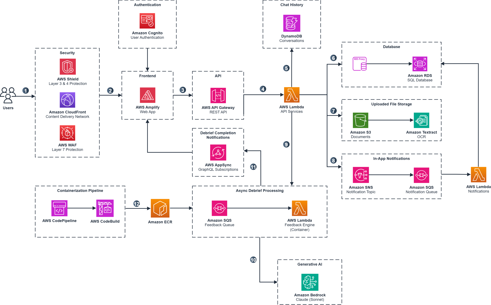
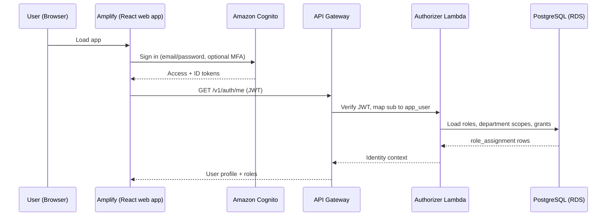
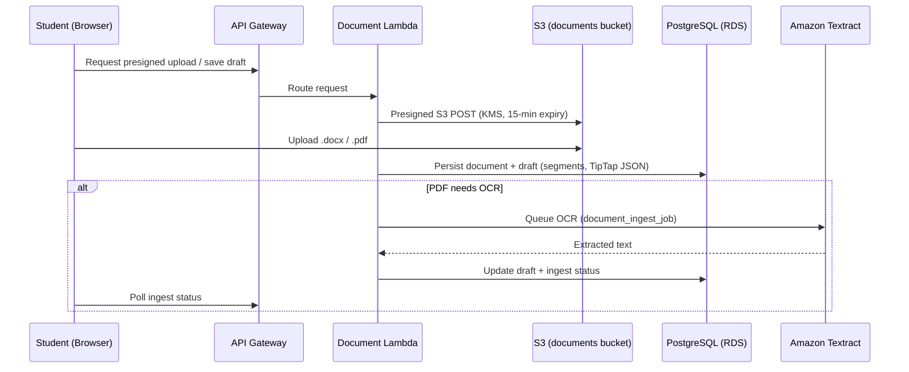
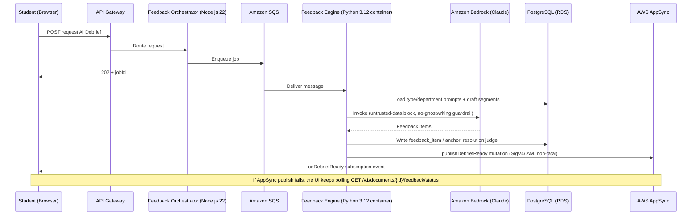
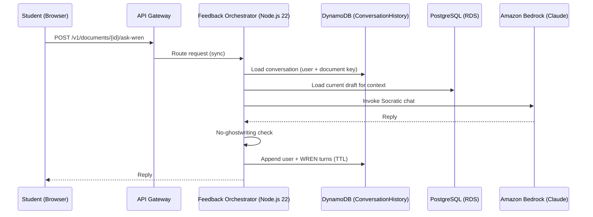
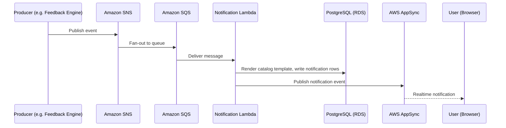
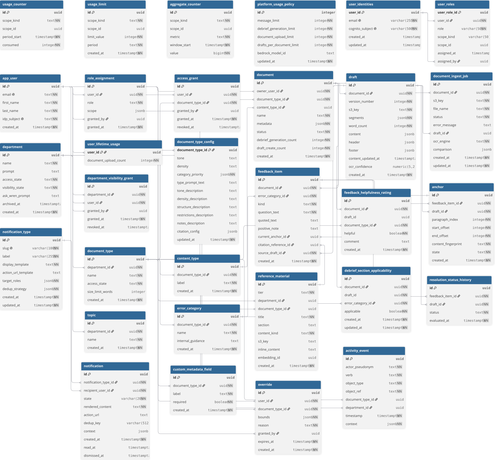

# Architecture Deep Dive

> **Type:** Technical Reference
>
> **Project:** WREN Writing Coach

## Table of Contents

- [Overview](#overview)
- [Component Breakdown](#component-breakdown)
  - [Edge and Security](#edge-and-security)
  - [Frontend Hosting](#frontend-hosting)
  - [Authentication](#authentication)
  - [API Layer](#api-layer)
  - [Real-time Events](#real-time-events)
  - [Data Persistence](#data-persistence)
  - [Object Storage](#object-storage)
  - [AI Services](#ai-services)
  - [Feedback Engine](#feedback-engine)
  - [Notifications](#notifications)
  - [Usage Limits and Quotas](#usage-limits-and-quotas)
- [Service Lambdas](#service-lambdas)
- [Data Flow Diagrams](#data-flow-diagrams)
  - [Sign-in Flow](#sign-in-flow)
  - [Draft / Upload Flow](#draft--upload-flow)
  - [AI Debrief Flow](#ai-debrief-flow)
  - [Ask WREN Flow](#ask-wren-flow)
  - [Notification Flow](#notification-flow)
- [Database Schema](#database-schema)
  - [Non-Postgres Stores](#non-postgres-stores)
  - [RDS PostgreSQL Tables](#rds-postgresql-tables)
  - [Enums and Constrained Values](#enums-and-constrained-values)
  - [Invariants (Schema-Enforced)](#invariants-schema-enforced)
- [Entity Relationships](#entity-relationships)
- [Cross-References](#cross-references)

## Overview

WREN is a Socratic writing coach for higher education. Students draft or upload documents, request an **AI Debrief** that returns probing questions (never rewrites or corrections), and track whether they address that feedback across draft revisions. The platform is built on AWS with CDK for infrastructure-as-code: a React web app on AWS Amplify, REST APIs on API Gateway backed by per-service Node.js 22 Lambdas, two Python 3.12 Lambdas (the Feedback Engine container for Bedrock inference and a Diff/Anchor/Progress function for pure-logic diff and resolution), and real-time events over AWS AppSync. **Amazon RDS PostgreSQL 16** is the system of record for users, departments, documents, immutable drafts, Socratic feedback, analytics, and in-app notifications, while **Amazon DynamoDB** holds Ask WREN conversation history.

The architecture is **region-portable**: persistent data (RDS, S3, DynamoDB) stays in whichever Region you deploy, with no cross-region replication by default (CloudFront is a global CDN). Region-specific deploy steps belong in the [deployment guide](./deployment-guide.md). For the debrief / diff / anchor pipeline in depth, see [DEBRIEF_ARCHITECTURE_DEEP_DIVE.md](./DEBRIEF_ARCHITECTURE_DEEP_DIVE.md).



## Component Breakdown

### Edge and Security

Optional API traffic passes through **Amazon CloudFront** (global CDN), where a **CloudFront-scoped AWS WAF** WebACL (AWS managed rule groups — Common, Known Bad Inputs, IP Reputation — plus a rate-based rule of 2000 requests per 5-minute window per IP) applies, and **AWS Shield Standard** is automatically in effect. CloudFront redirects HTTP to HTTPS and attaches security headers (CSP, HSTS, X-Frame-Options DENY, and others). Callers may also use the regional API Gateway stage URL directly; that path is authenticated but is **not** behind this WAF (the WebACL is CloudFront-scoped only). There is no Lambda@Edge and no CloudFront Functions in this stack.

### Frontend Hosting

The **React web app** is hosted on **AWS Amplify**, which auto-builds on push. The app uses a TipTap editor for drafting and communicates with the backend via REST and AWS AppSync subscriptions.

### Authentication

Users sign in with **Amazon Cognito** (email and password; optional MFA). Access and ID tokens expire after a configured lifetime (refresh tokens last longer); that is session duration, not request throttling. First login provisions an `app_user` (default **Student**). The Cognito **`SystemAdmin`** group seeds **TechnicalAdmin** on first login only; afterward **PostgreSQL** (`role_assignment`) is the authorization source of truth. A **Lambda authorizer** verifies the JWT and attaches roles, department scopes, and access grants; each service Lambda **re-checks** capabilities and document ownership.

### API Layer

The React app talks to **API Gateway** (a regional OpenAPI `SpecRestApi`) for CRUD and coaching APIs. Stage **throttling** is set on the API Gateway stage (rate limit 100, burst 200). REST routes integrate to the per-service Lambdas listed under [Service Lambdas](#service-lambdas).

### Real-time Events

Realtime debrief-ready and notification events use **AWS AppSync** (GraphQL subscriptions over WebSocket). When AppSync is not configured, the UI falls back to polling REST status endpoints such as `GET /v1/documents/{id}/feedback/status`.

### Data Persistence

Application Lambdas run in **private VPC subnets** and reach PostgreSQL through **RDS Proxy** (`requireTLS`) with TLS enforced on the instance (`rds.force_ssl = 1`). Each Lambda uses a dedicated Postgres role and Secrets Manager secret (`wren_document`, `wren_admin`, `wren_feedback_engine`, `wren_feedback_orch`, `wren_appsync_auth`, and so on), and is granted read access to only its own secret. **Amazon RDS PostgreSQL 16** (engine 16.13, isolated subnets, storage encrypted) is the system of record for users, departments, documents, immutable drafts, Socratic feedback, analytics aggregates, and in-app notifications. **pgvector** is enabled via SQL migration so embeddings can be stored later. Coaching is generated from the student's submitted draft plus department/type prompts.

**Amazon DynamoDB** stores **Ask WREN** conversation history in `{prefix}-ConversationHistory`. The partition key is `sessionId`, which is the composite `{userId}#{documentId}`, so a conversation is scoped to a user + document and survives draft regenerations and resubmits. Items carry a `ttl`.

### Object Storage

Writers upload `.docx`/`.pdf` via a **presigned S3 POST** (KMS, 15-minute expiry) or paste into the TipTap editor. Document bytes live in the documents bucket; reference material uses a second bucket.

### AI Services

**Amazon Bedrock** (Claude) backs both AI Debrief generation and Ask WREN chat. The active model id lives in **AWS Systems Manager Parameter Store** and can be overridden per job by `platform_usage_policy.bedrock_model_id`. Admin-submitted prompt fields are screened before save with a Bedrock **Guardrail** via `ApplyGuardrail`, backed by a save-time no-ghostwriting check ([bedrock-guardrails.md](./bedrock-guardrails.md)). Department Admins configure document types, error categories, and prompts in RDS; Technical Admins set the platform usage policy.

### Feedback Engine

Requesting an AI Debrief hits the **Feedback Orchestrator**, which returns **202** with a `jobId` and enqueues **Amazon SQS**. The **Feedback Engine** (Python 3.12 container Lambda from ECR, up to 15 minutes) loads type/department prompts, wraps student text in an untrusted-data block, invokes **Amazon Bedrock** (Claude), applies the no-ghostwriting output guardrail, writes `feedback_item` / `anchor` rows, and runs a **resolution judge** (`judge_resolutions_with_llm`) against prior items. When the job commits, the engine publishes a `publishDebriefReady` mutation to AppSync via SigV4/IAM; that publish is non-fatal, so the UI's REST polling fallback still completes the job if it fails. A **DLQ** (`maxReceiveCount` 3) catches poison messages.

### Notifications

A finished debrief triggers two separate mechanisms. The [Feedback Engine](#feedback-engine) publishes `publishDebriefReady` directly to AppSync (SigV4/IAM) as a transient "your debrief is ready" signal so the open editor refreshes; it persists nothing. Independently, producers publish to an **SNS** topic; the **Notification Lambda** (SNS → SQS → Lambda) renders catalog templates and writes durable `notification` rows for the bell/inbox, then pushes an AppSync notification event. Override expiry is scanned on an EventBridge schedule.

### Usage Limits and Quotas

Request capacity and product quotas are separate from login sessions:

- **AWS WAF** on CloudFront can rate-limit by IP (edge protection).
- **API Gateway stage throttling** (rate 100, burst 200) limits request rate to protect backends.
- **Application usage caps** (`platform_usage_policy`, `usage_limit`, `usage_counter`) enforce product limits such as debrief generations or uploads; the client sees `429 USAGE_LIMIT_REACHED`.

Helpfulness ratings and section applicability votes are stored **without `user_id`** for aggregate analytics. **Activity events** are append-only and have **no FK** to documents, so they survive document deletion (pseudonymous actor ids).

## Service Lambdas

REST routes in OpenAPI integrate to the Lambdas below. AI Debrief requests are handled by the Feedback Orchestrator (enqueue) and Feedback Engine (Bedrock + persist). Each function's IAM role grants only the AWS APIs it needs (S3, Bedrock, SQS, SNS, SSM, Secrets Manager, Textract, AppSync IAM publish). End-user API access is Cognito JWT, not caller IAM.

| Function | Runtime | Kind | Business logic |
| --- | --- | --- | --- |
| **Authorizer** | Node.js 22 | REST | Verify Cognito JWT; map `sub` to `app_user`; attach roles, department scopes, access grants |
| **AppSync Authorizer** | Node.js 22 | GraphQL | Same identity mapping for realtime subscriptions |
| **Document** | Node.js 22 | REST + SQS ingest | Document/draft CRUD, presigned S3 upload, PDF OCR via Textract |
| **Admin** | Node.js 22 | REST | Departments, document types, prompts, users/roles, platform usage policy; Bedrock prompt-attack scan on save |
| **Audit** | Node.js 22 | REST | Activity events and aggregate analytics |
| **Feedback Orchestrator** | Node.js 22 | REST | **AI Debrief:** accept request, return 202, enqueue SQS. **Ask WREN:** chat turns via Bedrock + DynamoDB |
| **Feedback Engine** | Python 3.12 (container) | SQS, container image from ECR | Load prompts, invoke Bedrock, no-ghostwriting guardrail, write `feedback_item` / `anchor` |
| **Diff / Anchor / Progress** | Python 3.12 | Invoked from engine | Diff drafts, remap anchors, resolution judge |
| **Notification** | Node.js 22 | SQS (from SNS) + REST + EventBridge | Render notification catalog templates, write `notification` rows, publish AppSync; scheduled override-expiry scan |

## Data Flow Diagrams

### Sign-in Flow



### Draft / Upload Flow



### AI Debrief Flow



### Ask WREN Flow



### Notification Flow



## Database Schema

Relational schema is applied by forward-only SQL in `backend/database/migrations/` (see [migrations README](../backend/database/migrations/README.md)). The earlier per-feature migrations were squashed into a single idempotent `0001_baseline.sql`; a fresh database is built from that file, and further changes are added as new numbered files. Names below use the current **V4 terminology** (`department`, `document_type`); the pre-V4 `organization` / `writing_type` names no longer appear as tables, though some legacy constraint/index identifiers still carry the old names (for example `writing_type_pkey`, `organization_pkey`).

The tables and FKs define the relational schema; per-table definitions and an [Entity Relationships](#entity-relationships) summary follow the diagram.



The diagram is generated from [`wren-schema.dbml`](./wren-schema.dbml) via [dbdiagram.io](https://dbdiagram.io) and covers every relational table, its columns/types, and the FK relationships (with delete behavior) from `0001_baseline.sql`. It excludes the DynamoDB Ask WREN store, which is not relational. Regenerate it by editing the DBML, re-importing into dbdiagram.io, and re-exporting `WREN-Schema.svg`.

### Non-Postgres Stores

| Store | Contents |
| --- | --- |
| S3 documents bucket | Upload objects, draft bytes (`draft.s3_key`) |
| S3 reference bucket | Reference material files |
| DynamoDB `{prefix}-ConversationHistory` | Ask WREN messages (`sessionId`, `ttl`) |
| Cognito | Passwords, MFA, `SystemAdmin` group — not app roles after first login |
| Systems Manager Parameter Store | Bedrock model id and other non-secret runtime config |

---

### RDS PostgreSQL Tables

### Core User and Auth Tables

#### `app_user` table

Global user. Not owned by a department.

| Column | Type | Description |
| --- | --- | --- |
| `id` | uuid (PK) | Unique identifier |
| `email` | text (UNIQUE) | Login email |
| `first_name` | text | Given name |
| `last_name` | text | Family name |
| `idp_subject` | text (UNIQUE) | Cognito `sub` (authentication mapping only) |
| `created_at` | timestamptz | Account creation timestamp |

#### `role_assignment` table

Authorization source of truth. Roles: `Student`, `DepartmentAdmin`, `TechnicalAdmin`.

| Column | Type | Description |
| --- | --- | --- |
| `id` | uuid (PK) | Unique identifier |
| `user_id` | uuid (FK → `app_user`) | Cascade delete |
| `role` | text | Assigned role (see enum) |
| `scope` | jsonb | e.g. `{ "departmentIds": [...] }` for Department Admin |
| `granted_by` | uuid (FK → `app_user`) | Set null on delete |
| `granted_at` | timestamptz | When the role was granted |

#### `user_identities` / `user_roles` tables

A parallel identity mapping (`cognito_subject`, scoped `user_roles`). `user_roles` FKs reference `user_identities(user_id)`, not `app_user`. Runtime identity for the authorizer is **`app_user` + `role_assignment`**, so these tables are not on the hot authorization path.

#### `access_grant` table

Associates a student with a **LOCKED** document type (no ownership of the type).

| Column | Type | Description |
| --- | --- | --- |
| `id` | uuid (PK) | Unique identifier |
| `user_id` | uuid (FK → `app_user`) | Cascade delete |
| `document_type_id` | uuid (FK → `document_type`) | Cascade delete |
| `granted_by` | uuid (FK → `app_user`) | Set null on delete |
| `granted_at` | timestamptz | Grant time |
| `revoked_at` | timestamptz | Null while active |

---

### Department and Document Type Catalog

#### `department` table

Grouping for document types and Department Admins. Not a tenant that owns users.

| Column | Type | Description |
| --- | --- | --- |
| `id` | uuid (PK) | Unique identifier |
| `name` | text | Display name |
| `prompt` | text | Technical Admin department-level coaching instructions |
| `access_state` | text | `OPEN` or `LOCKED` (student self-serve vs grant required) |
| `visibility_state` | text | `VISIBLE` or `PERMITTED_ONLY` (catalog discovery; see `department_visibility_grant`) |
| `ask_wren_prompt` | text | Optional department-level Ask WREN prompt (nullable) |
| `archived_at` | timestamptz | Soft-delete timestamp; null = active |
| `created_at` | timestamptz | Creation time |

#### `department_visibility_grant` table

Explicit catalog **discovery** permission for `PERMITTED_ONLY` departments (never submission access). A grant is active while `revoked_at` is null; revocation is a soft-delete.

| Column | Type | Description |
| --- | --- | --- |
| `id` | uuid (PK) | Unique identifier |
| `department_id` | uuid (FK → `department`) | Cascade delete |
| `user_id` | uuid (FK → `app_user`) | Cascade delete |
| `granted_by` | uuid (FK → `app_user`) | Set null on delete |
| `granted_at` | timestamptz | Grant time |
| `revoked_at` | timestamptz | Null while active |

#### `document_type` table

Configurable document type (data, not a hardcoded enum).

| Column | Type | Description |
| --- | --- | --- |
| `id` | uuid (PK) | Unique identifier |
| `department_id` | uuid (FK → `department`) | Cascade delete |
| `name` | text | Type name (e.g. legal memo) |
| `access_state` | text | `OPEN` or `LOCKED` |
| `size_limit_words` | integer | Optional word cap (null = inherit) |
| `created_at` | timestamptz | Creation time |

#### `document_type_config` table

1:1 config used by the Feedback Engine.

| Column | Type | Description |
| --- | --- | --- |
| `document_type_id` | uuid (PK, FK → `document_type`) | Cascade delete |
| `tone` | text | Tone hint |
| `density` | text | Density hint |
| `category_priority` | jsonb | Ordered error-category ids |
| `type_prompt_text` | text | Department Admin type prompt |
| `tone_description` | text | Tone guidance |
| `density_description` | text | Density guidance |
| `structure_description` | text | Structure prompt section |
| `restrictions_description` | text | Restrictions section |
| `notes_description` | text | Notes section |
| `citation_config` | jsonb | Citation/footnote style |
| `updated_at` | timestamptz | Last config change (carry-forward invalidation) |

#### `error_category` table

Configurable taxonomy. Feedback links by **id** so renames keep history.

| Column | Type | Description |
| --- | --- | --- |
| `id` | uuid (PK) | Unique identifier |
| `document_type_id` | uuid (FK → `document_type`) | Cascade delete |
| `name` | text | Category name (unique per type) |
| `internal_guidance` | text | Engine aid; **never** shown to students |
| `created_at` | timestamptz | Creation time |

#### `content_type` table

| Column | Type | Description |
| --- | --- | --- |
| `id` | uuid (PK) | Unique identifier |
| `document_type_id` | uuid (FK → `document_type`) | Cascade delete |
| `label` | text | Label (e.g. memo, brief) |
| `created_at` | timestamptz | Creation time |

#### `custom_metadata_field` table

| Column | Type | Description |
| --- | --- | --- |
| `id` | uuid (PK) | Unique identifier |
| `document_type_id` | uuid (FK → `document_type`) | Cascade delete |
| `label` | text | Field label |
| `required` | boolean | Whether required at submit |
| `created_at` | timestamptz | Creation time |

#### `topic` table

Business labels for organizing work; does not drive taxonomy.

| Column | Type | Description |
| --- | --- | --- |
| `id` | uuid (PK) | Unique identifier |
| `department_id` | uuid (FK → `department`) | Cascade delete |
| `name` | text | Topic name |
| `created_at` | timestamptz | Creation time |

#### `reference_material` table

Two-tier sources the engine may cite.

| Column | Type | Description |
| --- | --- | --- |
| `id` | uuid (PK) | Unique identifier |
| `tier` | text | `department` or `type` |
| `department_id` | uuid (FK → `department`) | Set for department-tier rows; cascade delete |
| `document_type_id` | uuid (FK → `document_type`) | Set for type-tier rows; cascade delete |
| `title` | text | Title |
| `section` | text | Optional section |
| `content_kind` | text | `file`, `text`, or `html` |
| `s3_key` | text | Object key when `file` |
| `inline_content` | text | Inline text/html |
| `embedding_id` | uuid | Optional pointer toward a vector row |
| `created_at` | timestamptz | Creation time |

---

### Document, Draft, and Ingest Tables

#### `document` table

Owned by a student; scoped to a document type.

| Column | Type | Description |
| --- | --- | --- |
| `id` | uuid (PK) | Unique identifier |
| `owner_user_id` | uuid (FK → `app_user`) | Cascade delete |
| `document_type_id` | uuid (FK → `document_type`) | Restrict delete |
| `content_type_id` | uuid (FK → `content_type`) | Set null on delete |
| `name` | text | Document name |
| `metadata` | jsonb | Custom field values |
| `status` | text | e.g. `Still Drafting`, `Polishing` |
| `debrief_generation_count` | integer | Lifetime debrief jobs (survives item replace) |
| `draft_create_count` | integer | Lifetime draft creates (survives draft delete) |
| `created_at` | timestamptz | Creation time |

#### `draft` table

Versioned snapshot. Identity, `s3_key`, and `segments` are immutable; autosave may update TipTap `content` / `word_count` / header / footer.

| Column | Type | Description |
| --- | --- | --- |
| `id` | uuid (PK) | Unique identifier |
| `document_id` | uuid (FK → `document`) | Cascade delete |
| `version_number` | integer | Monotonic version (≥ 1), unique per document |
| `s3_key` | text | S3 object for full content |
| `segments` | jsonb | Paragraph list (diff/anchor substrate) |
| `word_count` | integer | Word count |
| `content` | jsonb | TipTap JSON body |
| `header` | jsonb | TipTap JSON header |
| `footer` | jsonb | TipTap JSON footer |
| `content_updated_at` | timestamptz | Last autosave time |
| `ocr_confidence` | numeric(5,2) | Mean OCR confidence for scanned PDFs (nullable) |
| `created_at` | timestamptz | Version creation time |

#### `document_ingest_job` table

Async PDF ingest (API Gateway vs OCR timeout).

| Column | Type | Description |
| --- | --- | --- |
| `id` | uuid (PK) | Unique identifier |
| `document_id` | uuid (FK → `document`) | Cascade delete |
| `s3_key` | text | Source object |
| `file_name` | text | Original filename |
| `status` | text | `queued`, `processing`, `completed`, `failed` |
| `error_message` | text | Failure detail |
| `draft_id` | uuid (FK → `draft`) | Resulting draft when complete; set null on delete |
| `ocr_engine` | text | Default `textract` |
| `comparison` | jsonb | Optional comparison payload |
| `created_at` | timestamptz | Creation time |
| `updated_at` | timestamptz | Last update time |

---

### Feedback and Resolution Tables

#### `feedback_item` table

Socratic item.

| Column | Type | Description |
| --- | --- | --- |
| `id` | uuid (PK) | Unique identifier |
| `document_id` | uuid (FK → `document`) | Cascade delete |
| `error_category_id` | uuid (FK → `error_category`) | Restrict delete, so linkage survives category renames |
| `kind` | text | `inline`, `structural`, or `strength` |
| `question_text` | text | Socratic question (or follow-up on strengths) |
| `positive_note` | text | Affirmation for `strength` items |
| `quoted_text` | text | Verbatim cited span |
| `current_anchor_id` | uuid (FK → `anchor`) | Set null on delete |
| `citation_reference_id` | uuid (FK → `reference_material`) | Set null on delete |
| `source_draft_id` | uuid (FK → `draft`) | Draft that generated this item; cascade delete |
| `created_at` | timestamptz | Creation time |

#### `anchor` table

Ties an item to a span on a draft; remapped via diff.

| Column | Type | Description |
| --- | --- | --- |
| `id` | uuid (PK) | Unique identifier |
| `feedback_item_id` | uuid (FK → `feedback_item`) | Cascade delete |
| `draft_id` | uuid (FK → `draft`) | Cascade delete |
| `paragraph_index` | integer | Zero-based paragraph |
| `start_offset` | integer | Character start offset |
| `end_offset` | integer | Character end offset |
| `content_fingerprint` | text | Hash + context for remap |
| `state` | text | `active` or `removed` |
| `created_at` | timestamptz | Creation time |

#### `resolution_status_history` table

Append-only. One status per (item, draft). `UPDATE` is rejected.

| Column | Type | Description |
| --- | --- | --- |
| `id` | uuid (PK) | Unique identifier |
| `feedback_item_id` | uuid (FK → `feedback_item`) | Cascade delete |
| `draft_id` | uuid (FK → `draft`) | Cascade delete |
| `status` | text | `resolved`, `partially_resolved`, `still_unresolved`, `removed`, `unchanged` |
| `evaluated_at` | timestamptz | Evaluation time |

#### `feedback_helpfulness_rating` table

Anonymous (no `user_id`). Unique on `(document_id, draft_id)` when draft is set.

| Column | Type | Description |
| --- | --- | --- |
| `id` | uuid (PK) | Unique identifier |
| `document_id` | uuid (FK → `document`) | Cascade delete |
| `draft_id` | uuid | Draft the debrief was for |
| `document_type_id` | uuid (FK → `document_type`) | Denormalized for admin analytics |
| `helpful` | boolean | Whether the debrief was helpful |
| `comment` | text | Optional text |
| `created_at` | timestamptz | Submission time |

#### `debrief_section_applicability` table

Anonymous per-section votes. Unique `(document_id, draft_id, error_category_id)`.

| Column | Type | Description |
| --- | --- | --- |
| `id` | uuid (PK) | Unique identifier |
| `document_id` | uuid (FK → `document`) | Cascade delete |
| `draft_id` | uuid | Debrief generation |
| `error_category_id` | uuid (FK → `error_category`) | Cascade delete |
| `applicable` | boolean | Section applicability vote |
| `created_at` | timestamptz | Creation time |
| `updated_at` | timestamptz | Last update time |

---

### Usage and Policy Tables

#### `platform_usage_policy` table

Single row (`id = 1`). Technical Admin configurable.

| Column | Type | Description |
| --- | --- | --- |
| `id` | integer (PK) | Always `1` (CHECK) |
| `message_limit` | integer | Ask WREN / message cap |
| `debrief_generation_limit` | integer | Debrief jobs per policy |
| `document_upload_limit` | integer | Document uploads |
| `drafts_per_document_limit` | integer | Draft versions per document |
| `bedrock_model_id` | text | Optional runtime Bedrock model or inference-profile id |
| `updated_at` | timestamptz | Last update |

#### `user_lifetime_usage` table

Monotonic upload count; survives document delete.

| Column | Type | Description |
| --- | --- | --- |
| `user_id` | uuid (PK, FK → `app_user`) | Cascade delete |
| `document_upload_count` | integer | Lifetime uploads |

#### `usage_limit` / `usage_counter` tables

Scoped limits and period consumption. The `scope_kind` CHECK constraint allows only `platform` and `documentType` (there is no `department` scope in the current baseline).

#### `override` table

Temporary extra actions for a user + document type.

| Column | Type | Description |
| --- | --- | --- |
| `id` | uuid (PK) | Unique identifier |
| `user_id` | uuid (FK → `app_user`) | Cascade delete |
| `document_type_id` | uuid (FK → `document_type`) | Cascade delete |
| `bounds` | jsonb | e.g. `additionalActions` |
| `reason` | text | Why granted |
| `granted_by` | uuid (FK → `app_user`) | Set null on delete |
| `expires_at` | timestamptz | Expiry |
| `created_at` | timestamptz | Creation time |

---

### Audit and Analytics Tables

#### `activity_event` table

Actor–verb–object log. **No FK to document/draft/feedback_item.**

| Column | Type | Description |
| --- | --- | --- |
| `id` | uuid (PK) | Unique identifier |
| `actor_pseudonym` | text | Stable de-identified actor |
| `verb` | text | Action (e.g. `guardrail.passed`) |
| `object_type` | text | Object kind |
| `object_ref` | text | Object identity |
| `document_type_id` | uuid (FK → `document_type`) | Optional; set null on type delete |
| `department_id` | uuid (FK → `department`) | Optional; set null on delete |
| `timestamp` | timestamptz | Event time |
| `context` | jsonb | Contextual data (not raw draft text) |

#### `aggregate_counter` table

All-users metrics; retained across document deletion.

| Column | Type | Description |
| --- | --- | --- |
| `id` | uuid (PK) | Unique identifier |
| `scope_kind` | text | Aggregation scope kind |
| `scope_id` | uuid | Aggregation scope id (nullable) |
| `metric` | text | Metric name |
| `window_start` | timestamptz | Window start |
| `value` | bigint | Count |

---

### Notification Tables

#### `notification_type` table

Catalog managed by Technical Admin (not a code enum).

| Column | Type | Description |
| --- | --- | --- |
| `id` | uuid (PK) | Unique identifier |
| `slug` | varchar(100) (UNIQUE) | Unique slug |
| `label` | varchar(255) | Display label |
| `display_template` | text | Body template |
| `action_url_template` | text | Optional in-app path template |
| `target_roles` | jsonb | Role list |
| `dedup_strategy` | jsonb | Dedup config |
| `created_at` | timestamptz | Creation time |
| `updated_at` | timestamptz | Last update time |

#### `notification` table

One row per recipient per event. Lifecycle `unread` → `read` → `dismissed`.

| Column | Type | Description |
| --- | --- | --- |
| `id` | uuid (PK) | Unique identifier |
| `notification_type_id` | uuid (FK → `notification_type`) | Notification catalog entry |
| `recipient_user_id` | uuid (FK → `app_user`) | Cascade delete |
| `state` | varchar(20) | `unread`, `read`, `dismissed` |
| `rendered_content` | text | Rendered body |
| `action_url` | text | Optional URL |
| `dedup_key` | varchar(512) | Dedup (unique while not dismissed) |
| `context` | jsonb | Interpolation context |
| `created_at` | timestamptz | Creation time |
| `read_at` | timestamptz | Read timestamp |
| `dismissed_at` | timestamptz | Dismissed timestamp |

---

### Schema Migrations Bookkeeping

#### `schema_migrations` table

Applied by the Database stack migration runner. Do not edit applied files; add a new numbered `.sql` file.

---

### Enums and Constrained Values

#### `role_assignment.role`

- `Student`
- `DepartmentAdmin`
- `TechnicalAdmin`

#### `department.access_state` / `document_type.access_state`

- `OPEN`
- `LOCKED`

#### `feedback_item.kind`

- `inline`
- `structural`
- `strength`

#### `anchor.state`

- `active`
- `removed`

#### `resolution_status_history.status`

- `resolved`
- `partially_resolved`
- `still_unresolved`
- `removed`
- `unchanged`

#### `document_ingest_job.status`

- `queued`
- `processing`
- `completed`
- `failed`

#### `notification.state`

- `unread`
- `read`
- `dismissed`

#### `reference_material.tier`

- `department`
- `type`

#### `reference_material.content_kind`

- `file`
- `text`
- `html`

#### Document `status` (application, not a SQL enum)

- `Still Drafting`
- `Polishing`

---

### Invariants (Schema-Enforced)

1. **Draft identity is immutable** except autosave of editor content/word count.
2. **Resolution history is append-only.**
3. **No replacement-prose column** on any table.
4. **Activity events survive document delete.**
5. **Users are global**; departments group types and admins, not user records.
6. **Deleting a document** cascades drafts, anchors, feedback, ingest jobs, and anonymous ratings — not activity aggregates.

---

## Entity Relationships

Users are global (not owned by a department). Departments group document types and admins; document types own their configuration, taxonomy, and reference material. Documents belong to a student and a document type; drafts, feedback, anchors, ingest jobs, and anonymous ratings hang off a document and cascade on delete. Activity events and aggregate counters are intentionally FK-free so they survive document deletion.

```text
app_user (1) ──── (N) role_assignment
app_user (1) ──── (N) access_grant
app_user (1) ──── (N) document            (owner_user_id)
app_user (1) ──── (1) user_lifetime_usage
app_user (1) ──── (N) notification         (recipient_user_id)

department (1) ──── (N) document_type
department (1) ──── (N) topic
department (1) ──── (N) reference_material (department tier)
department (1) ──── (N) department_visibility_grant
app_user   (1) ──── (N) department_visibility_grant

document_type (1) ──── (1) document_type_config
document_type (1) ──── (N) error_category
document_type (1) ──── (N) content_type
document_type (1) ──── (N) custom_metadata_field
document_type (1) ──── (N) reference_material (type tier)
document_type (1) ──── (N) access_grant
document_type (1) ──── (N) document
document_type (1) ──── (N) override

document (1) ──── (N) draft
document (1) ──── (N) feedback_item
document (1) ──── (N) document_ingest_job
document (1) ──── (N) feedback_helpfulness_rating   (anonymous)
document (1) ──── (N) debrief_section_applicability (anonymous)

draft (1) ──── (N) anchor
draft (1) ──── (N) resolution_status_history

feedback_item (1) ──── (N) anchor
feedback_item (1) ──── (N) resolution_status_history
feedback_item (N) ──── (1) error_category
feedback_item (N) ──── (1) reference_material        (citation)

notification_type (1) ──── (N) notification

platform_usage_policy (single row, id = 1)
activity_event / aggregate_counter (no FK to document/draft/feedback_item)
```

The [ER diagram](#database-schema) at the top of the Database Schema section renders these relationships visually.

## Cross-References

- [Debrief / diff / anchors](./DEBRIEF_ARCHITECTURE_DEEP_DIVE.md) — Feedback Engine, diff, anchors, and resolution tracking
- [REST API](./api-guide.md) — Endpoint reference
- [Security overview](./security-overview.md) — AuthN/AuthZ, isolation, and data handling
- [Bedrock Guardrails](./bedrock-guardrails.md) — Prompt-attack scanning and output guardrails
- [Deployment](./deployment-guide.md) — Region-specific deploy steps
- [Modification guide](./modification-guide.md) — How to extend the platform safely
