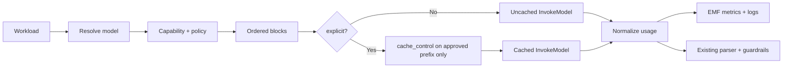

# WREN Bedrock Prompt Caching — Implementation Plan & Handoff

> Status: Proposed. This document is the reproducible source of truth for adding
> explicit Anthropic prompt caching to WREN's Amazon Bedrock workloads. An engineer
> unfamiliar with the originating discussion should be able to implement, validate,
> and roll back the work from this document alone.

## 1. Executive summary & problem statement

WREN repeatedly sends large, stable trusted prompt prefixes to Amazon Bedrock but
records no token usage, cache activity, or model-level cost. This initiative:

- Adds explicit Anthropic prompt caching to all economically eligible generative
  Bedrock workloads.
- Never places explicit cache markers on student-authored content.
- Adds token, cache, latency, and cost telemetry before enabling caching.
- Rolls out through development → staging → production canary → full production.

The primary objective is input-token cost reduction with no change to prompt
semantics, security boundaries, output quality, or rollback safety.

## 2. Confirmed requirements & decision log

| # | Decision | Value |
|---|----------|-------|
| 1 | Scope | All generative Bedrock workloads |
| 2 | Aggressiveness | Maximum viable caching of trusted prefixes only |
| 3 | Baseline | None available; observability is the first increment |
| 4 | API strategy | Anthropic-specific `InvokeModel` first, validated by research |
| 5 | Content policy | Trusted instructions/config/reference only; never student content |
| 6 | Rollout | Environment progression with gates |
| 7 | Research priority | Cost break-even analysis |
| 8 | Sources | AWS + Anthropic docs + WREN code/deploy docs |
| 9 | Contributed knowledge | None; proceed from repo evidence, label runtime assumptions |
| 10 | TTL | 5-minute initially; 1-hour only when data justifies |

## 3. In-scope and out-of-scope workloads

In scope (generative):
- Ask WREN chat — `backend/feedback/src/askWren.ts`.
- Primary Feedback Engine generation — `backend/engine/python/handler.py`.
- Strength fill-in — `backend/engine/python/handler.py`.
- Quote safety net — `backend/engine/python/handler.py`.
- Resolution judging — `backend/engine/python/handler.py`.

Out of scope:
- Bedrock `ApplyGuardrail` calls (`backend/admin/src/promptGuardrail.ts`) — not generative inference.
- One-token deployment availability smoke request (`cdk/scripts/operations/deployWorkflow.ts`) — no reuse.

## 4. Current architecture & invocation paths

### 4.1 Ask WREN (`backend/feedback/src/askWren.ts`)
- SDK: AWS SDK v3 `BedrockRuntimeClient` + `InvokeModelCommand` (imported line ~13).
- `generateAskWrenReply` (line ~426) builds the request body (line ~451):
  - `anthropic_version: 'bedrock-2023-05-31'` (line ~451)
  - `max_tokens: 512` (line ~452)
  - `temperature: 0.4` (line ~454)
  - `system: buildSystemPrompt(...)` (line ~454)
  - `messages: [...history, { role: 'user', content: userContent }]` (line ~456)
- `buildSystemPrompt` (line ~369) assembles universal system prompt → optional
  department context → optional document-type context.
- History = last 12 persisted messages; `userContent` = draft context + student question.
- No cache controls, no token/cost telemetry.

### 4.2 Feedback Engine (`backend/engine/python/handler.py`)
- `invoke_bedrock` (line ~623): `boto3` `bedrock-runtime.invoke_model`, Anthropic body
  (`anthropic_version` line ~664, `max_tokens` line ~666, `messages` line ~667). Splits a
  `system\n\n---\n\nuser` sentinel string.
- `assemble_prompt` (line ~449): builds stable document-type config + capped references +
  full draft + optional footnotes.
- `load_reference_material` (line ~422): lists/reads all S3 objects under
  `document-types/{writing_type_id}/`; order not explicitly canonicalized.
- `judge_resolutions_with_llm` (line ~1264): separate Anthropic body
  (`anthropic_version` line ~1313, `max_tokens: 2048`, `temperature: 0`).
- Strength/quote fill-ins reuse `invoke_bedrock`.

### 4.3 Prompt assembly security (`backend/engine/python/wren_engine/prompt_assembly.py`)
- `_generate_boundary_token` (line ~307) produces a fresh random delimiter per assembly
  (used at line ~183). This protects student-data boundaries but currently changes before
  reference content, defeating reference-prefix reuse.

### 4.4 Model & infrastructure
- Default model `us.anthropic.claude-sonnet-4-6`, region `ca-central-1` (`cdk/lib/config.ts`).
- Bedrock invocation permissions and Lambda config in `cdk/lib/stacks/ComputeStack.ts`.
- No cache/token/cost metrics in `cdk/lib/stacks/ObservabilityStack.ts`.

## 5. Model resolution precedence
1. Per-call/DB override (`platform_usage_policy.bedrock_model_id`), highest priority.
2. SSM parameter `/{STACK_PREFIX}/config/bedrock-model-id` when `STACK_PREFIX` set.
3. `BEDROCK_MODEL_ID` environment variable (local/test fallback).
4. Bare `anthropic.*`/`meta.*` IDs are normalized to `us.*` cross-region profiles
   (`backend/feedback/src/bedrockModelId.ts`, `backend/engine/python/wren_engine/model_invocation.py`).

Because DB/SSM can override the default, source code cannot prove the deployed model. Verify at runtime (Section 18).

## 6. Research findings (verified against official docs on 2026-09-03; re-verify before production)
Sources:
- AWS prompt caching: https://docs.aws.amazon.com/bedrock/latest/userguide/prompt-caching.html
- AWS Bedrock pricing: https://aws.amazon.com/bedrock/pricing/
- Anthropic prompt caching: https://platform.claude.com/docs/en/build-with-claude/prompt-caching
- AWS Anthropic Messages API: https://docs.aws.amazon.com/bedrock/latest/userguide/model-parameters-anthropic-claude-messages.html

Content was rephrased for compliance with licensing restrictions.

## 7. Claude Sonnet 4.6 caching limits
- Explicit caching supported through `InvokeModel`.
- Minimum cacheable prefix: 1,024 tokens.
- Maximum checkpoints: 4 per request.
- Checkpoint fields: `system`, `messages`, `tools`.
- TTL: 5 minutes default; 1 hour supported via `"ttl": "1h"` in the `cache_control` object.
- Exact prefix match required; any change at/before a breakpoint invalidates it.
- Cross-region inference supported; routing may increase cache writes.
- A written cache entry is unavailable to concurrent requests until the first response begins.
- Verify whether a prompt was cached via response usage fields
  (`cache_creation_input_tokens`, `cache_read_input_tokens`); both zero means no caching
  (often below minimum).

## 8. Pricing assumptions (verify against target account/region)
Indicative Claude Sonnet 4.6 per 1M tokens:

| Class | Price |
|-------|------:|
| Standard input | $3.00 |
| 5-minute cache write | $3.75 (1.25×) |
| 1-hour cache write | $6.00 (2×) |
| Cache read | $0.30 (0.1×) |
| Output | $15.00 |

Store as a versioned registry keyed by model and effective date. Do not hardcode across invocation code.

## 9. Break-even analysis
For prefix of T tokens with H reads after one write (B = base input rate):
- Uncached: `(H + 1) × T × B`
- Cached: `T × W + H × T × R`

5-minute (W=1.25B, R=0.1B): one write + one hit = 1.35× vs 2× uncached → net savings on first reuse.
1-hour (W=2B, R=0.1B): one write + one hit = 2.1× vs 2× uncached → needs ≥2 reads per write.

Recommendation: 5-minute TTL first. Enable 1-hour only when telemetry shows ≥2 reads/write/hour and positive net savings.

Per-request cost:
```
actual = (input_tokens*input_rate + cache_write_tokens*write_rate
         + cache_read_tokens*read_rate + output_tokens*output_rate) / 1_000_000
uncached_equiv = ((input_tokens + cache_write_tokens + cache_read_tokens)*input_rate
         + output_tokens*output_rate) / 1_000_000
savings = uncached_equiv - actual
```

## 10. Content classification
Approved for explicit caching:
- Universal system instructions.
- Department context.
- Document-type configuration, taxonomy, evaluation criteria.
- Approved reference materials (semantically data, not authoritative instructions).

Prohibited from explicit cache markers:
- Student drafts.
- Extracted footnotes.
- Student questions.
- Ask WREN conversation history.
- Model responses.

## 11. Implicit-caching compliance gate (production blocker if unresolved)
AWS docs state supported Anthropic models may perform best-effort implicit caching without
explicit controls, and the `InvokeModel` docs do not clearly expose a universal disable
switch. WREN can guarantee no explicit markers on student content. Before production,
confirm with AWS whether implicit caching may extend past the explicit checkpoint. If policy
requires preventing all provider cache handling of student content, this must be resolved first.

## 12. Proposed payload structures

### 12.1 Ask WREN (after)
```
system: [
  { type: text, text: "<universal>" },
  { type: text, text: "<department>" },
  { type: text, text: "<document-type>", cache_control: { type: "ephemeral" } }  // checkpoint
]
messages: [ ...history, { role: user, content: "<draft + question>" } ]          // uncached
```
Concatenated system block text must be byte-equivalent to current `buildSystemPrompt` output.

### 12.2 Feedback primary (after)
```
system: "<global scaffolding>"                     // optional checkpoint
user blocks:
  "<stable document-type config>"
  "<canonically ordered approved references>", cache_control ephemeral  // checkpoint
  "<dynamic focus/density directives>"
  "<RANDOM BOUNDARY> student draft + footnotes"     // uncached
```

## 13. Diagrams


## 14. Per-workload strategy matrix
| Workload | Initial policy | Rationale |
|----------|----------------|-----------|
| Ask WREN | explicit (flagged) | Stable trusted prefix, high reuse |
| Feedback primary | explicit (flagged) | Config + references reused per doc type |
| Resolution judge | observe | Rubric likely < 1,024 tokens |
| Strength fill-in | observe | Conditional, short, low reuse |
| Quote safety net | observe | Conditional, may miss threshold |
| Deploy smoke | uncached | One-token check, no reuse |
| Guardrails | n/a | Not generative |

## 15. Flags, capability registry, fallback
- Modes: `off`, `observe`, `explicit`.
- TTL: `5m`, `1h`.
- Per-workload allowlist; capability registry keyed by model family/version.
- Unknown/non-Anthropic models → uncached.
- Recognized cache syntax/capability validation error → retry once uncached; arbitrary
  failures keep current behavior (no extra inference).
- Initial config: `mode=observe`, `ttl=5m`, `workloads=none`.
- Post-baseline: `mode=explicit`, `ttl=5m`, `workloads=ask-wren,feedback-primary`.

## 16. Telemetry schema
Normalize: `input_tokens`, `output_tokens`, `cache_creation_input_tokens`,
`cache_read_input_tokens`, TTL details, model ID, workload, latency, stop reason,
success, fallback reason. Bedrock request ID in logs only.

CloudWatch EMF metrics: Invocations, InputTokens, OutputTokens, CacheWriteInputTokens,
CacheReadInputTokens, CacheEligibleInvocations, CacheFallbacks, InvocationLatency,
EstimatedCostUsd, EstimatedSavingsUsd.

Privacy: never log prompt text; never use user/document/draft/department/job IDs as
metric dimensions.

## 17. Test strategy, gates, rollout, rollback
- Characterization tests protect current requests before restructuring.
- Byte-equivalence tests for restructured prompts.
- Property tests for prompt-injection boundaries remain green.
- Rollout: dev (verify model + write/read) → staging (baseline then Ask WREN + primary)
  → production canary (incremental) → full production.
- Rollback: set `mode=off` and redeploy/reconfigure environment.

Tooling (confirmed): TypeScript uses Jest + ts-jest + fast-check (root `npm test`);
Python uses pytest under `backend/engine/python/tests/` (`test_*.py`). Both suites stub
Bedrock via injected/patched fakes with no live AWS calls.

## 18. Read-only operator commands (placeholders; no credentials)
```bash
# Verify SSM model parameter
aws ssm get-parameter --name "/<STACK_PREFIX>/config/bedrock-model-id" --region <REGION> \
  --query "Parameter.Value" --output text

# Verify inference profile availability
aws bedrock list-inference-profiles --region <REGION> \
  --query "inferenceProfileSummaries[?contains(inferenceProfileId,'anthropic')].inferenceProfileId" \
  --output text
```
DB model override (read-only): `SELECT bedrock_model_id FROM platform_usage_policy WHERE id = 1;`

## 19. Implementation tasks
1. Create and validate this handoff document.
2. Establish invocation characterization tests + runtime verification runbook.
3. Add normalized token/latency/cost telemetry in observe mode (TS + Python).
4. Introduce cache capability and policy layers (TS + Python).
5. Enable trusted-prefix caching for Ask WREN.
6. Refactor Feedback Engine prompt assembly into stable and dynamic blocks.
7. Add deterministic approved-reference caching to primary generation.
8. Instrument and economically gate secondary workloads.
9. Add deployment configuration, alarms, and cache-aware smoke verification.
10. Execute staged validation and complete rollout wiring.

Each task has objective, guidance, tests, and demo (see originating plan for full detail).

## 20. Production acceptance gates
- Deployed model verified cache-compatible.
- Implicit-caching policy question resolved.
- Cache write + read demonstrated with non-sensitive synthetic prompts.
- Positive net savings over representative traffic.
- No material Bedrock error / parser failure / truncation / quality regression.
- No student content in any explicit cached prefix.
- Rollback to off tested.

## 21. Status & ownership
| Task | Owner | Status | Evidence |
|------|-------|--------|----------|
| 1 Handoff doc | | | |
| 2 Characterization + runbook | | | |
| 3 Telemetry (observe) | | | |
| 4 Capability/policy | | | |
| 5 Ask WREN caching | | | |
| 6 FE assembly refactor | | | |
| 7 Reference caching | | | |
| 8 Secondary gating | | | |
| 9 CDK config/alarms/smoke | | | |
| 10 Staged rollout | | | |
