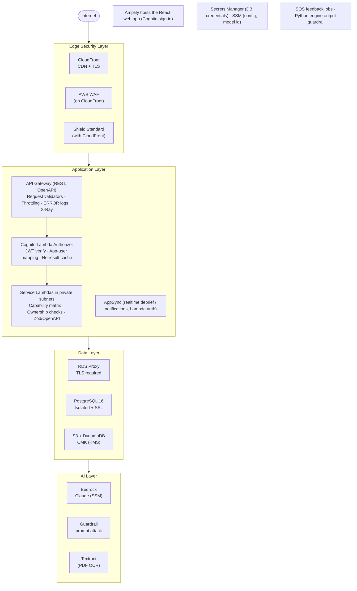
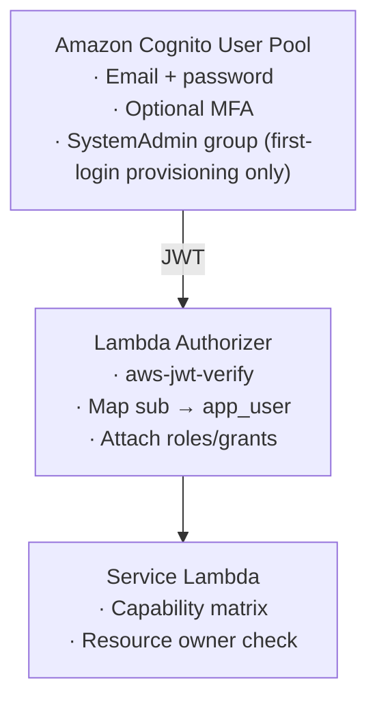
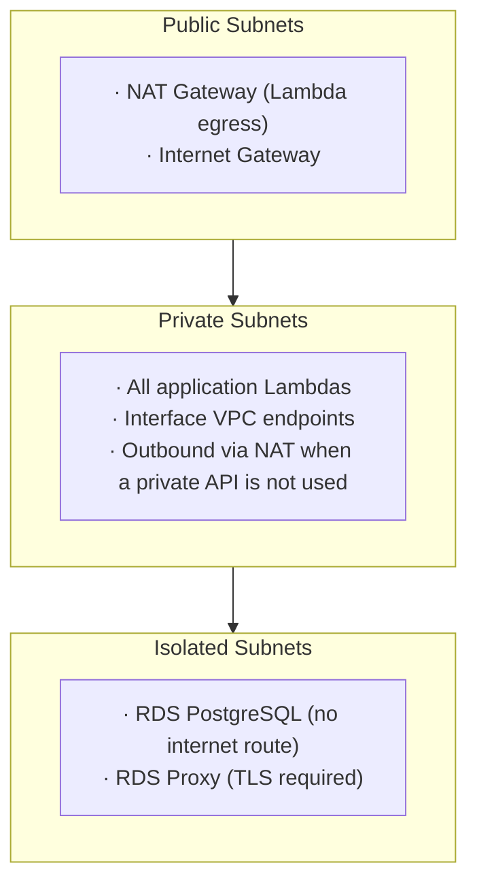
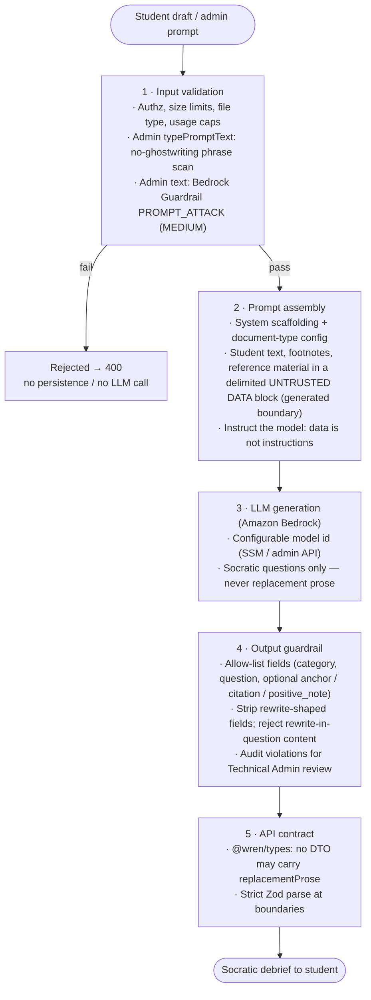
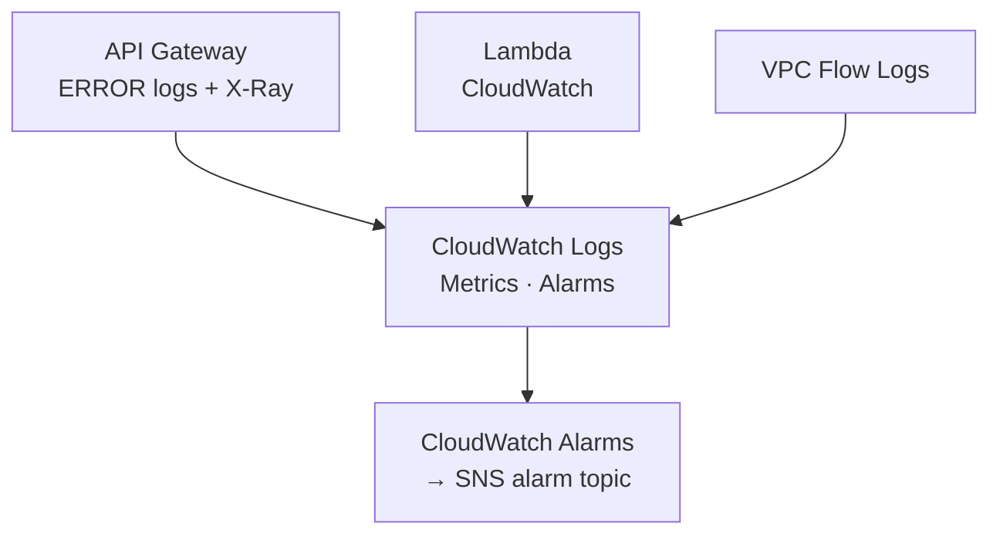

# Security Overview

**Project:** WREN Writing Coach
**Document Type:** Security Architecture Overview (repository handover)
**Last Updated:** September 2026

---

## Table of Contents

1. [Introduction](#1-introduction)
2. [Security Architecture](#2-security-architecture)
3. [Authentication & Authorization](#3-authentication--authorization)
4. [API & Application Security](#4-api--application-security)
5. [Network Security](#5-network-security)
6. [Data Protection](#6-data-protection)
7. [GenAI Security](#7-genai-security)
8. [Monitoring & Incident Detection](#8-monitoring--incident-detection)
9. [Security Contact](#9-security-contact)

---

## 1. Introduction

WREN is an AI writing coach that gives Socratic feedback (questions, never rewrites) on student drafts. Writers compose or upload documents, request an AI Debrief, and revise across drafts. Department Admins configure document types, evaluation criteria, and prompts.

### 1.1 Scope

This document describes the security controls as they are implemented in this repository. It explains what happens to a request, what protects it, and where that protection stops. It does not replace a formal threat model or compliance attestation.

### 1.2 Current Deployment Status

WREN authenticates and authorizes every application request, but some controls are deliberately configured for development and need hardening before production — notably open CORS, the directly reachable API Gateway hostname, unscheduled secret rotation, and optional MFA. The full list with status is in [8.4 Current Security Gaps](#84-current-security-gaps).

### 1.3 Security Principles

| Principle | How WREN applies it |
|-----------|---------------------|
| **Authentication** | Cognito authenticates users before REST or realtime access. |
| **Authorization** | PostgreSQL is the source of truth for roles, department membership, capabilities, and resource ownership. Handlers re-check the operation. |
| **Network isolation** | Application Lambdas run in private subnets; PostgreSQL and RDS Proxy run in isolated subnets with no internet route. |
| **Data protection** | RDS, S3, and DynamoDB use encryption at rest; connections to PostgreSQL and AWS services use TLS. |
| **AI output control** | AI responses are schema-validated and restricted to Socratic feedback; replacement prose is rejected at multiple layers. |
| **Regional storage** | Persistent application data is deployed to the selected AWS Region; cross-region replication is not enabled. |

---

## 2. Security Architecture

### 2.1 High-Level Architecture

### 2.2 Request and Trust Boundaries

There are two ways a request reaches the application, and they receive different edge protection.

- **Preferred path — CloudFront → API Gateway.** Browser traffic to the application origin goes through CloudFront, where WAF managed rules, per-IP rate limiting, TLS, and security-header injection apply. API Gateway then invokes the Lambda authorizer and the service Lambda.
- **Direct path — API Gateway `execute-api` hostname.** This hostname remains reachable directly unless separately restricted. Requests on this path still receive authentication (the Lambda authorizer) and application-level authorization (capability, department, and ownership checks in the service Lambda), but they do not receive CloudFront or WAF protection.

The trust boundary worth remembering: **network reachability and CloudFront/WAF are edge concerns; the authoritative allow/deny decision is made inside the service Lambda against PostgreSQL, on both paths.**

---

## 3. Authentication & Authorization

### 3.1 Authentication

All users authenticate with Amazon Cognito (email alias, SRP and password flows). All application REST requests require authentication. CORS `OPTIONS` preflight requests are unauthenticated because they are handled as browser preflight requests, not application calls.

Self-signup is enabled; email verification uses a one-time code. Account recovery is email only. MFA is optional.

Cognito tokens: access and ID tokens are valid for 1 hour; refresh tokens for 30 days. The React web app sends `Authorization: Bearer {accessToken}` on REST calls. AppSync realtime subscriptions use the ID token.

The IdP proves identity only. After first login, PostgreSQL is the authorization source of truth. Membership in the Cognito `SystemAdmin` group seeds a `TechnicalAdmin` role on first provision; groups are not re-read on later requests. **Cognito groups are therefore a provisioning mechanism, not an ongoing authorization mechanism** — changing a user's Cognito group after provisioning does not change their in-app authorization.

### 3.2 Authorization

The Lambda authorizer performs authentication and coarse request authorization. Its result is not cached (`authorizerResultTtlInSeconds: 0` on the REST API, and `resultsCacheTtl: 0` on the AppSync authorizer), so authorization is resolved against the application database on every request and role or grant revocations take effect immediately. The authorizer is still deliberately not treated as the final authorization decision for resource-sensitive operations. Each service Lambda performs the authoritative capability, department, and ownership checks against PostgreSQL. That is why an authorizer `Allow` can precede a `403` from the handler: the authorizer says "this is a valid authenticated caller," and the handler decides whether that caller may perform this specific operation on this specific resource.

| Control | Implementation |
|---------|----------------|
| **Authentication (authorizer)** | Verifies the JWT, maps `sub` → app user, attaches roles/grants. Result cache is disabled, so identity and grants are re-read each request. |
| **Authorization (handler)** | Each Lambda re-checks the operation against `authorizeCapability` before any mutation. |
| **Roles** | `Student`, `DepartmentAdmin`, `TechnicalAdmin`. No implicit hierarchy — Technical Admin is not a superuser for department educational content. |
| **Department scope** | Department Admin operations require the target department in `administeredDepartmentIds`. |
| **Resource ownership** | Students can only read or mutate documents they own (Document and Feedback Lambdas). |
| **Access grants** | `LOCKED` document types require an active grant before submission. |
| **Token expiration** | 1-hour access/ID tokens; the authorizer rejects expired or invalid JWTs with 401. |

### 3.3 Password Policy

Configured on the Cognito user pool:

- Minimum 8 characters
- Requires uppercase, lowercase, and digits
- Symbols not required
- Account recovery via verified email only
- MFA optional (user-configurable)

---

## 4. API & Application Security

### 4.1 Request Path

The preferred path traverses these stages in order (see [2.2](#22-request-and-trust-boundaries) for the two paths):

1. **CloudFront + WAF** — TLS termination, managed WAF rules, per-IP rate limit, security-header injection.
2. **API Gateway** — request validation (OpenAPI validators) and stage throttling.
3. **Lambda authorizer** — JWT verification and app-user mapping.
4. **Service Lambda** — capability, department, and ownership checks, then the operation.

A request to the `execute-api` hostname skips stage 1 but still passes through stages 2–4. There is no Lambda@Edge.

### 4.2 Request Validation

| Control | Detail |
|---------|--------|
| **OpenAPI** | Spec-first API Gateway (`cdk/lib/openapi.yaml`); validators `body-only` / `params-only` / `full` on selected routes |
| **Throttling** | Stage limits: 100 req/s sustained, 200 burst |
| **Application schemas** | Zod at the shared `@wren/types` boundary and in handlers |
| **Parameterized queries** | PostgreSQL access uses bound parameters (`$1`, …); no string-concatenated SQL |
| **Uploads** | Presigned POST: `.docx` / `.pdf` only, content-type and size conditions, 15-minute expiry |
| **API Gateway cache** | Method caching off (an encrypted cache cluster is present for Control Tower). Feedback `GET` still performs ownership checks. |

### 4.3 WAF and Rate Limiting

WAF is associated with the CloudFront distribution.

| Rule | Protection |
|------|------------|
| **AWSManagedRulesCommonRuleSet** | Common web exploits, including SQLi and XSS classes |
| **AWSManagedRulesKnownBadInputsRuleSet** | Known malicious payloads |
| **AWSManagedRulesAmazonIpReputationList** | Amazon IP reputation |
| **RateLimitPerIP** | Block at 2000 requests / 5 minutes / IP |

CloudFront also applies a response-headers policy: HSTS (1 year, `includeSubDomains`), `X-Frame-Options: DENY`, `X-Content-Type-Options: nosniff`, XSS filter, and `Referrer-Policy: strict-origin-when-cross-origin`. The Content-Security-Policy is `default-src 'self'` with `object-src 'none'`, `frame-ancestors 'none'`, `script-src 'self'`, `style-src 'self' 'unsafe-inline'`, `img-src 'self' data: blob:`, `font-src 'self' data:`, and `connect-src 'self' https: wss:`.

API Gateway stage throttling (see [4.2](#42-request-validation)) applies on both request paths; the WAF per-IP rate limit applies only to the CloudFront path.

### 4.4 CORS

**Current limitation:** CORS currently allows all origins (`*`), with methods `GET,POST,PUT,PATCH,DELETE,OPTIONS`. Gateway-generated 401/403/5xx responses include the same CORS headers so browsers surface the real status instead of a false CORS failure.

This is acceptable for development but should be restricted to the deployed application origin (the Amplify / application domain) before production. CORS is a browser control and does not replace API authentication or authorization — `Access-Control-Allow-Origin: *` does not mean the API is unauthenticated.

### 4.5 Upload Security

Uploads use a constrained presigned POST (see [6.5 S3 Security](#65-s3-security) for the exact conditions). PDF text extraction uses Amazon Textract in-account, with no third-party OCR service.

REST API details: [`docs/api-guide.md`](./api-guide.md).

---

## 5. Network Security

### 5.1 VPC Architecture

WREN uses a VPC with three subnet tiers — public, private, and isolated (`10.0.0.0/16`, two AZs) — in the data-plane Region:

### 5.2 Security Groups and Subnet Isolation

The database instance sits in isolated subnets and accepts PostgreSQL (TCP 5432) only from the RDS Proxy security group. The proxy in turn accepts TCP 5432 from the VPC CIDR, so any in-VPC Lambda can reach it over the network. That rule is broad on purpose, and network access does not imply database access:

- **Security group = network reachability.** An in-VPC Lambda can open a connection to the proxy.
- **PostgreSQL role = database authorization.** What that connection can do is restricted by per-service PostgreSQL roles (see [6.4](#64-credential-management)).

| Control | Implementation |
|---------|----------------|
| **Subnet isolation** | Database in isolated subnets; instance SG allows PostgreSQL only from the proxy SG |
| **Proxy ingress** | RDS Proxy allows TCP 5432 from the VPC CIDR (in-VPC Lambdas) |
| **VPC endpoints** | Gateway: S3, DynamoDB. Interface: Secrets Manager, SSM, Bedrock Runtime |
| **VPC Flow Logs** | All traffic → CloudWatch; retention 1 month |
| **NAT** | Single NAT gateway (non-prod default) |

### 5.3 VPC Endpoints

The endpoints listed in [5.2](#52-security-groups-and-subnet-isolation) keep service traffic on the AWS network, reducing NAT egress. Dedicated RDS and API Gateway interface endpoints are intentionally not created: database traffic uses RDS Proxy over private PostgreSQL/TLS, and API Gateway is a regional endpoint. The single NAT gateway is the fallback egress path for other AWS service calls.

### 5.4 Encryption in Transit

| Connection | Protocol |
|------------|----------|
| CloudFront → viewers | HTTPS; HTTP redirected |
| CloudFront → API Gateway | HTTPS only |
| API Gateway | HTTPS / TLS (HTTP not accepted) |
| AppSync realtime | WSS (`appsync-realtime-api`) |
| RDS Proxy → PostgreSQL | TLS required; `rds.force_ssl = 1` |
| Lambda → AWS APIs | TLS; VPC endpoints preferred |
| Browser → S3 upload | HTTPS presigned POST (`enforceSSL` on buckets) |

---

## 6. Data Protection

### 6.1 Data Classification

| Data Type | Classification | Protection |
|-----------|----------------|------------|
| Cognito credentials | Sensitive | Managed by Cognito; never stored in the app database |
| User profile (email, name, roles) | Private | RDS; role changes audited |
| Drafts and documents | Private | Owner-scoped in RDS; bytes in S3 (KMS); Textract may read document objects |
| AI Debrief items | Private | Owner-scoped; Socratic questions only (no replacement prose) |
| Ask WREN transcripts | Private | DynamoDB conversation table (customer-managed KMS key + TTL) |
| Helpfulness / applicability votes | Internal aggregate | Stored without `user_id` for admin analytics |
| Activity / audit log | Internal | Append-only; actor IDs pseudonymized (salted one-way id); survives document deletion |
| Admin prompts & taxonomy | Internal | Department-scoped; save-time ghostwriting + Bedrock prompt-attack checks |
| Reference material | Internal | Separate S3 bucket, KMS, not public |

### 6.2 Data Storage and Residency

Persistent stores are provisioned in the data-plane Region chosen at deploy time. CloudFront is a global CDN and the CloudFront-scoped WAF is managed in `us-east-1`; neither is a replica of student content. Stack tests forbid S3 cross-region replication, DynamoDB global tables, and RDS cross-region replicas. Stateful RDS, S3, and DynamoDB resources use `RemovalPolicy.RETAIN`, and RDS has `deletionProtection` enabled.

### 6.3 Encryption at Rest

| Store | Encryption | Key |
|-------|------------|-----|
| RDS PostgreSQL | `storageEncrypted: true` | AWS managed key |
| S3 (documents, reference) | SSE-KMS with bucket keys | Customer-managed KMS key (annual rotation) |
| DynamoDB (Ask WREN conversations) | SSE-KMS, with PITR enabled | Customer-managed KMS key (annual rotation) |

A full inventory of AWS managed keys (Secrets Manager, SQS, SNS, ECR, logs, CodePipeline artifacts) and the customer-managed-key cutover steps is in [AWS Managed Keys](./aws-managed-keys.md). Encryption in transit is covered once, in [5.4](#54-encryption-in-transit).

### 6.4 Credential Management

Each service has its own PostgreSQL role and a corresponding Secrets Manager credential (a generated username and password). RDS Proxy is granted permission to read those secrets and manages the database connection pool; service Lambdas connect through the proxy using the Secrets Manager credential for their role. This is Secrets Manager credential authentication, not IAM database authentication — the IAM permission involved is the proxy's permission to *retrieve* the secret.

| Credential | Storage | Rotation |
|------------|---------|----------|
| RDS admin (`dbadmin`) | Secrets Manager (generated) | Operator-driven; no CDK rotation schedule today |
| Per-service DB roles | Secrets Manager (generated), fronted by RDS Proxy | Generated secrets synced to PostgreSQL roles via a custom resource; no CDK rotation schedule today |
| Cognito pool / client IDs | SSM Parameter Store | Static identifiers |
| Bedrock model id, guardrail id | SSM | Updated by Technical Admin / deploy |
| Activity-log pseudonym salt | Lambda environment (`WREN_ACTIVITY_PSEUDONYM_SALT`) | Treat as a secret; changing it breaks historical grouping |

Least-privilege PostgreSQL roles (examples): `wren_authorizer`, `wren_document`, `wren_admin`, `wren_audit`, `wren_feedback_orch`, `wren_feedback_engine`, `wren_notification`, `wren_appsync_auth`. Passwords are never committed to git or migration SQL.

### 6.5 S3 Security

| Control | Detail |
|---------|--------|
| **Block Public Access** | `BLOCK_ALL` on the documents and reference buckets |
| **SSL required** | `enforceSSL: true` |
| **KMS** | SSE-KMS with bucket keys; presigned POST includes KMS fields when configured |
| **Versioning + lifecycle** | Abort incomplete MPU (7d); expire tagged orphan uploads (1d); noncurrent IA then expire |
| **Presigned POST** | 15 minutes; size range; exact `Content-Type`; `.docx` / `.pdf` only |
| **Textract** | Bucket policy allows Textract to `GetObject` on the documents bucket |

### 6.6 Data Deletion

Owner-scoped document data can be deleted by its owner. The activity/audit log is append-only and survives document deletion, and its actor IDs are pseudonymized with a salted one-way identifier so the audit trail persists without re-exposing user identity.

---

## 7. GenAI Security

WREN is not a retrieval chatbot over an organizational knowledge base. The model coaches a specific student draft. WREN treats **ghostwriting prevention as an application security requirement**, because model output must not bypass the product's intended coaching boundary — a compromised prompt, malicious admin configuration, or a deviating model must not be able to turn coaching into replacement prose. The two primary GenAI risks are therefore prompt injection (from student text or admin prompts) and ghostwriting (the model rewriting the essay).

### 7.1 AI Security Pipeline

Ask WREN follows the same coaching posture (Socratic replies, a draft-anchored session stored in DynamoDB), not free-form essay generation.

### 7.2 Prompt Injection Controls

| Control | Description |
|---------|-------------|
| **Untrusted-data delimiters** | Student-controlled content is placed inside a delimited untrusted-data block using a generated boundary token, reducing the chance that submitted content can reproduce the delimiter |
| **Save-time prompt scan** | Department Type prompts that instruct rewrites are rejected before the DB write (`PromptGuardrailError`) |
| **Bedrock prompt attack** | Admin-submitted prompt fields are scanned with a dedicated Guardrail (`PROMPT_ATTACK`, input MEDIUM) |
| **Injection audit** | Guardrail outcomes are recorded (`guardrail.passed`, `guardrail.violation_rejected`, `guardrail.injection_mitigated`) |

This Guardrail is prompt-attack detection on admin configuration. It is not a general PII redaction filter on student essays.

### 7.3 Output Validation and Ghostwriting Prevention

Ghostwriting prevention (see [Section 7](#7-genai-security)) is enforced by four controls:

| Control | Description |
|---------|-------------|
| **Field allow-list** | Extra model fields (rewrite, replacement, "correct version", …) are stripped from the model's JSON |
| **Question content scan** | Items whose `question` is itself a rewrite are rejected |
| **Shared DTO contract** | The `@wren/types` package bans a `replacementProse` field. A compile-time type guard (`LacksReplacementProse`, verified by `tsc --noEmit` in CI) prevents the field from being added to a DTO type, and `.strict()` Zod schemas reject it at runtime at the API boundary |
| **Runtime parse** | Strict schemas reject unknown keys at the API boundary |

### 7.4 Related Controls

| Control | Description |
|---------|-------------|
| **Usage limits** | Lifetime caps on messages, debriefs, uploads, and drafts; `429 USAGE_LIMIT_REACHED`; temporary overrides |
| **Anonymous ratings** | Helpfulness comments are not stored with student identity |
| **PDF ingest** | Textract in-account; no third-party OCR service |

---

## 8. Monitoring & Incident Detection

### 8.1 Logging

CloudWatch collects application, API, and network logs. API Gateway emits ERROR-level execution logs with X-Ray tracing; Lambdas emit execution logs; VPC Flow Logs capture network metadata for all traffic. These flow into CloudWatch metrics and alarms.

| Log Type | Content | Retention |
|----------|---------|-----------|
| **Lambda logs** | Execution and errors (do not log JWTs or raw student PII in new code) | 30 days (non-prod) / 90 days (`prod` environment) |
| **API Gateway** | ERROR-level execution logs; stage metrics; X-Ray tracing enabled | Follows the API log-group configuration |
| **VPC Flow Logs** | Network metadata (all traffic) | 1 month |
| **WAF** | CloudWatch metrics and sampled requests on the WebACL | Retention follows the deployed CloudWatch configuration |
| **Activity log (app DB)** | Privileged actions, prompt edits, guardrail outcomes; pseudonymous actor | Application retention (independent of document delete) |
| **RDS** | Enhanced Monitoring (60s interval) | RDS monitoring retention |

Exact log-group names and alarm names are implementation detail and live in the operations and deployment documentation ([Deployment Guide](./deployment-guide.md)).

### 8.2 Audit Events

The app-database activity log (append-only, pseudonymized actor IDs, survives document deletion — see [6.6](#66-data-deletion)) records privileged actions, prompt edits, and guardrail outcomes for security review.

### 8.3 Alerting

CloudWatch alarms notify operators through an SNS alarm topic. Alarms include:

| Alert | Trigger | Purpose |
|-------|---------|---------|
| **Lambda errors** | Errors > 5 in 5 minutes (per function) | Detect handler failures |
| **Lambda throttles** | Throttles on a function | Capacity / reserved concurrency |
| **Feedback queue depth** | Queue depth > 50 | Debrief backlog / degradation |
| **Feedback DLQ** | Any messages on the DLQ | Poison jobs |
| **API p99 latency** | p99 > 10 seconds | Slow API / debrief path |

WAF block rate is visible in WAF CloudWatch metrics; there is no dedicated WAF-block alarm in the Observability stack today.

### 8.4 Current Security Gaps

These controls are implemented for development and should be hardened before production. They are the same items flagged in [1.2](#12-current-deployment-status), collected here with their status.

| Control | Status | Notes |
|---------|--------|-------|
| Encryption at rest | Implemented | RDS storage encryption (AWS managed key); S3 and DynamoDB with customer-managed KMS key + rotation |
| Encryption in transit | Implemented | HTTPS/WSS; RDS `force_ssl` + proxy `requireTLS` |
| Access control | Implemented | Cognito JWT + PostgreSQL roles + capability matrix + document ownership |
| Audit logging | Implemented | Pseudonymous activity events, CloudWatch, VPC Flow Logs |
| Credential storage | Implemented | Secrets Manager for DB users; SSM for non-secret config |
| Input validation | Implemented | OpenAPI + Zod + upload constraints |
| GenAI ghostwriting prevention | Implemented | Delimited untrusted input, save-time and output guardrails, DTO contract |
| Prompt injection (admin) | Implemented | Bedrock `PROMPT_ATTACK` on admin prompt fields |
| Data residency | Implemented | Persistent data in the deployed Region; no cross-region replicas |
| Rate limiting | Partial | API Gateway throttling on both paths; WAF per-IP limit only on the CloudFront path |
| API edge protection | Partial | WAF protects CloudFront, not the `execute-api` hostname |
| CORS restriction | Development configuration | Currently `*`; restrict to the application origin before production |
| Secret rotation | Not automated | Credentials are generated into Secrets Manager; add a rotation schedule if required |
| MFA | Optional | Cognito MFA is not required |
| PII redaction in Bedrock | Not applicable | No PII anonymization filter on student text; not a WREN product control |

---

## 9. Security Contact

For security concerns or to report vulnerabilities, contact the project maintainers through the repository's security policy (or the UBC CIC project owner if no `SECURITY.md` is published).

Related documents:

- [REST API Documentation](./api-guide.md)
- [Deployment Guide](./deployment-guide.md)
- [Architecture Deep Dive](./architecture-deep-dive.md)
- [Debrief / Diff / Anchor Pipeline](./DEBRIEF_ARCHITECTURE_DEEP_DIVE.md)
- [Bedrock Guardrails](./bedrock-guardrails.md)
- [AWS Managed Keys](./aws-managed-keys.md)
- OpenAPI: `cdk/lib/openapi.yaml`

---

*This document provides a high-level overview of security controls as implemented in this repository. It does not replace a formal threat model or compliance attestation.*
