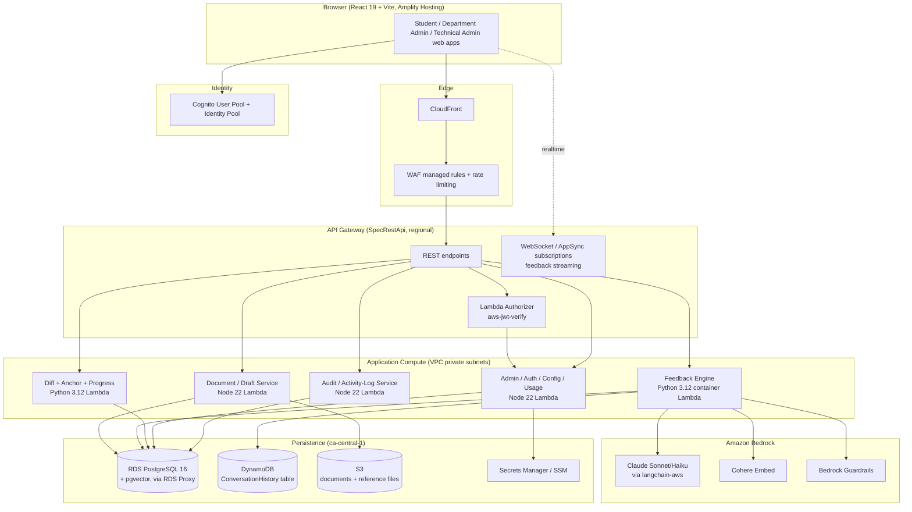
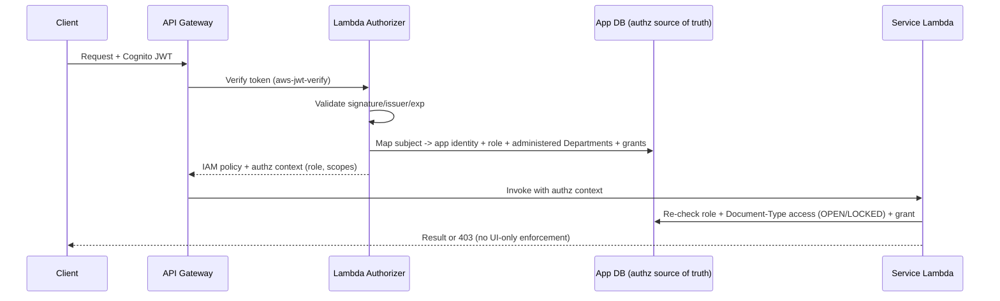
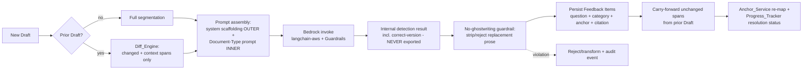
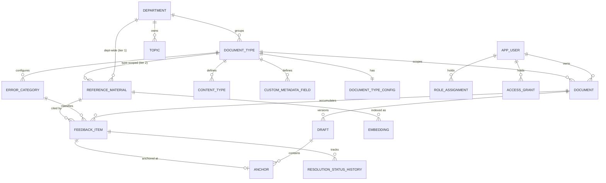

# Design Document

## Overview

WREN (Writing Refinement, Expression & Navigation) is an MIT-licensed, AWS-hosted, AI-powered writing coach whose central rule is **no ghostwriting**: WREN surfaces Socratic questions and error-type flags anchored to a writer's own text, tracks recurring patterns across drafts, and never produces replacement prose. This document translates the approved requirements (`requirements.md`, V4) into an implementable architecture on the UBC CIC baseline stack (AWS CDK v2 TypeScript, Lambda + Fargate, RDS PostgreSQL 16 + `pgvector`, DynamoDB, S3, Cognito, Amazon Bedrock via `langchain-aws`, React 19 / Vite / Tailwind / shadcn/ui), with all persistent personal data resident in `ca-central-1`.

> **V4 terminology note.** This design supersedes all prior (V1–V3) terminology. The platform is organized around **Document Types** (not Writing Domains), grouped administratively by **Departments** (not Organizations, which are removed entirely — no tenant isolation, no Org Owner role). There are three roles: **Student**, **Department Admin** (educational configuration owner, scoped to the Department(s) they administer; absorbs all former Document Expert / Field Expert duties as of V4), and **Technical Admin** (platform/infrastructure only). Where the existing V1-shaped codebase (see `requirements.md` → Implementation Status) uses `Organization`, `WritingType`/`WritingDomain`, or `FieldExpert`/`DocumentExpert`/`OrgOwner`, this design specifies the target migration mapping rather than a rebuild.

### Design Goals and Driving Constraints

The design is shaped by a small set of non-negotiable constraints drawn directly from the requirements. These constraints, rather than any single feature, drive most architectural decisions:

1. **No ghostwriting is a system invariant, not a prompt suggestion** (REQ-CORE-NOGHOST-01). The internal "correct version" the model derives to *detect* an error must never leave the backend. This forces a two-stage pipeline (internal detection context → externally-stored Feedback Item) and an output guardrail that strips/rejects replacement prose before persistence.
2. **Feedback is anchored to draft versions and must survive revision** (REQ-ANCHOR-01, draft anchoring in `frontend.md`). Anchors carry positional + content-fingerprint data so they can be re-mapped via diff across drafts, and feedback can never silently drift onto unrelated text.
3. **Departments are groupings, not isolated tenants; Students are global** (REQ-DEPT-GROUPING-01). Authorization is resolved in the application database from role scoping + Document Type OPEN/LOCKED access state + Access Grants — never from tenant partitioning or IdP claims (REQ-SEC-AUTHDECOUPLE-01). A Document Type's access state has **no** inheritance layer (Departments carry no access state of their own).
4. **Cost/latency discipline through diff-based, cached processing** (REQ-DRAFT-DIFF-01, REQ-NFR-COST-01, REQ-NFR-LATENCY-01). Only changed spans plus bounded context reach the LLM; unchanged spans carry forward prior Feedback Items unless their governing configuration changed.
5. **No surveillance**: per-Student operational state powers the writer's own experience only; everyone above sees all-users aggregate totals derived from an independent Actor–Verb–Object activity log that outlives deleted documents (REQ-AUDIT-OPSTATE-01, REQ-ACTIVITY-LOG-01, REQ-AUDIT-RETENTION-01).
6. **Configurable everything**: taxonomy, conventions, prompts, app name, and model identifier are data/config, never hardcoded enums or literals (REQ-TAXONOMY-01, REQ-NFR-MODEL-01, REQ-NFR-APPNAME-01).
7. **Educational configuration is unified under Department Admin** (REQ-ROLE-DEPTADMIN-01, V4 Decisions). There is no separate subject-matter-expert role and no assignment step between a Department Admin and the Document Types in Departments they administer — ownership is automatic and direct. Technical Admin never touches educational content.

### Scope Note

The authoritative UI reference is the Student (writer) flow (Figma slides 1–11): auth, the writer dashboard, document creation, and the AI Debrief / inline-feedback view. Department Admin and Technical Admin consoles are functionally specified by the requirements but their frames are subject to change (and were designed against a now-superseded "Instructor"/Document-Expert mental model per requirements.md's frame re-interpretation debt); this design specifies their behavior and API contracts while leaving visual detail to implementation. Out of scope (per requirements): mobile native, real-time co-editing, plagiarism/AI-text detection, Organization-level tenant isolation, and a separate Document-Expert role.

---

## Architecture

### System Context



### Subsystem-to-Compute Mapping

The requirements name eleven logical subsystems. They map onto compute as follows, grouping cohesive concerns to limit cold starts and IAM surface (one scoped role per function, per security steering):

| Requirements subsystem | Compute home | Runtime | Rationale |
|---|---|---|---|
| Document_Service | Document/Draft Lambda | Node 22 | I/O bound: S3 upload, format handling, draft versioning |
| Anchor_Service, Diff_Engine, Progress_Tracker | Diff/Anchor/Progress Lambda | Python 3.12 | Shared diff data structures; pure-logic core ideal for PBT |
| Feedback_Engine, Feedback_Presenter (data) | Feedback Engine container Lambda | Python 3.12 | Heavy AI workload; `langchain-aws`, larger deps → container image |
| Config_Service, Admin_Service, Auth_Service, Usage_Service | Admin/Config Lambda | Node 22 | Transactional Postgres writes; authorization resolution |
| Audit_Service | Audit Lambda | Node 22 | Append-only activity log + aggregate read models |
| Reference_Service | Split: upload path in Document Lambda, retrieval/grounding in Feedback Engine | — | Files in S3; embeddings in a single `pgvector`-backed `embedding` table managed via LlamaIndex's `PGVectorStore` (embeddings/retrieval only — LiteParse/`mammoth` handle document parsing) |

> Feedback generation latency target is 10s for ~500 words (REQ-NFR-LATENCY-01). Feedback runs as an asynchronous job: the API enqueues generation and the client receives streamed/poll-based status, displaying a loading state (REQ-FB-VIEW-01, REQ-NFR-LATENCY-01). For 100–500 concurrent users (REQ-NFR-SCALE-01), Lambda concurrency scales automatically; a queue (SQS) in front of the Feedback Engine provides graceful degradation (queue/throttle rather than hard-fail) when load exceeds range.

### Request / Authorization Flow



Authorization is enforced twice — once at the authorizer (coarse, cacheable) and again inside each service against the operation's specific scope (REQ-SEC-ROLE-01). The IdP is used **only** to prove identity; all roles, Department-Admin administered-Department assignments, and Access Grants live in Postgres (REQ-SEC-AUTHDECOUPLE-01), so swapping Cognito for another provider changes no authorization logic.

### Feedback Generation Pipeline (no-ghostwriting enforced)



The guardrail at step H is the architectural embodiment of REQ-CORE-NOGHOST-01: the internal corrected example (used only to classify) is discarded; only the Socratic question, error category, anchor, and optional citation are persisted. Prompt assembly always nests Document-Type content **inside** system scaffolding so the guardrail and system instructions cannot be overridden by Document-Type config or by injected instructions in submitted text (REQ-PROMPT-EDIT-01 criterion 8, REQ-SEC-PROMPTINJECT-01).

### Infrastructure (CDK Stacks)

Following the CDK steering (one stack per concern, `${StackPrefix}-<Concern>`, SSM for cross-stack values, `RETAIN` + `deletionProtection` + `storageEncrypted` on stateful resources):

- **`Vpc`** — public / private-with-egress / isolated subnets; interface endpoints (Secrets Manager, SSM, RDS, API Gateway, Bedrock), gateway endpoint (DynamoDB, S3); VPC flow logs.
- **`Database`** — RDS PostgreSQL 16 with RDS Proxy (TLS enforced, `rds.force_ssl`), `pgvector`; credentials in Secrets Manager.
- **`Storage`** — S3 buckets (documents, reference materials) with block-public-access, `enforceSSL`, KMS, lifecycle rules; a DynamoDB table named `${StackPrefix}-ConversationHistory` for conversation/session state. The table name is scoped to `StackPrefix` only and carries no display/brand literal — it derives from the project name (e.g. `wren-...`).
- **`Api`** — `SpecRestApi` from an OpenAPI spec, regional endpoint, Lambda authorizer, throttling, ERROR-level logging; AppSync/WebSocket for feedback streaming.
- **`Compute`** — the Lambda functions / container Lambda above, each with a scoped IAM role; SQS queue + DLQ for async feedback jobs.
- **`CloudFrontWaf`** — CloudFront distribution + WAF (managed rule sets, rate limiting).
- **`Amplify`** — frontend hosting, per-branch build (`npm ci && npm run build`, Vite `dist`).
- **`Observability`** — CloudWatch log groups with deliberate retention, Lambda Powertools (Python), metrics/alarms on latency, throttles, queue depth.
- **`CICD`** — CodePipeline + CodeBuild, ECR with `imageScanOnPush`.

The application name (REQ-NFR-APPNAME-01) and model identifier (REQ-NFR-MODEL-01) are SSM parameters; no backend literal carries the app name, and all stack/resource names derive from the project identifier `wren`. The application-name parameter is the configurable display name resolved from a single config value whose default is `<APP NAME HERE>` — the only place that brand literal may appear; it is set to any desired display name via configuration only.

---

## Components and Interfaces

### Document / Draft Service (Node 22)

Responsible for ingestion, format handling, size limits, and draft versioning (REQ-DOC-SUBMIT-01, REQ-DOC-SIZE-01, REQ-DOC-DRAFT-01).

- **Ingestion & extraction**: `.docx` and `.pdf` accepted; all other extensions rejected with an accepted-formats message. `.docx` text extraction uses **`mammoth`** (BSD-2-Clause, MIT-compatible), preserving paragraph boundaries via its semantic HTML/paragraph output. PDF text extraction is best-effort via **LiteParse** (`run-llama/liteparse`, Apache-2.0) — a local, in-Lambda, layout-aware parser (Rust core with native Python bindings; no cloud calls, no API keys) that preserves paragraph boundaries via its spatial/bounding-box output; on no-recoverable-text it returns a fallback prompt (upload `.docx` / paste text). Pasted text treats paragraph breaks as boundaries. LiteParse and `mammoth` both run entirely inside the Document/Draft Lambda (no external service, no per-page cost, no data leaving `ca-central-1`). LlamaIndex is scoped solely to the embeddings/retrieval layer (a `PGVectorStore` over the single `embedding` table — see Reference Materials); it plays no role in document ingestion. Generation remains on Bedrock via `langchain-aws`.
- **Segmentation**: produces an ordered list of paragraph segments with stable indices; this segmentation is the substrate for anchoring and diffing.
- **Size enforcement**: rejects documents over the configured max word count (default 10,000 words) *before* creating a Draft or invoking the Feedback Engine; Document-Type overrides win over the default.
- **Metadata**: stores Department-Admin-defined custom metadata fields (e.g., "Writing Topic") against the Document; required fields are enforced at submission (create/activate disabled while empty).
- **Submission gating**: before accepting a submission, calls Auth_Service to confirm the Document Type is OPEN to the global Student or that an Access Grant exists; otherwise offers the access-request flow.

Key interface:

```typescript
interface DocumentService {
  createDocument(input: CreateDocumentInput, actor: AuthContext): Promise<Document>;
  submitDraft(documentId: DocumentId, content: DraftContent, actor: AuthContext): Promise<Draft>;
  getDocument(documentId: DocumentId, actor: AuthContext): Promise<DocumentWithDrafts>;
  deleteDocument(documentId: DocumentId, actor: AuthContext): Promise<DeletionReceipt>;
}

interface CreateDocumentInput {
  documentTypeId: DocumentTypeId;
  contentTypeId: ContentTypeId;
  name: string;
  metadata: Record<string, string>;     // validated against required custom fields
  source: { kind: "file"; key: S3Key } | { kind: "paste"; text: string };
}
```

### Diff Engine, Anchor Service, Progress Tracker (Python 3.12)

A cohesive pure-logic core (the prime target for property-based testing).

- **Diff_Engine** computes the change set between consecutive drafts at paragraph + intra-paragraph span granularity, and selects changed/added spans plus a bounded context window for the LLM, excluding unchanged spans (REQ-DRAFT-DIFF-01). An empty change set short-circuits feedback generation.
- **Anchor_Service** stores, per anchor, a start/end offset, paragraph index, and a content fingerprint (normalized text hash + short surrounding context). On a new draft it re-maps each anchor using the diff: a confident match preserves the association (shifted offsets allowed); a deleted/unrecognizable/ambiguous target marks the anchor `removed` rather than mis-attach (REQ-ANCHOR-01).
- **Progress_Tracker** re-evaluates each Feedback Item to a Resolution Status (`resolved`, `partially_resolved`, `still_unresolved`, `removed`, `unchanged`), tracked per Feedback Item (not per span). Unchanged spans → `unchanged` without an LLM call; `removed` anchors → `removed`; changed spans use the diff-selected region as model input. Document-wide structural items (no Anchor) are re-evaluated against the full new Draft; they may never be `removed` (REQ-RESOLUTION-01 criterion 7). Resolution history is persisted across drafts. Pattern recognition runs across ≥2 drafts and surfaces improving/persistent/emerging tendencies; with <2 drafts no pattern claims are made (REQ-RESOLUTION-01, REQ-PROGRESS-ACK-01).

```python
class AnchorService:
    def remap(self, anchors: list[Anchor], diff: Diff) -> list[RemapResult]: ...
    # RemapResult = Remapped(anchor', span) | Removed(anchor)

class DiffEngine:
    def compute(self, prev: list[Segment], curr: list[Segment]) -> Diff: ...
    def select_for_llm(self, diff: Diff, context_window: int) -> list[Span]: ...

class ProgressTracker:
    def reevaluate(self, items: list[FeedbackItem], diff: Diff,
                   judge: SpanJudge) -> list[ResolutionUpdate]: ...
    def detect_patterns(self, history: ResolutionHistory) -> list[PatternAck]: ...
```

### Feedback Engine (Python 3.12, container Lambda)

Generates Socratic feedback through Bedrock and enforces no-ghostwriting (REQ-CORE-NOGHOST-01, REQ-FB-INLINE-01, REQ-FB-DENSITY-01, REQ-FB-STRUCTURAL-01, REQ-TAXONOMY-01, REQ-REFMAT-CITE-01, REQ-NFR-MODEL-01, REQ-SEC-PROMPTINJECT-01).

- **Prompt assembly**: composes system scaffolding (cross-type instructions, output schema, no-ghostwriting guardrail) as the authoritative outer layer with the Document-Type prompt (taxonomy, tone/density/priority conventions, type instructions, reference grounding) as the inner layer. Submitted text and reference material are inserted as clearly delimited untrusted data, never as instructions.
- **Model invocation**: via `langchain-aws` against a configured Bedrock model id (Claude Sonnet/Haiku). No model id is hardcoded; changing it is configuration only.
- **No-ghostwriting guardrail (output)**: validates each generated item, strips any internal "correct version"/rewrite, and rejects/transforms output that contains replacement prose or "suggest a revision / explain the improvement" content before persistence. Produces only `{category, question, anchor?, citation?}`.
- **Density**: number of inline items scales with document length, bounded by the Document-Type density setting; recurring patterns are prioritized when the density cap binds.
- **Structural feedback**: produces document-wide, non-anchored Socratic/structural items, presented distinctly from inline items, subject to the same guardrail.
- **Citations**: when an item is grounded in specific Reference Material, attaches a source-identity citation (title/section); never reproduces replacement prose. Grounding uses **LlamaIndex** retrieval (a `PGVectorStore` over the single `embedding` table) for similarity over indexed reference content (both tiers).
- **Carry-forward & caching**: reuses prior Feedback Items for spans unchanged in text *and* governing config; invalidates on text change or config change (REQ-NFR-COST-01, REQ-CONFIG-CONV-01 criterion 3).

```python
class FeedbackEngine:
    def generate(self, draft: Draft, prior: Optional[Draft],
                 config: DocumentTypeConfig,
                 references: ReferenceBundle) -> FeedbackResult: ...
    # Internal-only: detection context (correct_version) discarded before FeedbackResult
```

### Config Service & Prompt Editor (Node 22)

Department-Admin-facing configuration scoped to administered Departments (REQ-TAXONOMY-01, REQ-CONFIG-CONV-01, REQ-PROMPT-DOCTYPE-01, REQ-PROMPT-EDIT-01, REQ-DOCTYPE-SCOPE-01, REQ-SCOPE-01, REQ-REFMAT-01).

- Stores error categories as Document-Type-scoped data (not an enum); supports add/remove/rename with **rename preserving linkage** of existing Feedback Items.
- Stores Document-Type prompt content (tone "Tone of Speaker", density, category/issue priority, type instruction text) and Document-Type-scoped Reference Material (file / pasted text / rich HTML).
- **Edit boundary** (resolves CONFLICT-4): Department Admins edit Document-Type prompt content for Document Types within Department(s) they administer; the Technical Admin owns system-level scaffolding (system instructions, model config, guardrail templates), which Department Admins cannot edit and which always takes precedence.
- **Save-time no-ghostwriting validation**: rejects/transforms any prompt content instructing the model to produce replacement prose or justify revisions, with a clear validation error identifying the offending instruction.
- Multi-Department admins must select an active Document Type before edits apply.

### Admin / Auth / Usage Service (Node 22)

Department grouping, role matrix, access model, usage limits (Section 6, Section 7, REQ-TOKEN-LIMIT-01).

- **Department grouping**: Departments group Document Types, Department-wide Reference Material, and business Topics; they own no Students and are never a data-isolation boundary. A Department's initial creation is a joint Technical-Admin/Department-Admin-appointment action (REQ-ROLE-DEPTADMIN-01 criterion 1); once created, a Department Admin may rename/remove (but not originate) a Department they administer.
- **Access model**: Document Type access state is its explicit OPEN/LOCKED — there is no higher-level inheritance. OPEN → any authenticated global Student may self-select/submit; LOCKED → submission requires an Access Grant, else the access-request flow routes to a Department Admin who administers that Document Type's Department for approval (which creates a grant).
- **Role matrix** (REQ-ROLE-MATRIX-01): Technical Admin may assign/revoke any role and appoint/remove a Department Admin's administered Department(s); Department Admin may create/revoke Access Grants within administered Departments only; Student assigns nothing. Disallowed assignments are denied at the API layer.
- **Department Admin vs Technical Admin split**: Technical Admin = technical (model/prompt scaffolding/app settings, Department Admin role assignment + initial Department creation, usage limits); Department Admin = educational (Document Types and their full configuration — taxonomy/prompts/conventions/Reference Material — Content Types, custom metadata, Topics, Access Grants) for administered Departments. There is no superuser fallback — Technical Admin cannot edit educational content (REQ-ROLE-TECHADMIN-01 criterion 4).
- **Usage limits** (REQ-USAGE-LIMITS-01, REQ-TOKEN-LIMIT-01): each feedback-generating action is attributed to every scope it falls under (Document Type, platform) — never to a "home Department" of the global Student. Enforcement is **most-restrictive-wins**: blocked if any applicable scope is at limit. Department Admin or Technical Admin may grant a temporary, scoped override (audited); overrides expire on usage-period reset.

```typescript
interface AuthService {
  resolveAccess(userId: UserId, dt: DocumentTypeId): Promise<AccessDecision>; // OPEN | GRANTED | DENIED
  authorizeRoleAssignment(actor: AuthContext, target: UserId, role: Role,
                          scope: AssignmentScope): Promise<boolean>;
}
interface UsageService {
  checkAndReserve(action: FeedbackAction): Promise<UsageDecision>; // most-restrictive-wins
  grantOverride(grantor: AuthContext, user: UserId, dt: DocumentTypeId,
                bounds: OverrideBounds, reason: string): Promise<Override>;
}
```

### Audit / Activity-Log Service (Node 22)

No-surveillance analytics and retention (Section 8).

- **Activity log**: append-only Actor–Verb–Object (xAPI-shaped, not full xAPI) events `{actor, verb, object, timestamp, context}`, persisted **independently of document content** so they survive document deletion; de-identified (stable pseudonymous actor id) where retention requires.
- **Aggregate analytics**: Department Admin sees aggregate, Document-Type-scoped (within administered Departments); Technical Admin sees platform-wide aggregate, filterable by Document Type. No per-Student analytics dashboards anywhere. Numeric indicators appear only as all-users aggregate totals and never in the writer-facing progress experience.
- **Retention**: deleting a Document deletes its Drafts, Feedback Items, Anchors, and resolution history (per-Student operational state), after confirmation; aggregate counters and activity-log events are retained.

### Frontend (React 19 / Vite / Tailwind / shadcn/ui)

Per `frontend.md`: feature-based organization (`/features/<feature>/components`), shared primitives in `/components/ui`, design tokens centralized (no hardcoded colors/spacing/fonts), React Query for server state with per-environment cache keys (debrief invalidated on regenerate), React Hook Form + Zod with API-boundary validation, and a single shared API client wrapping Cognito auth/error handling.

Compliance-shaping components:
- `<AiDisclaimerNotice>` — single reusable notice (dashboard, debrief, chat).
- Editor/debrief must **visually distinguish** AI feedback from writer-authored text (no editor that renders AI content indistinguishably; no Apply/Insert/Accept affordance).
- Feedback components hold a stable reference to the draft version they were generated against (no silent drift).
- UI emits audit-relevant events (debrief request, regenerate, helpfulness rating) so they can be logged.
- Status is an enum (`Still Drafting`, `Polishing`, extensible) mapped to color tokens via a single lookup; severity is shown by color, never a numeric score.
- Role checks in shared components (no student-only assumptions; three roles: Student, Department Admin, Technical Admin).

---

## Data Models

All relational data is in RDS PostgreSQL 16 (via RDS Proxy, TLS enforced); document/reference bytes in S3; all reference embeddings live in a **single** `pgvector`-backed `embedding` table (managed through a LlamaIndex `PGVectorStore`); Ask WREN session/conversation state in DynamoDB.



### Core Entities

**AppUser** (global; not owned by any Department)
- `id`, `email`, `firstName`, `lastName`, `idpSubject` (Cognito sub; auth only), `createdAt`.

**RoleAssignment** (authorization source of truth)
- `id`, `userId`, `role` (`Student` | `DepartmentAdmin` | `TechnicalAdmin`), `scope` (null for Student/Technical Admin; `{departmentIds[]}` for Department Admin), `grantedBy`, `grantedAt`.
- **V4 migration note**: any legacy `FieldExpert` / `DocumentExpert` / `OrgOwner` values SHALL be migrated to `DepartmentAdmin` scoped to the Department containing their previously assigned Document Type(s).

**Department** (grouping, not tenant)
- `id`, `name`, `createdAt`. Owns no Students. Carries no access state (unlike V1's Organization).

**DocumentType** (formerly `WritingDomain`)
- `id`, `departmentId`, `name`, `accessState` (`OPEN` | `LOCKED`), `sizeLimitWords` (nullable → platform default).
- Access state is the sole and direct control — no inheritance from Department.

**DocumentTypeConfig** (1:1 with DocumentType)
- `tone`, `density` (`low` | `medium` | `high` | items-per-N-words), `categoryPriority[]`, `typePromptText`, `updatedAt` (drives carry-forward invalidation).

**ErrorCategory** (configurable taxonomy; NOT an enum)
- `id`, `documentTypeId`, `name`, `internalGuidance` (detection aid; never user-facing). Rename updates `name` while preserving `id` (Feedback Item linkage).

**ContentType** (`{id, documentTypeId, label}`), **CustomMetadataField** (`{id, documentTypeId, label, required}`), **Topic** (`{id, departmentId, name}`).

**AccessGrant**
- `id`, `userId`, `documentTypeId`, `grantedBy`, `grantedAt`, `revokedAt?`. Associates a global Student with a LOCKED Document Type without transferring ownership.

**Document**
- `id`, `ownerUserId`, `documentTypeId`, `contentTypeId`, `name`, `metadata` (JSONB), `status` (`Still Drafting` | `Polishing` | extensible enum), `createdAt`.

**Draft**
- `id`, `documentId`, `versionNumber` (monotonic), `s3Key`, `segments` (JSONB: ordered paragraph segments with indices), `wordCount`, `createdAt`. Drafts are immutable and chronologically ordered; the highest `versionNumber` is current.

**Anchor**
- `id`, `feedbackItemId`, `draftId`, `paragraphIndex`, `startOffset`, `endOffset`, `contentFingerprint` (normalized text hash + bounded surrounding context), `state` (`active` | `removed`).

**FeedbackItem** (never contains replacement prose)
- `id`, `documentId`, `errorCategoryId`, `kind` (`inline` | `structural`), `questionText`, `currentAnchorId?`, `citationReferenceId?`, `sourceDraftId`, `createdAt`.
- Invariant: no `replacementProse` field exists in the schema or any API DTO.

**ResolutionStatusHistory**
- `id`, `feedbackItemId`, `draftId`, `status` (`resolved` | `partially_resolved` | `still_unresolved` | `removed` | `unchanged`), `evaluatedAt`. Append-only per (item, draft). `removed` is never assigned to `structural` items (REQ-RESOLUTION-01 criterion 7).

**ReferenceMaterial**
- `id`, `tier` (`department` | `type`), `departmentId?`, `documentTypeId?`, `title`, `section?`, `contentKind` (`file` | `text` | `html`), `s3Key?`, `inlineContent?`. Its chunk embeddings live in the shared `Embedding` table (linked by `referenceMaterialId`), not inline on this row.

**Embedding** (the single vector table; managed via a LlamaIndex `PGVectorStore`)
- One table holds **all** embeddings for the platform. Row: `id`, `referenceMaterialId` (nullable FK — the source Reference Material), `tier` (`department` | `type`), `departmentId?`, `documentTypeId?`, `chunkIndex`, `content` (the chunked text LlamaIndex indexed), `embedding` (`vector`, `pgvector`), `metadata` (JSONB — LlamaIndex node metadata), `createdAt`.
- Scope filtering (department-wide ∪ the active Document Type's type-scoped material) is done with a `WHERE` filter on `tier` / `departmentId` / `documentTypeId` against this one table — no per-tier or per-type tables.

**UsageLimit** / **UsageCounter** / **Override**
- `UsageLimit`: `scopeKind` (`platform` | `documentType`), `scopeId?`, `limit`, `period`.
- `UsageCounter`: `scopeKind`, `scopeId?`, `periodStart`, `consumed`.
- `Override`: `userId`, `documentTypeId`, `bounds`, `reason`, `grantedBy`, `expiresAt`.

**ActivityEvent** (independent of documents; survives deletion)
- `id`, `actorPseudonym`, `verb`, `objectType`, `objectRef`, `documentTypeId?`, `departmentId?`, `timestamp`, `context` (JSONB). No raw document content.

**AggregateCounter** (read model for analytics)
- `scopeKind`, `scopeId`, `metric`, `windowStart`, `value`. All-users totals only; never per-Student.

### Ask WREN Session State — `${StackPrefix}-ConversationHistory` (DynamoDB)

- Stored in a DynamoDB table named `${StackPrefix}-ConversationHistory` (scoped to `StackPrefix` only; the table name carries no brand/application name).
- PK `sessionId`, attributes: `userId`, `documentId`, `draftId`, `messages[]`, `ttl`. Anchored to a specific draft version; Ask WREN answers are Socratic-only and subject to the same no-ghostwriting guardrail.

### Key Invariants Captured in the Model

- A Feedback Item is linked to an ErrorCategory by `id`, so renaming a category preserves the link (REQ-TAXONOMY-01 criterion 3).
- A Draft is immutable; revision creates a new Draft, never mutates a prior one, and prior drafts are retained (REQ-DOC-DRAFT-01).
- Deleting a Document cascades to Drafts/Anchors/FeedbackItems/ResolutionHistory but **not** to ActivityEvent/AggregateCounter (REQ-AUDIT-RETENTION-01).
- No table or DTO carries replacement prose (REQ-CORE-NOGHOST-01).
- `removed` is never assigned to a `structural` FeedbackItem (REQ-RESOLUTION-01 criterion 7).

### V1→V4 Schema Migration Mapping

The existing V1-shaped database schema (see `requirements.md` → Implementation Status) needs the following renames/removals, not a rebuild:

| V1 entity / column | V4 target | Notes |
|---|---|---|
| `Organization` table | **Remove** (or rename to `Department`) | All `organizationId` FKs → `departmentId` |
| `WritingDomain` / `WritingType` table | Rename to `DocumentType` | `organizationId` FK → `departmentId`; remove `INHERIT` access state value (no inheritance) |
| `WritingDomainConfig` | Rename to `DocumentTypeConfig` | Column renames only |
| `RoleAssignment.role` enum values `FieldExpert`, `DocumentExpert`, `OrgOwner` | Collapse to `DepartmentAdmin` | Re-scope to the Department containing their previously assigned Document Type(s) |
| `RoleAssignment.scope` `{writingDomainIds[]}` (Field Expert) | Change to `{departmentIds[]}` | Map each Writing Domain → its containing Department |
| `RoleAssignment.scope` `{organizationId}` (Org Owner) | Change to `{departmentIds[]}` | Map each Organization → the Department it becomes |
| `AccessGrant.scope` `{organizationId}` variant | **Remove** | Only `{documentTypeId}` remains (no org-level grants) |
| `UsageLimit` / `UsageCounter` `scopeKind: 'organization'` | **Remove** | Only `platform` and `documentType` scopes remain |
| `Embedding` / `ReferenceMaterial` `organizationId` | Rename to `departmentId`; `tier: 'org'` → `'department'` | |
| `ActivityEvent.organizationId` | Rename to `departmentId` | |

---

## Correctness Properties

*A property is a characteristic or behavior that should hold true across all valid executions of a system — essentially, a formal statement about what the system should do. Properties serve as the bridge between human-readable specifications and machine-verifiable correctness guarantees.*

The properties below were derived from the acceptance-criteria prework. Redundant criteria were consolidated. Pure-logic cores — diff, anchoring, access/role decisions, usage enforcement, resolution status, analytics projection, taxonomy linkage, and the no-ghostwriting guardrail — are the property-based targets. UI rendering, CRUD, infrastructure, and performance criteria are covered by example/integration/smoke tests in the Testing Strategy instead.

### Property 1: File-extension acceptance

*For any* filename, the Document Service accepts it iff its extension is `.docx` or `.pdf` (case-insensitive), and every rejection returns a message naming the accepted formats.

**Validates: Requirements 6.1**

### Property 2: Paragraph structure preservation

*For any* source content (uploaded text or pasted text) with known paragraph boundaries, the extracted segments preserve the original paragraph boundaries and their ordering.

**Validates: Requirements 6.2, 6.5**

### Property 3: Required-field gating

*For any* set of custom metadata fields (each required or optional) and any submitted metadata map, document creation is enabled iff every required field has a non-empty value.

**Validates: Requirements 6.7, 30.4**

### Property 4: Size-limit enforcement using effective limit

*For any* document word count and any effective size limit (default, or a Document-Type override), the submission is rejected iff the word count exceeds the effective limit; on rejection no Draft is created and the Feedback Engine is not invoked.

**Validates: Requirements 7.2, 7.3, 7.4**

### Property 5: Draft history accumulation

*For any* sequence of submissions to a Document, each submission creates exactly one new Draft, retains all prior Drafts unchanged, assigns strictly increasing version numbers, and identifies the highest version as the current Draft.

**Validates: Requirements 8.1, 8.2**

### Property 6: Anchor re-mapping preserves surviving spans

*For any* Draft and any edit, an Anchor over text that survives the edit (possibly shifted) is re-mapped so that the content at its new span still matches the Anchor's stored fingerprint.

**Validates: Requirements 9.1, 9.3**

### Property 7: Anchors never mis-attach

*For any* edit that deletes, rewrites beyond recognition, or makes ambiguous the text an Anchor refers to, the Anchor is marked `removed` and is never bound to a span whose content differs from its stored fingerprint.

**Validates: Requirements 9.2, 9.5**

### Property 8: Diff selection completeness and identity

*For any* pair of Drafts, the spans selected for LLM processing include every changed or added span and exclude every span lying entirely outside any change-plus-context window; when the two Drafts are identical the change set is empty and the Feedback Engine is not invoked.

**Validates: Requirements 10.1, 10.2, 10.4**

### Property 9: Carry-forward caching

*For any* span across two Drafts, the prior Feedback Item is carried forward without an LLM call iff the span's text is unchanged and its governing Document-Type configuration is unchanged; if either the text or the configuration changed, the span's feedback is regenerated.

**Validates: Requirements 10.3, 49.1, 49.2, 27.3**

### Property 10: No-ghostwriting guardrail

*For any* model output (including outputs that embed a corrected version or rewrite), the persisted Feedback Item and every API payload delivered to a client contain only an error category, a Socratic question, an optional anchor, and an optional citation — never replacement prose, a candidate rewrite, or the internal "correct version".

**Validates: Requirements 11.1, 11.3, 11.4, 12.3, 15.4, 38.3**

### Property 11: Prompt content guardrail rejects ghostwriting instructions

*For any* prompt text submitted for saving, the Config Service rejects or transforms it iff it contains an instruction to produce replacement prose, suggest a revised version, or justify an improvement, and a rejection identifies the offending instruction.

**Validates: Requirements 11.6, 32.5**

### Property 12: Untrusted content stays data

*For any* submitted document or Reference Material content (including content that embeds adversarial instructions), prompt assembly places that content inside the delimited untrusted-data region and never in the system-instruction layer, so submitted instructions cannot override system scaffolding or the no-ghostwriting guardrail.

**Validates: Requirements 38.1, 38.2, 32.8**

### Property 13: Annotation density bound

*For any* document length and any configured Document-Type density setting, the number of inline Feedback Items does not exceed the density bound and is non-decreasing in document length for a fixed density.

**Validates: Requirements 13.1, 13.2**

### Property 14: Classification stays within configured taxonomy

*For any* Document Type taxonomy configuration, every generated Feedback Item's error category belongs to that type's configured categories (never a hardcoded enumeration).

**Validates: Requirements 15.1**

### Property 15: Category rename preserves linkage

*For any* set of Feedback Items linked to an error category, renaming that category preserves every Item's linkage (by category id) while changing only the displayed name.

**Validates: Requirements 15.3**

### Property 16: Resolution status correctness

*For any* anchored Feedback Item re-evaluated against a new Draft, exactly one Resolution Status from `{resolved, partially_resolved, still_unresolved, removed, unchanged}` is assigned; an Item whose Anchor is `removed` maps to `removed`, and an Item over an unchanged span maps to `unchanged` without invoking the LLM judge. For structural (non-anchored) items, `removed` is never assigned; re-evaluation uses the full new Draft.

**Validates: Requirements 17.1, 17.2, 17.3, 17.4, 17.7**

### Property 17: Resolution history accumulation

*For any* sequence of Drafts, the resolution history gains one entry per (Feedback Item, Draft) re-evaluation and never alters previously recorded entries.

**Validates: Requirements 17.6**

### Property 18: Pattern acknowledgment gating

*For any* Draft history, pattern-level acknowledgments are surfaced iff at least two Drafts exist; a recurring error category across drafts is surfaced with a tendency label (improving, persistent, or emerging), and with fewer than two Drafts no pattern-level claim is made.

**Validates: Requirements 18.2, 18.5**

### Property 19: Writer-facing progress carries no numeric scoring

*For any* progress summary serialized for a writer client, the payload contains no numeric score, letter grade, ranking, or Student-to-Student comparison field.

**Validates: Requirements 18.3**

### Property 20: Feedback citation presence and content

*For any* Feedback Item, a citation is attached iff specific Reference Material informed it; when present the citation carries the Reference Material's source identity (title/section) and contains no replacement prose.

**Validates: Requirements 21.1, 21.3, 21.4**

### Property 21: Reference bundle scoping

*For any* feedback generation for a Document Type, the reference bundle equals the union of its Department's Department-wide Reference Material and that Document Type's type-scoped Reference Material, and never includes another Document Type's type-scoped material.

**Validates: Requirements 22.2, 22.3, 20.4, 26.3**

### Property 22: Access resolution and submission permission

*For any* Document Type access state, Student, and grant set, submission is permitted iff the access state is OPEN, or it is LOCKED and the Student holds an applicable Access Grant; otherwise submission is denied and the access-request flow is offered. There is no inheritance layer.

**Validates: Requirements 4.1, 4.2, 4.3, 4.5, 6.8, 28.3**

### Property 23: Capability enforcement at the API layer

*For any* (requester role, requested operation, target scope), the operation is permitted iff the role-capability matrix grants it for that scope (including Department Admin configuration limited to administered Departments); otherwise the request is denied with an authorization error and performs no data mutation, independent of any UI state.

**Validates: Requirements 36.1, 36.3, 36.4, 23.1, 23.2, 23.6, 4.7**

### Property 24: Role-assignment authority matrix

*For any* (actor role, actor scope, target role, target scope), a role assignment is permitted iff the matrix allows it — a Technical Admin may assign or revoke any role and appoint/remove a Department Admin's administered Department(s); a Department Admin may create or revoke Access Grants only within administered Departments; Student may assign nothing — and a Department Admin may never assign Department Admin or Technical Admin or act outside administered Departments.

**Validates: Requirements 5.1, 5.2, 5.3**

### Property 25: Authorization is identity-provider independent

*For any* authenticated token, the authorization decision depends only on the application-database records mapped from the authenticated subject and is identical regardless of the IdP groups, claims, or attributes present in the token.

**Validates: Requirements 37.2, 37.3, 37.4**

### Property 26: Analytics expose only all-users aggregates

*For any* analytics request by a Department Admin or Technical Admin, the response contains only all-users aggregate totals scoped correctly (Department Admin → Document Types within administered Departments; Technical Admin → platform-wide, filterable by Document Type) and contains no per-Student entries, per-Student scores, or named per-Student activity.

**Validates: Requirements 40.1, 40.2, 40.6, 41.2, 41.3, 41.6, 42.1, 42.5, 19.1, 19.2, 43.2**

### Property 27: Document deletion partitions operational vs retained state

*For any* Document with Drafts, Feedback Items, Anchors, resolution history, and derived activity events, deleting the Document removes all of its per-Student operational state while leaving the activity-log events and aggregate analytics counters intact.

**Validates: Requirements 45.1, 45.4, 44.2, 43.4, 39.3**

### Property 28: De-identification preserves aggregate value

*For any* set of activity-log events, the aggregate analytics computed before de-identification equal those computed after de-identification, and no raw actor identity remains in the de-identified events.

**Validates: Requirements 44.4**

### Property 29: Usage attribution and most-restrictive enforcement

*For any* feedback-generating action, usage is attributed to exactly the set {target Document Type, platform}; given the configured limits and current counters for those scopes, the action is allowed iff every applicable scope is below its limit, and when blocked the response identifies a scope that is at or over its limit.

**Validates: Requirements 54.2, 54.3, 54.4**

### Property 30: Override lifecycle

*For any* Student blocked by a Document-Type limit, granting a temporary override permits that Student's feedback-generating actions up to the override bounds within the scoped Document Type until the usage period resets, after which the override expires and the standard limit is enforced again.

**Validates: Requirements 54.5, 54.7, 54.8**

---

## Error Handling

### Principles

Errors are classified by layer, mapped to stable error codes, logged with structured context (Lambda Powertools for Python services), and surfaced to clients with actionable messages — never with internal detail or any model-derived corrected text. Async feedback jobs use idempotent handlers, retries with exponential backoff and jitter, and a dead-letter queue (Reliability pillar).

### Categories and Handling

| Category | Examples | Handling |
|---|---|---|
| **Input validation** | Unsupported file type, oversize document, missing required metadata, empty/whitespace paste | Reject before any Draft/engine work; return the specific limit/format and a remediation (e.g., upload `.docx` or paste). No partial state. (REQ-DOC-SUBMIT-01, REQ-DOC-SIZE-01) |
| **Extraction failure** | PDF yields no recoverable text, corrupt file | Inform the Student and offer the `.docx`/paste fallback; do not create a Draft. (REQ-DOC-SUBMIT-01.4) |
| **Authorization** | Insufficient role/scope, LOCKED Document Type without grant, disallowed role assignment | Deny at the API layer with an authorization error before any data operation; for LOCKED-without-grant, offer the access-request flow. No UI-only enforcement. (REQ-SEC-ROLE-01, REQ-DOCTYPE-ACCESS-01, REQ-ROLE-MATRIX-01) |
| **Usage limit reached** | Any applicable scope at limit | Block with a clear message naming the binding scope; offer the override path to authorized grantors. (REQ-TOKEN-LIMIT-01.4) |
| **Feedback generation failure** | Bedrock timeout/throttle, upstream error, latency budget exceeded | Display an error state with a retry affordance; the prior persisted feedback remains intact and re-openable. Retry with backoff; route to DLQ after max attempts. (REQ-FB-VIEW-01.3, REQ-NFR-LATENCY-01.3) |
| **Guardrail violation** | Model emits replacement prose, output exceeds instructed scope, prompt-injection attempt | Reject or sanitize the output before storage/surfacing; record an audit event; never persist or return replacement prose. (REQ-CORE-NOGHOST-01.6, REQ-SEC-PROMPTINJECT-01.3) |
| **Config validation** | Prompt content instructing ghostwriting, empty required prompt field | Block the save with a validation error identifying the offending instruction/field. (REQ-PROMPT-EDIT-01.4, REQ-PROMPT-EDIT-01.5) |
| **Destructive operations** | Delete Document Type with documents, delete Topic referenced by documents, delete Document | Require explicit confirmation describing the impact; preserve historical activity-log/aggregate data and per-document Topic values. (REQ-DOCTYPE-CONFIG-01.5, REQ-TOPIC-01.5, REQ-AUDIT-RETENTION-01.3) |
| **Upload failure** | Reference Material upload interrupted | Show an error state; do not persist a partial file. (REQ-REFMAT-01.4) |
| **Overload** | Concurrency beyond supported range | Degrade gracefully via queue/throttle rather than unexplained failures; surface a transient-busy message. (REQ-NFR-SCALE-01.3) |

### Frontend Error Posture

API responses are validated at the boundary (Zod), especially AI Debrief payloads, so malformed feedback fails safely rather than rendering broken UI (per `frontend.md` §7). Loading, error (with retry), and empty states are explicit for feedback views.

---

## Testing Strategy

### Dual Approach

- **Property-based tests** verify the universal properties above across generated inputs — the pure-logic cores (diff, anchoring, access/role decisions, usage enforcement, resolution status, analytics projection, taxonomy linkage, no-ghostwriting guardrail).
- **Unit/example tests** cover specific scenarios, UI rendering, CRUD, and edge cases.
- **Integration tests** cover external/infra wiring (Bedrock, RDS, S3, Cognito) with 1–3 representative cases.
- **Snapshot tests** cover CDK stack synthesis.

### Property-Based Testing

PBT **is** appropriate here because the backend has substantial pure-function logic with universal properties over large input spaces. Tooling per the tech-stack steering:

- **Python services** (Diff/Anchor/Progress, Feedback Engine logic, guardrail, resolution, reference scoping): `pytest` + **Hypothesis**, markers `property`, `integration`, `slow`. External dependencies (Bedrock, DB) are mocked so the logic layer is tested in isolation.
- **TypeScript services** (Auth/access resolution, role matrix, usage enforcement, analytics projection, validation gating): **fast-check** with Jest/ts-jest.

Requirements for property tests:
- Each property test runs a **minimum of 100 iterations**.
- Each property test is tagged with a comment referencing its design property in the form: **Feature: wren-writing-coach, Property {number}: {property text}**.
- Each correctness property (1–30) is implemented by a **single** property-based test.
- Generators must exercise edge cases: whitespace-only / empty content, non-ASCII characters, duplicated anchored text (ambiguity), identical drafts (empty diff), config-changed-but-text-unchanged spans, multi-Department Department-Admin scoping, and adversarial injected instructions in submitted text.

Mapping of properties to test homes:

| Properties | Service / layer | Library |
|---|---|---|
| 1–5 | Document/Draft logic | fast-check (TS) |
| 6–9, 12, 13, 16–18 | Diff/Anchor/Progress + Feedback Engine logic | Hypothesis (Py) |
| 10, 11, 14, 15, 20, 21 | Feedback Engine guardrail + Config/taxonomy | Hypothesis (Py) |
| 19 | Progress payload serialization | Hypothesis or fast-check |
| 22–26, 29, 30 | Auth/Access/Usage/Analytics | fast-check (TS) |
| 27, 28 | Audit/retention logic | fast-check (TS) |

### Example / Unit Tests

- Frontend render tests for every `/features` component; **compliance tests** asserting AI feedback is visually/structurally distinguishable from writer text and that no Apply/Insert/Accept affordance exists (REQ-CORE-NOGHOST-01.2; `frontend.md` §10).
- AI Debrief modal accessibility: focus trap, Escape/×, focus return (`frontend.md` §8).
- PDF extraction with representative files; no-recoverable-text fallback (REQ-DOC-SUBMIT-01.3/.4).
- Access-request → route → approve → grant-created workflow (REQ-DOCTYPE-ACCESS-01.5).
- Reference Material CRUD and upload loading/error states (REQ-REFMAT-01).
- Regenerate triggers engine re-run; loading/error/empty states (REQ-FB-VIEW-01).
- Seed-data check: every shipped prompt passes the no-ghostwriting validator; other Document Types start with empty taxonomy (REQ-CORE-NOGHOST-01.7, REQ-TAXONOMY-01.5).

### Integration Tests

- Bedrock invocation via `langchain-aws` against a configured model id; swapping the configured id requires no orchestration change (REQ-NFR-MODEL-01).
- End-to-end submit → generate → persist → re-open without regeneration when unchanged (REQ-NFR-COST-01.4).
- Cognito JWT verification → app-DB identity mapping in the authorizer (REQ-SEC-AUTHDECOUPLE-01.5).
- Activity-log persistence surviving document deletion against a real DB (complements Property 27).

### Smoke / Configuration Checks

- App-name scan: the application-name literal appears only in its single config definition; a backend search returns zero other matches (REQ-NFR-APPNAME-01.4).
- CDK assertions: RDS/S3/DynamoDB provisioned in `ca-central-1`; no persistent store cross-region; TLS/encryption/block-public-access enforced (REQ-NFR-RESIDENCY-01; security steering).
- LICENSE present and MIT; `cdk synth` succeeds; documented configuration values present (REQ-NFR-OSS-01).

### Performance / Load Tests

- Latency: feedback for ~500 words returns within 10s under nominal load (REQ-NFR-LATENCY-01.1).
- Scale: 100–500 concurrent users meet latency targets; beyond range, the queue/throttle path degrades gracefully (REQ-NFR-SCALE-01).

### Coverage Target

Aim for >80% coverage on public functions (tech-stack steering), with property tests providing breadth across input space and example tests pinning specific behaviors and compliance guarantees.
